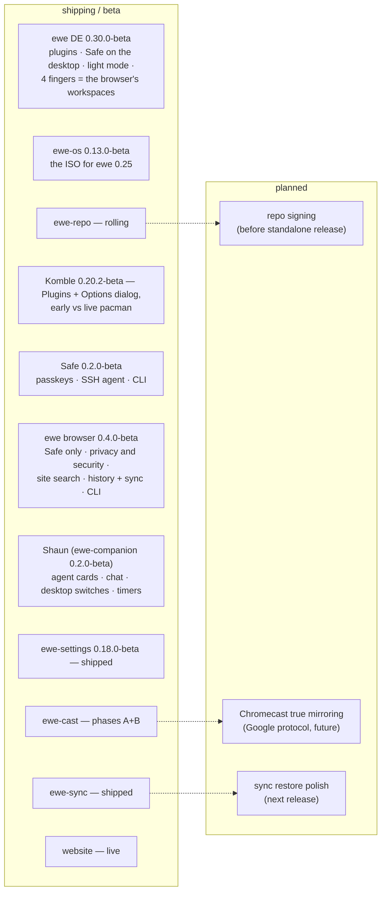

---
tags:
  - ewe-map
  - overview
title: Roadmap and Status
up: "[[Home]]"
---

# Roadmap and Status

Snapshot as of **2026-11-22**. Released 2026-11-22: **one file picker** — ewe 0.48.0-beta with Komble 0.25.1-beta, ewe Settings 0.26.1-beta, ewe Sync 0.17.2-beta, ewe Safe 0.5.2-beta and ewe-apps 0.2.1-beta (below; `[ewe]` publish run 45002206864) — [[RFC-011 — One File Picker]]. Released 2026-11-21: **the installer wave** — **ewe-os 0.17.0-beta** (the ISO for ewe 0.47: the installer asks your language first and offers apps for day one; ewe-os#22, ISO run 44937629332) with **Komble 0.25.0-beta** (apps picked in the installer wait in For you; komble-arch#23, `[ewe]` publish run 44920315898) — [[Language First — the installer asks in your words]]; before it the same day, **Shaun 0.3 + knowledge 2.0** — ewe-companion 0.3.0-beta and the island `ewe.companion` 0.7.0 in **ewe 0.47.0-beta** (below; `[ewe]` publish run 44905371096); before it the same day, the **media + languages wave** — ewe 0.46.0-beta, ewe-apps 0.2.0-beta, ewe Settings 0.26.0-beta, ewe Browser 0.9.0-beta and Komble 0.24.0-beta (below). Before it: the **0.45 milestone wave** — ewe 0.45.0-beta, ewe Settings 0.25.0-beta, ewe-apps 0.1.1-beta, Komble 0.23.1-beta, ewe Sync 0.17.1-beta, ewe Safe 0.5.1-beta and five plugins (below); before it: **ewe 0.44.0-beta**, **ewe-apps 0.1.0-beta** (ewe Files, ewe Player, ewe Viewer — the first release), **ewe Settings 0.24.0-beta**, **ewe Sync 0.17.0-beta**, **Komble 0.23.0-beta** and **ewe Browser 0.8.4-beta**, with **ewe-os 0.16.0-beta** to follow when the owner tags it (2026-11-19, ewe's own apps and the package diet — below; tags in [[Version Ledger]]); before them **ewe 0.43.0-beta**, **Komble 0.22.1-beta** and **ewe Browser 0.8.3-beta** (2026-11-19, the polish pass — below); before them **ewe 0.42.0-beta**, **ewe Settings 0.23.0-beta** and **Shaun (ewe-companion) 0.2.4-beta** (2026-11-08, CJK text, the cursor, Ultra game mode — below); before them **ewe 0.41.0-beta**, **Komble 0.22.0-beta** and **ewe-sync 0.16.2-beta** (2026-11-08, the resource diet — below); before them **ewe-os 0.15.0-beta**, **ewe 0.37.0-beta**, **ewe-sync 0.15.0-beta** and **ewe browser 0.6.0-beta** (2026-10-31, the owner's ask: sign in once and everything follows — below); before them **ewe 0.36.0-beta** (2026-10-27, the Alt+Tab switcher, Monocle) and **0.35.2-beta** (2026-10-26); before them **ewe-os 0.14.0-beta** (2026-10-23, the ISO for ewe 0.35, with the website refresh — below); before it **ewe (DE) 0.35.0-beta** with **Dock 1.3.0** and **ewe-settings 0.20.0-beta** (2026-10-23, the owner's ask: every display its own workspaces, like macOS, or one shared set — below); before it **ewe browser 0.5.2-beta** (2026-10-23, the dock's Downloads ring moves while a download runs); before it **ewe (DE) 0.34.1-beta** with **Dock 1.2.1** (2026-10-23, the owner's follow-up: each minimized window is its own picture tile in the dock, like macOS — below); before it **ewe (DE) 0.34.0-beta** with **Dock 1.2.0** (2026-10-23, the owner's ask: a Mission-Control Overview, Super+Z minimize with a Minimized section in the dock, ewe browser downloads in the dock — below); before it **ewe 0.33.1-beta** (2026-10-21, sign-in links open your browser), **0.33.0-beta** (2026-10-20, ewe-conf sync merges key by key), **0.32.1-beta** and **0.32.0-beta** (2026-10-20, ewe browser back in the launcher; the Slack plugin); before them **ewe (DE) 0.31.0-beta** with **Safe 0.3.0-beta** and **ewe browser 0.5.0-beta** (2026-10-18, the owner's ask: unlock Safe with the login password, no more keyring prompt at every start, cards and addresses, every sign-up asks to save — below); before it **ewe (DE) 0.30.0-beta** with **ewe browser 0.4.0-beta** and **ewe-companion 0.2.0-beta** (2026-10-18, wave 2: gestures, right-click menus, find, privacy and security, site search and Safe-only filling in the browser; Shaun's desktop switches, timers, sums and a site's own search — below); before it **ewe (DE) 0.29.0-beta** with **ewe-companion 0.1.0-beta** (2026-10-17, the companion's first release, named **Shaun**, its notch now the bar's own material — below); before it **ewe browser 0.3.0-beta** (2026-10-17, the owner's ask: workspaces and tools in a thin bottom bar across the window, + opens a new workspace on Home; [[Browser Bottom Bar — workspaces and tools]]); before it **ewe browser 0.2.2-beta** (2026-10-16, two bug fixes: Gmail's *browser no longer supported* banner in 0.2.1-beta, dead patches on websites in 0.2.2-beta; see [[ewe-browser]]); before it **ewe (DE) 0.28.0-beta** with **Safe 0.2.0-beta** and **ewe browser 0.2.0-beta** (2026-10-15, "a real safe": passkeys, an SSH agent, an `op`-like CLI, Safe inside the browser, browser history and sync — below); before it **ewe 0.27.0-beta** with **Safe 0.1.0-beta** (2026-10-15, Safe — ewe's own password manager — and its desktop plugin); before that **ewe 0.26.1-beta** (2026-10-14, light mode is official, companion groundwork); before that **ewe 0.26.0-beta** with **ewe browser 0.1.0-beta** and **Komble 0.20.2-beta** (2026-10-14, ewe browser replaces Helium); before that **ewe 0.25.2-beta** and **Komble 0.20.1-beta** (2026-10-11, bug fixes on 0.25.1-beta of 2026-10-10 with Komble
0.20.0-beta, ewe-settings 0.18.0-beta and ewe-sync 0.14.4-beta; 0.25.0-beta on 2026-10-04), **ewe-os (distro) 0.13.0-beta**
(2026-10-04, the ISO for ewe 0.25 with the installer's Plugins step, see
[[ewe-os ISO]]; later releases stop at the ewe-repo publish). The README speaks of a
`0.9.x` beta line and names the **1.0-beta release "Dolly"**.


## 2026-11-23 — ewe Mobile (0.1.0-beta, private) + Phone 1.1.0 + sshfs by default (ewe 0.49.2) — released

The owner: "now i want you to generate new app. i want ewe mobile app. based
on kde … create new tauri [app] which will use kde connect backend but will
do everything with different ui … we need better ui, contacts, send message
and stuff like we have on kde connect, everything offered from ewe
perspective." An explicit new feature (the bugs-only rule stands otherwise).
Then: "thats great release also make sshfs installed by default", and
"create new repo … for now private in github".
**Released 2026-11-23:** ewe Mobile `v0.1.0-beta` (`prj786/ewe-mobile`,
**private**, tag on the merge `ca5f921`; release run 45230965959);
ewe-plugin-phone#1 (1.1.0, `b494f33`); ewe `v0.49.2-beta` (ewe#95, the merge
`92c4c65`); `[ewe]` published, run 45230302638.

| what | where | state |
|---|---|---|
| **ewe Mobile 0.1.0-beta** — eight pages over `kdeconnectd` (Phone, Messages, Contacts, Notifications, Media, Files, Remote, Devices), `--page`, `--status`, `--version` | `prj786/ewe-mobile` (**private**), `v0.1.0-beta`; the package is on that release, **not in `[ewe]`** and not on the website while the repo is private | released; reads verified on the owner's phone, **nothing that writes has been tried on a phone** ([[ewe Mobile]]) |
| **ewe.phone 1.1.0** — Messages against a real phone (wrong object path + message shape), a button that opens ewe Mobile | ewe-plugin-phone **#1**, vendored in ewe **#95** | released in ewe 0.49.2-beta ([[Phone Plugin]]) |
| **`sshfs` by default** — in `packages/common.list`, so a dependency of the `ewe` package (KDE Connect mounts the phone's storage with it and lists it as optional) | ewe **#95** | released; an owner exception to [[The Package Diet]]'s "a plugin's package goes in its `requires`" |
| decision 76 | [[ewe Mobile — a window over KDE Connect]] | recorded |

**Open (owner):** `sudo pacman -Syu` (ewe 0.49.2: the plugin and `sshfs`);
install the app from the private release (`gh release download v0.1.0-beta
-R prj786/ewe-mobile -p '*.pkg.tar.zst'`, then `sudo pacman -U` it); send
one message from it. **When the repo goes public:** add `ewe-mobile` to
ewe-repo's publish list (opt-in, like ewe-safe) and to the website's apps.

## 2026-11-23 — faster to open, one Open with, thirty small bugs (ewe-apps 0.4.1) — released

The owner: "i think open with options dialog not really ewe design. Fix it
also ewe view must be fast and responsive same goes with files. Once again
revisit and fix small bugs." Then: "release".
**Released 2026-11-23:** ewe-apps `v0.4.1-beta` (ewe-apps#7, the merge
`d8b0dc5`); `[ewe]` publish run 45210346787. Nothing else changed: the shell's own
Open with (`AppChooser.qml`) already was the design system's card.

| what | where | state |
|---|---|---|
| One Open with card in the kit — the apps' own icons, the default first and ticked, Other apps…, "Always use this app for …", Find an app in Komble… | [[ewe-apps]] | released |
| Start-up, measured: ewe Files 568 → ~405 ms to a drawn folder, ewe Viewer 597 → 470–500 ms to a large JPEG, 686 → ~560 ms to a PDF (headless medians, `scripts/perf.sh`) | [[ewe-apps]], [[Troubleshooting Knowledge]] | released |
| The theme watcher took its own read for a change: `theme-changed` five times a second in all three apps | [[Troubleshooting Knowledge]] | fixed, test fails without the fix |
| ewe Files: a copy pasted into its own folder with Replace deleted the file; a merge with Skip deleted the skipped files; a lock-up between a finishing job and the list; half files after Stop | [[ewe-apps]] | fixed, tested |
| ewe Viewer: no flash at 100 % between pictures, a touchpad swipe zooms as far as it travels, the picture toolbar folds, comics / books / PDF tabs / Markdown links | [[ewe-apps]] | released |
| Shortcuts match the letter on the key: Ctrl+C, V, X… on the Georgian layout and under Caps Lock | [[ewe-apps]] | released, unit-tested |
| AppImages as cards (`source = "appimage"` in eep) — asked, answered "yes, about 2–3 days", not started | [[eep]] | open |
| The owner's real machine: `sudo pacman -Syu`, then a real touchpad, a real Georgian layout, how opening feels with the GPU | — | open |

## 2026-11-23 — installing shows (eep 0.3, ewe-apps 0.4, ewe 0.49.1) — released

The owner, after a day with eep on the real machine: "now i want you to
polish eep installation and processes. somehow Applications directory
becomes laggy not functionall and makes ui to broke. also when i download
eep file and move it feels like installed but 1st start takes like forever
… when i move eep there. it should be taking long time so i know its
installing. also when i click on eep it should be opening dialog with icon
and name top of the install button." Then: "thats great release".
**Released 2026-11-23:** eep `v0.3.0-beta` (eep#3); ewe-apps `v0.4.0-beta`
(ewe-apps#6); ewe `v0.49.1-beta` (ewe#94); `[ewe]` publish run 45163595840.

| what | where | state |
|---|---|---|
| The frozen Applications folder (the windowed grid measured the first rendered row) | [[ewe-apps]], [[Troubleshooting Knowledge]] | fixed, reproduced before and after |
| A card that is still installing shows it (ring, "Installing 43%", activity file, ready rule) | [[eep]], [[ewe-apps]] | released |
| The Install view: icon and name over Install; a small floating window for a card clicked outside Files | [[ewe-apps]], ewe's `eep-install` rule | released |
| Applications has its own menus; an app dragged out is copied | [[ewe-apps]] | released |
| Retries, cancel by taking the card out, one bad card never stops the others | [[eep]] | released |
| The owner's real machine: `sudo pacman -Syu`, a click on a downloaded card, a real slow download | — | open |

## 2026-11-23 — every app is a card (eep 0.2, ewe 0.49, ewe-apps 0.3.1) — released

The owner: "now i want you to release eveything about eep files. so i can
test them in reality using real system. now gimp opens as file manager.
also for now it would be great that every single package will be an eep
file even default ewe applications. also the apps i am currently using. use
fable … to check code for eep and otherwise extend it with opus". Decision
75, [[Every App Is a Card — eep finds what is installed]]. **Released
2026-11-23:** eep `v0.2.0-beta` (eep#2); ewe `v0.49.0-beta` (ewe#93, depends
on eep); ewe-apps `v0.3.1-beta` (ewe-apps#5); ewe-repo#8 (eep required);
`[ewe]` publish run 45065952675; eep's index rebuilt with 43 apps (run
45064092952); website `/apps/` 40 apps (prj786.github.io#18).

| what | where | state |
|---|---|---|
| every app on the computer gets a card; Trash = hidden, restore = shown, uninstalled = card gone | eep `crates/eep/src/system.rs` | released; unit tests + the owner's app list in a sandboxed HOME (61 apps, 59 icons); **the owner's real machine is the test** |
| Fable's review of eep 0.1: 13 findings fixed (validation, ids, sure listings, open through the index, JSON errors, private scratch) | eep | released; container e2e 16/16, update 11/11 |
| eep is part of ewe; the launcher skips cards as files; Files explains a card without eep | ewe `packaging/PKGBUILD`, `Launcher.qml`; ewe-apps Files | released; nested shell checked |
| catalog 43 apps | eep `catalog/apps.toml` | live on the data site; Thunderbird waits for the cache |

## 2026-11-22 — eep: apps as cards (eep 0.1, ewe 0.48.1, Komble 0.26, ewe-apps 0.3) — released

The owner: "now i want you to look through plan for package manager and
start building. i want fast well maintened package", then "go do it" and,
after testing in the VM, "imagine installing eep from komble or from
downloads its same as moving this file in Applications directori right
click and delete removes app … also hide file extension". Decision 74,
[[RFC-010 — eep]], component [[eep]]. **Released 2026-11-22:** eep
`v0.1.0-beta` (prj786/eep, new repo, data site `prj786.github.io/eep`);
ewe `v0.48.1-beta` on `a75e555` (ewe#92); Komble `v0.26.0-beta`
(komble-arch#25); ewe-apps `v0.3.0-beta` (ewe-apps#4); ewe-repo#7 puts
`eep` in `[ewe]` (opt-in); `[ewe]` publish run 45031083917; ewe-os#23
(VM harness `EWE_VM_VGA`, `--vnc`; no ISO); website `/apps/`
(prj786.github.io#17).

| what | where | state |
|---|---|---|
| eep: one card per app in `~/Applications`, apps from cache.nixos.org, server-made index, zstd patch updates, crash journal, watcher, Mesa driver timer | prj786/eep `crates/`, `packaging/` | released; every go/no-go row passed in the VM (`bench/RESULTS.md`) |
| the data site: index, cards, icons, patches rebuilt daily | eep `publish-index.yml` → `gh-pages` | live; one CI run so far (byte-identical rebuild); the patch step waits for the next nixos-unstable release |
| Komble lists eep apps (search, install, update, remove, Ready in Settings) | komble-arch `src-tauri/src/eep.rs` | released; checked in dev-mock and in the VM with the real eep |
| ewe Files: Applications under Home, cards as apps, Remove app | ewe-apps `crates/core` `eep`, Files | released; checked in the VM |
| the launcher's file search skips hidden folders | ewe `Launcher.qml` | released; fake-home test + nested shell |
| website `/apps/`: Get = the card, how install/remove/restore work | prj786.github.io `src/routes/apps/` | released |
| real GPU (B11), a real boot with the 0.1.0-beta package, the owner's machine | after `pacman -Syu` + `pacman -S eep` and a new session | **not verified yet** |

## 2026-11-22 — one file picker (ewe 0.48, Komble 0.25.1, ewe Settings 0.26.1, ewe Sync 0.17.2, ewe Safe 0.5.2, ewe-apps 0.2.1) — released

The owner: "cant we have one ewe like looking app? the popup dialog where we
can select files we want. floating one always. now picker sometimes is under
the app". Plan → "go" → "commit and release" the same day; decision 73,
[[RFC-011 — One File Picker]]. **Released 2026-11-22:** ewe `v0.48.0-beta` on
`05123fa` (ewe#91); Komble `v0.25.1-beta` (komble-arch#24), ewe Settings
`v0.26.1-beta` (ewe-settings#29), ewe Sync `v0.17.2-beta` (ewe-sync#17), ewe
Safe `v0.5.2-beta` (ewe-safe#25), ewe-apps `v0.2.1-beta` (ewe-apps#3);
`[ewe]` publish run 45002206864. No ISO.

| what | where | state |
|---|---|---|
| `ewe-portal`: the portal's FileChooser + AppChooser go to ewe; the shell draws them, the GTK dialog when it can't | ewe `bin/ewe-portal`, `dotfiles/xdg-desktop-portal`, `deploy_portal` | released; 54 tests incl. the real frontend on a private bus |
| the picker: places, breadcrumb or typed path, search, list or grid with thumbnails, the app's types and options, Replace?, New folder, keyboard; Open with | ewe `FilePicker.qml`, `AppChooser.qml` | released; walked in the nested shell (dark + light) |
| every app asks: `GTK_USE_PORTAL=1`, qt6ct portal dialogs, the Tauri apps' dialog plugin on `xdg-portal` | ewe + the five apps | released; Qt and GTK 3 proved against ewe-portal |
| real device: ewe Browser upload, Firefox, a Flatpak app, two monitors, fullscreen parents | the owner's machine after `pacman -Syu` and a new session | **not verified yet** |

## 2026-11-21 — Shaun 0.3 + knowledge 2.0 (ewe-companion 0.3.0-beta, ewe.companion 0.7.0, ewe 0.47) — released

Phase S of the same plan (the owner: "make shaun more powerfull. we can
add knowledge."), on top of 0.3, which had been built and waiting since
2026-11-08 (the owner: "i want it more wise. smarter and faster"). Two
decisions: 54 ([[Shaun 0.3 — faster and wiser]]) and 71
([[Knowledge 2.0 — Shaun follows ewe]]). **Released 2026-11-21:**
ewe-companion `v0.3.0-beta` on `82d6819` (ewe-companion#9, which carries #8's commits;
#8 closed), the island `ewe.companion` **0.7.0** (ewe-plugin-companion#7,
merged as `d78fa46`; plugin #5's 0.6.0 is inside it), vendored in ewe
0.47.0-beta (ewe#89, merged as `1db008b`; branch `release/0.47-shaun`: the
vendor and the version bump only). `[ewe]` publish run 44905371096 (success). The owner updates through
Komble.

| what | where | state |
|---|---|---|
| Claude Code lean (none of the user's own setup) and warm (started on the first keystroke, `chat.warm`): ~1 s to an answer instead of 5–8 s; answers stream in (`chat.reply` `partial`) | ewe-companion `feat/shaun-wiser`, plugin 0.6.0 → 0.7.0 | released; not verified: a real Claude Code stream in the notch |
| look-ups, up to three things per reply with one Undo; the clock, dates and units; this computer's battery, memory, CPU, disk and network; windows and workspaces; memory (`003_memory`, secrets refused) | ewe-companion | released; not verified: window commands on the live Hyprland |
| knowledge 2.0: the pack follows ewe 0.40–0.47 (128 → 174 topics), a coverage test that fails the build, "what's new" from `news.md`, BM25F search | ewe-companion `feat/shaun-knowledge` | released; core 128, daemon 67, chat 213, brain 28, canary 10, relay 26 |
| the ArchWiki offline (`arch-wiki-lite`, now a dependency) and manuals; the user's notes in `~/Documents/Shaun` ("learn this: …") | ewe-companion | released |
| music and links in ewe Player, "why won't this play", ewe Files `--select=` / `--open-with=` (the island's `do app`), keyboard layouts, "add japanese typing" (`ewe-ime`), "translate this", plocate | ewe-companion + plugin 0.7.0 | released; ewe Player, ewe Files and `ewe-ime` only through fakes |
| settings by text: the dock's displays, the bar's fold, dark/light — proposals with Run, then Undo | ewe-companion | released |
| website: /docs/apps/shaun/ rewritten in plain words (what Shaun does, with and without an AI, teaching it, "why won't this play", privacy) | prj786.github.io `docs/shaun-03` | built (`npm run build` green), not deployed |
| vault: decisions 54 + 71, contracts, ledger, facts, troubleshooting, quick answers (carries ewe-map#35, closed as superseded) | ewe-map `docs/shaun-03` | this change |

**Open:** the window commands and a real Claude Code answer streaming in
the notch on the owner's desktop; the real ewe Player link, ewe Files
`--select=` and `ewe-ime` from Shaun; the warm `claude`'s memory over a
day; the `[ewe]` publish run; the site deploy. **Next:** Phase I — ewe-os
0.17.0-beta (language first, first-day apps, Shaun at first sign-in, the
QEMU pass).

## 2026-11-21 — media + languages (ewe 0.46, ewe-apps 0.2, ewe Settings 0.26, ewe Browser 0.9, Komble 0.24) — released

The owner: "we are promising some next update — what's that? let's
implement it already. some multimedia codecs, now i cant even play a video
from stremio … firstly upgrade our tools for good support for languages and
multimedia, after that make shaun more powerful … finally update
installer." Then: "go, no translation for now, ask before releases". The
plan's order is **A multimedia → L languages → S Shaun → I installer**; A
and L are built here, one release. Six decisions ([[Decision Index]]
65–70). **Released 2026-11-21** on the owner's "just release": ewe `v0.46.0-beta` (ewe#88), ewe-apps `v0.2.0-beta` (#2), ewe Settings `v0.26.0-beta` (#28), ewe Browser `v0.9.0-beta` (#24), Komble `v0.24.0-beta` (#22); [ewe] publish run 44898072925; the owner updates through Komble.

| what | where | state |
|---|---|---|
| ewe Player plays web page links through yt-dlp (`ewe-player <url>`), honest error page (gst-libav only when missing — the stale "next update" sentence was the owner's "Cannot play watch"), no `crossorigin` on links, track languages + preferred languages, cues above the bar — [[ewe Player Plays Links — yt-dlp]] | ewe-apps `feat/player-links` | built; YouTube, Twitch, BBC, a CORS-less `.mp4`, an M3U of pages played + seeked headless |
| text in any encoding (subtitles, `.m3u`, Viewer, Files previews), HEIC through `heif-dec`, AVIF/JXL, `dir="auto"`, Noto script faces — [[Every Script Reads Right — encodings, phone pictures, right-to-left]] | ewe-apps `feat/text-images` (merged into `feat/player-links` at `3011bce`) | built; encoding fixtures in `cargo test` |
| typing in other languages: fcitx5 on demand, `ewe-ime`, `[desktop.ime]`, one bar indicator, themed candidates, Ctrl+Space / Super+Space — [[Typing in Other Languages — fcitx5 on demand]] | ewe `feat/media-languages` (`415555e`) + ewe Settings Keyboard and mouse | built; nested harness (GTK, Qt, kitty, the launcher), `tests/ewe-ime-test.sh` |
| `[desktop.language]` + the Language page, Formats (LC_*), app language packs, `install_packages` — [[Language Lives in Two Places — ewe.conf and the locale]] | ewe (`ewe-conf`), ewe Settings `feat/media-languages` (`6f0fb9e`) | built |
| spell checking: `hunspell` + `hunspell-en_us` ship; ewe Browser follows ewe.conf with Chromium's dictionaries; Play in ewe Player on links/pages — [[Spell Checking — hunspell and Chromium]] | ewe `common.list`; ewe Browser `feat/spell-play` (ewe-browser#24) | built; unit + 2 e2e tests in cage |
| the clock follows LC_TIME; CRLF `.desktop` apps in the launcher; RTL titles; Arabic/Hebrew/Armenian fonts; `webp-pixbuf-loader`, `libdvdcss` | ewe `feat/media-languages` | built; `tests/ewe-desktop-entries-test.sh` |
| Komble: what an installed app still needs — Stremio Enhanced's streaming server in one click; curated Stremio = `stremio-linux-shell`; IntelliJ → `intellij-idea-oss` — [[What an Installed App Still Needs]] | komble-arch `feat/stremio` (`52edcfd`) | built; dev-mock shots dark + light |
| website: limitations without "no IME", Player links/subtitles/languages, HEIC + encodings, Typing in other languages, Spell checking, Formats, the Stremio note, Ctrl+Space, the schema keys | prj786.github.io `docs/media-languages` | built (`npm run build` green), not deployed |
| vault: decisions 65–70, contracts, ledger, facts, troubleshooting | ewe-map `docs/media-languages-046` | this change |

**To release (owner's word):** commit ewe Browser's staged changes; bump
`VERSION`s (ewe 0.46.0-beta + `Globals.version`, ewe-apps 0.2.0-beta,
ewe Settings 0.26.0-beta, ewe Browser 0.9.0-beta, Komble 0.24.0-beta); app
releases → ewe `release.sh --publish` → `[ewe]` publish → site deploy →
flip these lines to *released* ([[Release Checklist]]).

**Open:** typing in other languages on real hardware; whether the locale
needs a reboot or a sign-out ([[Open Questions]]); ewe Browser does not
check Georgian (Chromium has no `.bdic`) and fetches `.bdic` files from
Google's server; a real Stremio stream after Komble's fix; the Player's
remux route for split-only sites, link drops, ID3v1 cp1251 tags; the
ISO's package parity (Phase I). **Next:** Phase S — Shaun 0.3 lands
(ewe-companion#8, ewe-plugin-companion 0.6.0, ewe-map#35 / decision 54) +
knowledge 2.0 → ewe 0.47.0-beta (**released the same day**, above: ewe-companion#9,
ewe-plugin-companion#7, ewe#89; decisions 54 and 71); Phase I — ewe-os
0.17.0-beta (language first, first-day apps, the QEMU pass) — **released
the same day** (ewe-os#22 + Komble 0.25.0-beta, komble-arch#23; decision
72). Open after it: installer translations; Steam / AppImage picks / a
real AUR build / Chinese, Korean, Vietnamese and Indic paths / a restore
after the language step in QEMU; installer-installed repo apps are not in
`[apps.installed]`; `sudo` for systems installed with ISO ≤ 0.16 is an ewe dependency
since ewe#90 (ships with the next ewe release; until then `pkexec pacman -S sudo`);
a real-hardware install.

## 2026-11-20 — the milestone polish (ewe 0.45, ewe Settings 0.25, ewe-apps 0.1.1, Komble 0.23.1, ewe Sync 0.17.1, ewe Safe 0.5.1, five plugins) — released

The owner, before recording a video guide: Files is not truly responsive; a
fullscreen video blanks the external monitor; the bar is overloaded (an
optional Omarchy-style minimizer); screen capture lives in three places; a
dock on none / the main / all displays; every bar dropdown should look like the
System monitor's; polish every app. Planned by Fable, built by Opus; released
2026-11-20 on the owner's word (ewe#87, ewe-settings#27, ewe-apps#1, komble-arch#21,
ewe-sync#16, ewe-safe#24, plugin PRs dock#3 clipboard#4 sysmon#3 media#1 places#3, site#13).

| what | where | state |
|---|---|---|
| `render.cm_auto_hdr = 0` — [[No Automatic HDR]] | ewe `hyprland.lua` | built |
| the bar's fold: `desktop.bar.collapse`, chevron, `barWidget.collapsible`, IPC `bar extras` — [[The Bar's Fold]] | ewe (Bar, BarPluginSlots, Globals, ewe-conf, ewe-plugin), ewe Settings Layout | built, checked in the nest (off = identical) |
| one bar card: `BarPopup` + `PopupHead`, `AnchoredPopup.exclusiveKeyboard` — [[One Bar Card — BarPopup]] | ewe + sysmon 2.1.0, media 1.1.0, clipboard 1.3.0 (API 3), places 1.2.0, dock 1.5.0 Downloads | built, nest shots |
| Quick settings: no camera, no half-empty row, roomy shortcuts — [[Two Ways to Capture]] | ewe QuickSettings, Tile | built |
| Dock `display` primary · all · none — [[Dock On Every Display]] | ewe-plugin-dock 1.5.0 | built, two-output nest checks |
| narrow windows — [[ewe-apps]] | ewe-apps 0.1.1-beta | built, headless shots 1200 → 520, dark + light |
| polish: GNOME-only tray row, "You're up to date", one-sentence browser alert, an empty safe's one action, row tiles visible on hover (`design/components.css`) | Komble 0.23.1, ewe Sync 0.17.1, ewe Safe 0.5.1, ewe Settings 0.25 | built, before/after shots |
| website: Fold the extras, no Screenshot in Quick settings, the Dock's screens, the clipboard icon | prj786.github.io `docs/milestone-045` | built |

Open: every click path untested by hand in the nest (no pointer); a real
two-monitor dock test; Shaun's `NowPlaying` still lists WebKit's twin MPRIS
entry.

## 2026-11-19 — ewe's own apps and the package diet (ewe 0.44, ewe-apps 0.1, ewe Settings 0.24, ewe Sync 0.17, Komble 0.23, ewe Browser 0.8.4, ewe-os 0.16)

The second 2026-11-19 wave. Four decisions ([[Decision Index]] 56–59) and one
measured surprise: every machine had a 1 GB NVIDIA driver.

| what | where | state |
|---|---|---|
| **ewe Files, ewe Player, ewe Viewer** — Tauri 2 on the system WebKitGTK, ewe Browser's file-manager UI; `--version` JSON, `--select=`/`--open-with=`, `FileManager1`, the loopback media server; replace Nemo/Engrampa/imv/Zathura/mpv ([[ewe's Own Apps — Files, Player, Viewer]], [[ewe-apps]]) | `prj786/ewe-apps` `v0.1.0-beta` on `3694278` (Viewer, Files and Player merged into `main`) | released 2026-11-19 |
| ewe 0.44: `ewe-apps` a dependency; `fileManager = ewe-files-app`; launcher Open with… / Open containing folder; `ewe-setup` mime defaults + one-time `default-apps-0.44.done`; warmup; phase 90 checks; Quick settings panel lazy (~15 MB idle), wallpaper `sourceClipRect` (18 → 9 MB per screen); Nemo terminal dconf path + `ewe-terminal-here`; here-launch terminals; `Shell.openSettings` passes `--page` | ewe `fix/small-things` → ewe#86, `v0.44.0-beta` on `94e2742` | released 2026-11-19 |
| **The package diet**: `vulkan-swrast` front-pinned (zed's `vulkan-driver` pulled `nvidia-utils` on every machine), `ewe-cast`/`gnome-network-displays`/`kdeconnect`/`qt5-wayland` → plugins' `requires`, `base-devel` → Komble's first AUR build, tesseract data + JetBrains out, GStreamer + ffmpeg in ([[The Package Diet]]) | ewe PKGBUILD + `common.list` + `aur.list`; komble-arch#19 (`ensure_build_tools`) | released 2026-11-19 |
| **ewe-repo**: `publish.yml` downloads ewe-apps; the gate blacklists `nvidia-utils`; `reversal-icon-theme` pkgrel 2 hard-links (416 → ~14 MiB); `mpv-uosc-git` out | ewe-repo#6 (`f679b1b`) | merged; `[ewe]` published 2026-11-19 |
| **Password sign-in** — `ewe-cloud login <srv> --user X --password-stdin` (OCS `getapppassword`, no redirects); ewe Sync and the installer ask server · user · password; the browser flow stays for 2FA/SSO. **Reverses** "ewe never sees your password" ([[Password Sign-in — a reversal]]) | ewe#86; ewe-sync#14 `v0.17.0-beta` on `6945d97`; ewe-os `fix/password-sign-in` | released 2026-11-19 (ISO pending the tag) |
| **Apps are not resident** — Komble quits on close unless a transaction runs, no tray setting; ewe Sync's glyph in Rust (`bar.rs`), window on demand + `terminate_web_process` (181 → 19 MB idle), avatar as `data:` URL ([[Apps Are Not Resident]]) | komble-arch#19 `v0.23.0-beta` on `565ca2d`; ewe-sync#14 | released 2026-11-19 |
| ewe Settings 0.24: `--page` honoured by a running instance (`open-page`); Default apps rows Music player / Document viewer / Archives | ewe-settings#25, `v0.24.0-beta` on `0d0e1dc` | released 2026-11-19 |
| ewe Browser 0.8.4: `apps` permission kind (`claude://`, `mailto:` … ask per site; "Open Claude works"); Play in ewe Player (`EWE_PLAYER_BIN`, mpv fallback); folder give-back `ewe-files-app.desktop` | ewe-browser#23, `v0.8.4-beta` on `25a5e39` | released 2026-11-19 |
| **ewe-os 0.16.0-beta**: the ISO trim (nvidia-open, cloud-init, imaging tools, irssi/lynx/mc/nmap/tcpdump, refind, dial-up/VPN extras out; `vulkan-swrast`; 7.5 → 5.4 GB installed, ISO 3.2 → 2.6 GB (measured: 2,591,948,800 bytes)); installer password step | ewe-os#21 → `v0.16.0-beta` on `037e56d` | tagged 2026-11-19 after the `[ewe]` publish; CI builds the image |
| **Open (owner):** `pacman -Syu`, then once `sudo pacman -Rns nemo engrampa imv zathura zathura-pdf-mupdf mpv-mpris mpv-uosc-git` (mpv stays for mpvpaper; Nemo holds `FileManager1` until removed); a real sign-in with a password and with a 2FA account; the shell's now-playing still lists WebKitGTK's own `org.webkit.*` MPRIS player beside ewe Player; `Settings.qml` still says "ewe never sees your password"; QEMU pass of the 0.16 ISO | owner / next session | open |

## 2026-11-19 — the polish pass (ewe 0.43, Komble 0.22.1, nine plugins)

The owner's ask: *"now i want to polish ewe once again … right clicks on files, like
compress. icon missleading, options for menus … pointer is not changing, i cant open link
from terminal, clicking on opened app like komble dont makes me to focus the window, but
notification from steam makes me to goe on the workspace where steam is … we need ubuntu
level polishment, everything we have must be working."* An audit (Files + packaging
parity, shell interactions, window management) came first, then the fixes (ewe#85).

- **Steam dragging you to its workspace** — a Window Rules workspace moved every `steam`
  window with focus, toasts included. Now [[Who May Move You — launches, toasts and activation]]:
  rule-placed windows open without focus; a launch you made takes you along.
- **Clicks that missed** — a minimized app opened `special:minimized` as an overlay (new
  windows landed in it); Komble AppImages and Steam games were not matched to their entry
  (generic icon, a second copy on click: `Globals.entryForClass`, komble-arch#18 writes
  `StartupWMClass`); a notification from a tray-only app did nothing.
- **Links from the terminal** opened in a browser window on another workspace that never
  came forward: `misc.focus_on_activate` (token-checked), XWayland urgent-only, urgent dots.
  ewe Browser 0.8.3-beta (ewe-browser#22) opens such a link in the window used last.
- **The pointer** kept the login-time theme in every process: `XCURSOR_THEME=default`,
  `cursor.sync_gsettings_theme` off — the nested harness (shared session bus) had flipped
  the owner's cursor through that sync.
- **Files** — Open in Terminal ran `velocitty` (cinnamon-desktop 6.8's default); the dconf
  system db, the logind power-key drop-in, the Nemo actions and other phase-30 files never
  reached pacman/ISO installs (the package hook and `ewe-setup` do now); Compress → .zip
  with a clear icon, Extract To…, Set as Wallpaper, RAR (`unarchiver`), Open With
  terminal apps (`xdg-terminal-exec`), 50 MB thumbnails, no Delete beside Trash.
- **Shell** — shared `ContextMenu` + `Tooltip`; menus on dock tiles, pinned apps,
  launcher results, Overview cards, the empty desktop, Places; notification action
  buttons, hover-pause, critical stays; tray menu (icons, check/radio, nested flyouts,
  Esc); pointer shapes; clearer icons; clipboard Clear all asks first.
- **Keys** — Alt+F4, Ctrl+Alt+T, Super+B brings the browser forward, Super+Ctrl+Q and
  Ctrl+Alt+Delete sign out after asking; dialogs over their parent, PiP for Chromium.
- **Plugins** (merged in their repos, vendored): dock 1.4.0, places 1.1.0, clipboard
  1.2.0, slack 0.4.0, mail 1.2.0, safe 1.2.0, switcher 1.0.1, companion 0.5.2, insomnia 1.0.2.
- **Open:** the owner's `pacman -Syu` + a real Steam toast, a link from kitty, a Komble
  AppImage click, hover tooltips; owner calls on focus
  follows mouse, Super+L, the 5 s pointer auto-hide; next: drives/Trash reachability, PDF
  thumbnails, gvfs-afc/gphoto2/wsdd, DNS + bluez tuning on pacman installs; then the new
  tiling system.

## 2026-11-08 — CJK text, the cursor, Ultra game mode (ewe 0.42, ewe Settings 0.23, Shaun 0.2.4)

The owner's ask: *"some font aint really displaying like chiness korean or japanees … lets
add one more option in settings for cursor … i want super optimized gaming on ewe. even
when i have integrated graphics … now i have filling it does really nothing."*

- **CJK text** (ewe#84): ewe shipped no CJK font — every such character was a box.
  `adobe-source-han-sans-otc-fonts` is a dependency; fontconfig falls back to Source Han
  Sans and prepends the JP / KR / TC / HC cut by `lang`. Terminal limit: a few shared
  characters keep the Chinese shape in Japanese (only HW SC is monospace-generic).
- **Cursor** (ewe#84 + ewe-settings#24): `[desktop.cursor] size` / `color`; Settings →
  Keyboard and mouse → Cursor; `colorscheme.sh` sets the live pointer, `start-hyprland.sh`
  reads the same at sign-in (the light scheme no longer starts with a white cursor).
- **Game mode** (ewe#84 + ewe-settings#24 + ewe-companion#7) — why it did nothing:
  GameMode's polkit rule trusts only the empty `gamemode` group (journal: every boost
  "Not authorized"), and on an iGPU its pinned governor starves the GPU (RAPL is
  root-only, so GameMode cannot tell). Now [[Game Mode — one, owned by the desktop]]:
  `ewe-game` with Balanced and Ultra (Performance profile, direct scanout, ewe Sync and
  the browser's background process closed, widgets and video wallpaper still), auto for
  Steam games, the Quick settings tile, Settings → Power → Gaming, Shaun delegates.
- **Researched, not adopted:** Raven (Mirko Brombin, the Bottles author; FOSS since
  2026-10-24) — a Windows-kernel personality without Wine or a VM; source-only, early,
  not in the AUR. Watch; Proton/Wine stay the answer for games.
- **Open:** the owner upgrades (`pacman -Syu` brings the font and the polkit rule) and
  plays one game on Ultra; the in-shell Settings fallback has no Cursor/Gaming rows; the
  website has no `/docs/cli/ewe-game` page.

## 2026-11-08 — resource diet (ewe 0.41, Komble 0.22, ewe Sync 0.16.2, System monitor 2.0.1, VPN 1.0.3)

The owner's ask: *"os is using too much [RAM] … apps like google chrome takes more time
to load. run specific processes to detect it by yourself"* — measured on the laptop
(Core Ultra 7 258V, 30 GB, xe), audited by Opus + Fable (shell), DeepSeek v4.1 flash
(services) and GLM 5.3 (system); every finding re-checked in code before a fix.

- **Komble 0.22.0** (komble-arch#17, `177f956`): AppImages run from an unpacked copy in
  `.komble-run/<id>/` — Chrome's first window **1.12–1.28 s → 0.49–0.52 s**; old installs
  converted in the background when Komble starts.
- **System monitor 2.0.1**: `GPUReclaim` (kernel 6.18+, the GPU driver's pool of freed
  buffers) counts as free — **4.47 GB** read as used; the bar readout alone samples every
  3 s, one fork a tick. **VPN 1.0.3**: no second `nmcli monitor` (follows `netEpoch`).
- **ewe 0.41.0** (ewe#83): `kb-per-window.py` = one socket write instead of 11 `hyprctl`
  per focus change; [[Memory Tuning — match zram]] (zswap off, swappiness 180,
  page-cluster 0, THP madvise, 1 GB journal, plocate out of boot); the warm wallpaper
  shares the Overview's decode; global-shortcut safety sync 5 min.
- **ewe Sync 0.16.2** (ewe-sync#13, `396005d`): the hidden window reads only the bar
  glyph's inputs, every 2 min (70 s hidden: 6 processes → 1).
- **Not done, on purpose:** ewe browser at sign-in in the background (~700 MB, the
  owner's own two settings — off = a slower first window); ewe Sync's hidden WebKit
  page (~250 MB PSS — needs the bar state machine in Rust first); app blur `xray`
  (changes the look); the per-window layer for one desktop widget.
- **Open:** the owner upgrades and opens Komble once (Chrome converts); a real-use read
  of qs RSS and Hyprland GTT after a day on 0.41.

## 2026-11-05 — Remote after a reboot, and the blink (ewe 0.40.1, ewe Sync 0.16.1, ewe Browser 0.8.2)

The owner's report: *"my laptop is paired but emoh is unreachable. while simple ssh
works just fine"*, then *"browser also blinks recent places... like reappears
constantly"*.

- **ewe 0.40.1** (ewe#82, `ee9792e`): a computer that only joins others lost Remote at
  every reboot, because only sharing and pairing made the runtime directory. The reboot
  asked for on 2026-11-04 is what exposed it.
- **ewe Sync 0.16.1** (ewe-sync#12, `448cebf`): reading `ewe.conf` woke its own watcher,
  every 2.3 s, for as long as the app ran.
- **ewe Browser 0.8.2** (ewe-browser#21, `5018691`): the error page says whose problem
  it is, and a refresh no longer rebuilds Home's cards.
- **Open:** a real reboot and a second network; both fixes on the installed apps. A
  restored browser tab can show the error page's title over Home (cause not found,
  `ewe-browser/docs/PLAN.md`).

## 2026-11-04 — once per power-on, and working from home (ewe Safe 0.5, ewe 0.40)

The owner's ask: *"somehow safe asks all the time for allow"*, *"instead we can
make it once per turn on"*, and the laptop goes home with nobody at the work PC.

- **ewe Safe 0.5** (ewe-safe#23, `c608939`): the bug was the unit. Its mount
  namespace hid every caller from the agent, so nothing was remembered, on every
  installed machine since 0.2.0 ([[Troubleshooting Knowledge]]). Now one question
  per power-on and nothing locks by itself by default; an SSH session asks nothing
  on the computer's screen (decision 51).
- **ewe 0.40** (ewe#81, `199dffa`): Remote holds through a Wi-Fi drop (15-minute
  keepalive), the terminal reconnects by itself and offers to unlock a locked Safe
  there, Wi-Fi power saving is off while connected.
- **Open:** a real drop and a real second network are the owner's check before
  leaving. After a reboot nobody has logged in to, sharing isn't running (no
  linger, on purpose: RFC-009); `ssh <host>` on the system sshd is the way in.
  One work repo (`health-reder`) is over HTTPS with no saved login, so it asks in
  the terminal, here as at the desk.

## 2026-11-01 — one product: the UI revamp + Safe is the SSH gate (ewe 0.39, ewe Settings 0.22, Komble 0.21, ewe Sync 0.16, ewe Safe 0.4, ewe Browser 0.8)

The owner's ask: *"revamp ui of control center and all apps. And also plugins in
komble … plugin for ram usages should have one more section for internet speed.
Totally remove it from control center … same naming style for apps"*. Mockups
first (Design canvas "ewe UI revamp", approved: *"Both are great, start a new
release"*), then one wave: *"yes merge and release all"*. The owner also chose to
ship the waiting **SSH gate** (decision 49) in the same wave. [[UI Revamp — one
product]] (decision 50). No ISO.

- **Names = ewe + Word**: ewe Settings, ewe Sync, ewe Browser, ewe Safe, ewe Cast
  (display only; every id unchanged), across the shell, the five apps, 10 plugins,
  ewe Cast 0.13, Shaun 0.2.2, the installer and the website.
- **ewe 0.39** (ewe#79 `db58e95`, incl. ewe#78): Quick settings without the rail
  (header, shortcut row, inline notifications, battery + power-mode footer, a
  Power page, Esc goes back); `desktopWidget.visible`; `remote`/`power` reserved
  page keys; the bar's app label from the desktop entry; the shell speaks ewe
  Sync's words. Vendors **System monitor 2.0.0** ([[System Monitor Plugin]]) and
  the renamed plugins (safe 1.1.1, passwords 1.3.1, companion 0.5.1, dock 1.3.2,
  mail 1.1.1, places 1.0.3, cast 1.0.2, vpn 1.0.2, ssh 1.1.0).
- **ewe Settings 0.22** (ewe-settings#23 `331f236`): four nav groups, Find a
  setting, one page grammar; fixes: Keyboard and mouse no longer writes on view,
  `theme_scheme` pokes sync only on writes.
- **Komble 0.21** (komble-arch#15 `e09fb9f`): one row per plugin + the plugin
  sheet (Options dialog gone), Add plugin…, grouped nav, display names on Updates.
- **ewe Sync 0.16** (ewe-sync#11 `51dad69`): "Needs you", one ⋯ per folder,
  conflicts under their folder, "Computers", Geist bundled, no "Push anyway".
- **ewe Safe 0.4** (ewe-safe#21 SSH gate + #22 revamp, `01448b2`): the shared app
  frame, one header, the detail grid, ewe Sync's sync words, the SSH page;
  fix: the generator no longer submits the form.
- **ewe Browser 0.8** (ewe-browser#19 `2ab9c8d`): Settings with sections, every
  new tab opens Home (`app://newtab` retired), plain error pages, Undo after
  removing a workspace, window title "ewe Browser".
- **Open:** every app checked only in mocks / the nested shell — a real-desktop
  pass with a pointer; on the owner's box run **Move SSH to Safe** once after
  updating (else ssh offers Safe's 6 keys first → MaxAuthTries); the site's hero
  images still show the old names and rail; Shaun's knowledge still describes the
  old Quick settings rail / Komble Options dialog and quotes "Save to ewe Safe?"
  (the browser says "Save this login to ewe Safe?"); Komble's `StartupWMClass`
  may not match its window class (check).

## 2026-11-01 — the network says what's true; share this computer (ewe 0.38, ewe browser 0.7, ewe-sync 0.15.1)

The owner's ask: *"cable connected, indicator showing, still no internet —
polish Wi-Fi/Ethernet"* and *"share my PC with my other ewe PC, fully over
SSH, and a browser workspace that browses from it"*. [[RFC-009 — ewe Remote]]
(decisions 47–48). ewe#77, ewe-browser#18, ewe-sync#10, then the `[ewe]`
publish (no ISO).

- **Network (ewe 0.38)**: the work desktop's journal — OOM with no swap,
  then DHCP unanswered at 100 Mb/s behind NetworkManager's 5-minute block.
  `20-ewe-wired.conf` (a cable keeps asking), zram on every chassis (also via
  `ewe.install` on `pacman -Syu`), NetState (the bar shows the link in use, a
  no-internet mark; plain wired states + Reconnect), `ewe-tailscale` (health,
  exit node, one-prompt setup; Tailscale ships, off until set up).
- **Remote (ewe 0.38)**: `ewe-remote`, a per-user sshd on 3933, pairing by
  an 8-digit code (SPAKE2, single use), the Sharing tile/page and the bar's
  share glyph.
- **ewe browser 0.7**: + → *Browse from work-pc* — own session, SOCKS through
  `ewe-remote tunnel`, fail closed, no history.
- **ewe-sync 0.15.1**: `machines/<id>.json` (the owner's two "emoh"s).
- **Open:** real pairing laptop ↔ work PC over Tailscale; the installed unit;
  real `tailscale up --json` and pkexec setup; `ethtool` output on hardware;
  the `ewe.vpn` plugin still lists `tailscale0`; ewe-settings has no
  Remote/Tailscale cards yet.

## 2026-10-31 — sign in once, everything follows (ewe-sync 0.15, ewe browser 0.6, ewe 0.37, ewe-os 0.15)

The owner's ask: *log in and get everything you had before; set up the
folders to sync and see every connected folder, in ewe and in ewe browser;
the installer: sign in or skip, bring the plugins back and let me turn on
others.* [[Sync — sign in once, everything follows]] (decision 46).
ewe-sync#8 + #9, ewe-browser#17, ewe#76, ewe-os#19, then the `[ewe]`
publish and the ISO. Research on the owner's own machine found three engines
on `~/Nextcloud` (the Nextcloud desktop app, ewe-files' failing mount,
ewe-sync's offer), a folder list that never travelled, one-way "on change",
and a default-off browser switch.

- **ewe-sync 0.15.0-beta**: the Overview, *Bring everything back*, Folders
  (suggestions, a folder chooser, an account picker, pause per computer, the
  Nextcloud app shown and taken over), remote-change polling,
  `sync-folders.json`, GTK bookmarks, `--pane/--add-folder/--status`;
  `tests/e2e-nextcloud.sh` against a real Nextcloud (podman) passes.
- **ewe browser 0.6.0-beta**: sync follows the account; Files shows Synced
  folders, a chip, *Keep in your account…*.
- **ewe 0.37.0-beta**: `sync.folders` shared in the merge; ewe-files never
  mounts over files; no second restore offer.
- **ewe-os 0.15.0-beta**: the installer's *Your ewe account* step (the app
  password into the new login keyring, the restore at install), the
  backup's plugins pre-checked.
- **Release snag:** ewe-sync's first `v0.15.0-beta` package build failed
  (Tauri npm/crate minor mismatch after adding the dialog plugin; PR CI
  never runs `tauri build`) — fixed in ewe-sync#9 with a CI check, the
  unreleased tag moved. [[Troubleshooting Knowledge]]
- **Open:** a QEMU pass of the 0.15 ISO (no sudo/archiso on the build
  host); the takeover against a running Nextcloud app on the owner's
  machine; a real second computer on metal; the TUI installer has no
  account step.
## ewe-os 0.14.0-beta + the website refresh (released 2026-10-23)

The owner's ask (2026-10-23): "update website … even limitations, because we
fixed a lot. dont make detalization … just simple explain … docs needs to be
[the] best part. describe plugins and built in plugins. also update installer
… make new release after that for website and installer".

| what | where | state |
|---|---|---|
| ISO for ewe 0.35: the Plugins step lists all 16 plugins (it reads the live payload); Shaun and Slack get `icMessage`, not the puzzle; the username fix (#13, parked since 0.12.x); *beta* rail label; README/INSTALL/TESTING counts | ewe-os#18, `v0.14.0-beta` on `21a5b0b`, `release-iso` | released |
| Website: plain-language home and features (ewe browser, Safe, Shaun, Overview, minimize, workspaces per display); new docs — The desktop, Apps (ewe browser, Safe, Shaun, Komble, Settings), Plugins (what a plugin is) and **Built-in plugins** (all 16, grouped, use/keys/settings); `/docs/add-ons/` 308 → `/docs/plugins/built-in/`; Known limitations cut to what is still true; privacy adds Safe, browser sync and Shaun's optional AI provider; download → 0.14.0-beta | prj786.github.io | deployed |
| QEMU pass of the CI-built ISO | owner / next session | open |

## 0.35.0-beta + Dock 1.3.0 + ewe-settings 0.20.0-beta — workspaces per display (released 2026-10-23)

The owner's ask (2026-10-23): "separated workspaces for each monitor. again
like in mac … option for monitors. like shared workspaces or separated
workspaces toggler". Shared = macOS's (switching one switches all); the
default is separate. Decision: [[Decision Index]] row 45,
[[Workspaces Per Display]].

| what | where | state |
|---|---|---|
| Every display owns ten ids (1–10, 11–20 …) shown as 1, 2, 3 …; Super+N/Shift+N/wheel/swipe-down per display; shared sync; hot-plug merge; one-time migration of the old numbering | ewe#72 (`dotfiles/hypr/workspaces.lua`), `v0.35.0-beta` on `d1cca36` | released |
| `[desktop.workspaces] mode` = separate \| shared (ewe-conf, `workspaces` domain) | ewe#72 (`bin/ewe-conf`) | released |
| Bar chip per screen, Overview strip numbers, `Shell.workspacesShared` / `Shell.workspaceNumber` | ewe#72 | released |
| Dock workspace boxes follow the mode | ewe-plugin-dock `c88fdc4` (1.3.0), vendored in ewe#72 | released |
| Settings → Displays → Workspaces (Separate \| Shared, with ≥ 2 displays) | ewe-settings#21, `v0.20.0-beta` on `14b72a8` | released |
| Website: shortcuts + schema `[desktop.workspaces]` | prj786.github.io `c60bb1d` | deployed |
| Two real monitors (hot-plug, shared sync, the swipe) | owner | open |

## 0.34.0/0.34.1-beta + Dock 1.2.0/1.2.1 — the Overview spreads your windows (released 2026-10-23)

The owner's ask (2026-10-23): "i want mac like overview. exactly like it …
performance is the must"; Super+Z should minimize into a new dock section
with polished thumbnails, the secret desktop (the Pen) removed; a downloads
icon after it for ewe browser. Decision: [[Decision Index]] row 44,
[[Overview Spreads the Windows]].

| what | where | state |
|---|---|---|
| Overview: windows fly from their real places into a spread and back; workspaces along the top (labels → thumbnails on hover/drag), drop to move; no search, no add; one frame per window, no blur | ewe#70 (`Overview.qml`) | released |
| Minimize: Super+Z → `special:minimized`, Super+Shift+Z brings the last back; the Pen binds gone | ewe#70 (`hyprland.lua`) | released |
| Dock Minimized box + thumbnail panel; Downloads ring + the day's list from ewe browser's `downloads.json` | ewe-plugin-dock `d2cc093` (1.2.0), vendored in ewe#70 | released |
| Minimized windows as their own picture tiles, no group, no panel (owner: "exactly like in mac") | ewe-plugin-dock `2189ce4` (1.2.1), ewe#71 → 0.34.1-beta | released |
| Website: first login, shortcuts, components, motion | prj786.github.io `d05a237` | deployed |
| Real-machine check (4K, multi-monitor, a real browser download) | owner | open |
| Design `preview.html` for the Overview and Dock cards still show the old designs | `design/system/components/` | open |

## 0.31.0-beta + Safe 0.3.0-beta + ewe browser 0.5.0-beta — Safe and the system (released 2026-10-18)

The owner's ask (2026-10-18, heading out: "choose any recommended option"):
unlock Safe with the sudo (login) password; get rid of the keyring prompt at
every start; cards and addresses without ruining users' safety, encrypted in
Nextcloud; full Safe control; and "when I register somewhere it should ask
to save a new login". Contract: `ewe-safe/docs/SYSTEM.md`; decision:
[[Decision Index]] row 43, [[RFC-008 — ewe Safe]] → Amendment 2026-10-18.

| what | where | state |
|---|---|---|
| The prompt at every start: a second keyring (`Default_keyring`) was the `default`, plus a gnome-keyring crash at boot. `ewe-safe keyring repair` copies everything into `login` and points `default` at it | ewe-safe#18 (`crates/secrets`), ewe#64 (TROUBLESHOOTING) | released; tried against a real gnome-keyring in a sandbox shaped like the owner's; **not yet run on the owner's machine** |
| Unlock Safe with the login password (`ewe-safe login enable`, Settings → Security); Safe opens at login through gnome-keyring's `login`; five tries, then the master password | ewe-safe#18 (`crates/login`, `login.rs`, `carrier.rs`), ewe#64 (`[safe] unlock_at_login`) | released; sandbox: enable → restart → opens by itself, locked `login` → no prompt |
| `confirm` (login or master password, 5 minutes) before a card fill | ewe-safe#18, ewe#64 (`[safe] confirm_cards`) | released |
| Cards and addresses in the same encrypted KDBX; 1Password's cards and identities import as them; `convert --from-1password` | ewe-safe#18 (`card.rs`, `cards.rs`), ewe-plugin-safe#1 (Quick Access skips them, 1.0.1 in ewe 0.31) | released; KeePassXC showing the fields not checked |
| Every sign-up asks to save (also locked: Unlock and save); cards and addresses fill in pages (cards on https only) | ewe-browser#14 | released in ewe browser 0.5.0-beta; e2e 22/22 against the real Safe 0.3.0; real sites untried |
| **Parked:** Safe's own PAM module (owner review first) and Safe as the Secret Service (`keyring adopt` refuses without the module) | `.wt/parked-pam/`, `crates/secrets` | built, not shipped |

## 0.30.0-beta + ewe browser 0.4.0-beta + ewe-companion 0.2.0-beta — wave 2 (released 2026-10-18)

The owner's ask (2026-10-18): finger gestures, more shortcuts, right-click
menus on websites and only Safe filling passwords in the browser; DNS and
security settings; and more Shaun — more browser, more knowledge about ewe,
more commands ("search men's shoes on zara" straight to Zara's results).
Delivered as "PRs + release" in one wave; no ISO (release scope unchanged).
Decisions 40–42 ([[Decision Index]]).

| change | where | state |
|---|---|---|
| Two-finger swipe back/forward, side buttons, find in page (Ctrl+F), ~20 new rebindable shortcuts (web pages first on keys they use), right-click menus on pages | ewe-browser **#13** (`feat/input-menus`) | released in ewe browser 0.4.0-beta (`v0.4.0-beta` on `1d36473` → `ewe-browser-0.4.0beta-1`); swipe tested with synthetic wheel events only |
| **Safe only**: the `ewe-pass` route leaves the browser; password-manager extensions refused before they load (36 store ids) | ewe-browser **#13** | released; decision 40 — [[Browser Passwords — Safe only]] |
| Settings → Privacy and security: Secure DNS (off/automatic/Cloudflare/Quad9/Mullvad/AdGuard/NextDNS/custom), HTTPS-Only (off by default, interstitial), third-party cookies blocked (Chromium's `ForceThirdPartyCookieBlockingEnabled`, after a restart), GPC on | ewe-browser **#13** (`feat/privacy-site-search`) | released; the five DoH providers resolved live in e2e |
| Site permissions ask per site (prompt card, `permissions.json`, site info from the lock) instead of silent denial | ewe-browser **#13** | released; decision 42 — [[Site Permissions — ask per site]]; location has no provider on Linux |
| Site search: `@zara men's shoes`, `search --site`, `site` (history → OpenSearch → a 66-site table → `site:` filter) | ewe-browser **#13** | released |
| CLI 31 → 43 tools: `site`, `workspaces`, `workspace activate\|next\|prev\|create\|rename\|remove`, `back`, `forward`, `download open\|show`, `open --workspace` | ewe-browser **#13** | released (public API, [[Contracts and Public API]]); unit 146 + 326, e2e 58 passed (7 need the real Safe) |
| Shaun: a site's own search, bookmarks, back/forward, tabs, workspaces, downloads; Wi-Fi, Bluetooth + paired devices, airplane mode, keep awake, "install X" → Komble's search; a calculator; timers and reminders (`companion.db` migration 002); proposals only for dark/light, power, empty trash; knowledge pack 91 → 122 topics with `cli.md` | ewe-companion **#3** | `v0.2.0-beta` on `30eb37f` → `ewe-companion-0.2.0beta-1`; core 81 + daemon 31 unit, `tests/chat.sh` 112, `tests/canary.sh` 9 — against fakes |
| The island's row icons (download, workspace, timer, Bluetooth) | ewe-plugin-companion **#3** (0.5.0) | vendored in ewe 0.30.0-beta |
| 4-finger swipe left/right = ewe browser's workspaces while it is focused; SHORTCUTS.md rows | ewe **#62** | released in ewe 0.30.0-beta (`v0.30.0-beta` on `1f6721e`); decision 41 — [[Four Fingers — ewe browser's workspaces]] |

Published to `[ewe]` on 2026-10-18. Install: `sudo pacman -Syu` (ewe,
ewe-browser, ewe-companion). Not verified: the swipe and the 4-finger gesture on a real
touchpad, printing by hand, Shaun against the real browser 0.4 CLI, a
paired Bluetooth device, the Insomnia plugin and a real timer banner — the
owner's try after the upgrade.

## 0.29.0-beta + ewe-companion 0.1.0-beta — Shaun (released 2026-10-17)

The owner's ask: the companion's notch never matched the top bar ("it feels
different, in dark mode and even more on light … because of notch"), and
"rename this companion as shaun". Then: "just commit and make new release".

| change | where | state |
|---|---|---|
| The notch is the bar's material: the blur rule is `xray` (the notch blurs the wallpaper, as the bar does, not the window under it), the fill clipped at the bar's edge | ewe-plugin-companion **#2** (0.4.0) | released in ewe 0.29.0-beta (ewe#61); measured equal to the bar in the island harness at 1.8, dark/light Glass, solid, the 36 px bar |
| The name is **Shaun**: the notch's word, Komble's plugin name, the persona, the knowledge pack; ids stay `companion` | ewe-plugin-companion **#2**, ewe-companion **#2**, ewe#61 (SHORTCUTS, RFC-007) | released; decision 39 |
| The first release: `.github/workflows/release.yml` (makepkg in `packaging/`), `v0.1.0-beta` | ewe-companion **#2** | package `ewe-companion-0.1.0beta-1` in [ewe] (ewe-repo **#4**) |
| `vendor-plugins.sh` leaves a plugin repo's `AGENTS.md`/`CLAUDE.md` behind | ewe#61 | released |
| `tests/island.sh restart` replaces the daemon after a rebuild | ewe-companion **#2** | merged |

Install: `sudo pacman -Syu ewe-companion`, then Komble → Plugins → From ewe →
Shaun. Not verified: the QEMU e2e (P7's gate) and a real-device check of
the packaged daemon on the owner's laptop, which ran a dev install (binaries
in `~/.local/bin`, its own user unit, the plugin as a symlink).

## 0.28.0-beta + Safe 0.2.0-beta + ewe browser 0.2.0-beta — a real safe (released 2026-10-15)

The owner's ask the same day: "Safe is a real safe" (like 1Password today),
a browser with real sync and history, and a companion that can use both.
Contract: `ewe-safe/docs/TRIO.md`; decisions: [[Decision Index]] rows 35–37.
The owner said "merge all PRs and make new releases"; everything was merged
and released on 2026-10-15 and published to `[ewe]` the same day. No ISO.

| piece | where | state |
|---|---|---|
| Safe: `read`, `run`, `inject`, `git-credential`, `safe://` references | ewe-safe **#10** | released in Safe 0.2.0-beta; not verified: a real `git push` |
| Safe: passkeys (KeePassXC's format, ES256 + EdDSA, Safe's AAGUID) | ewe-safe **#11** (also carries `docs/TRIO.md`) | released in Safe 0.2.0-beta; byte-checked against KeePassXC's test vectors, `keepassxc-cli` 2.7.12 reads them; not verified: a real site |
| Safe window: saving an edited login works again | ewe-safe **#12** | released in Safe 0.2.0-beta (0.1.0-beta could not save an edited login) |
| Safe: SSH keys (KeeAgent format) + an ssh-agent, `ssh_confirm` | ewe-safe **#13** + ewe **#59** (`[safe] ssh_agent`, `ssh_confirm`) | released in Safe 0.2.0-beta + ewe 0.28.0-beta; not verified: the approval window on screen, `ssh adopt` on the owner's safe |
| all four Safe PRs together | ewe-safe **#14** (`integrate/trio`), bump **#15** | `v0.2.0-beta` on `a3fcc5e` (after #16, a test-race fix, and #17, openssh for the package check; the tag moved twice, before any package was made) → `ewe-safe-0.2.0beta-1`; `cargo test` 214 passed |
| ewe-conf: quoted key parts keep their dots | ewe **#58** | released in ewe 0.28.0-beta |
| Passwords 1.3.0: **Use Safe** when the chosen manager is gone; `ewe-pass` exits 0 | ewe-plugin-passwords **#3** | vendored in ewe 0.28.0-beta (bump ewe#60, `v0.28.0-beta` on `52bf89a`); `test.sh` 52/52 |
| ewe browser: the command line (`docs/CLI.md`) + the hidden rail | ewe-browser **#3** | released in ewe browser 0.2.0-beta |
| ewe browser: Safe built in (inline suggestions, passkeys) | ewe-browser **#4** | released in ewe browser 0.2.0-beta; the owner approved it 2026-10-15; e2e 40 passed, the 7 tests against a real Safe skipped there |
| ewe browser: `app://history`, SQLite, synced deletes, other computers' tabs | ewe-browser **#5**, bump **#6** | released in ewe browser 0.2.0-beta (`v0.2.0-beta` on `1e94143` → `ewe-browser-0.2.0beta-1`); e2e 44 passed |
| the companion P2.9: Safe, ewe browser, the finder | ewe-companion **#1** + ewe-plugin-companion **#1** (0.3.0) | **merged, not released** — the companion is not in `[ewe]` yet (its first release is P7); `tests/canary.sh` 8, `tests/chat.sh` 53; against fakes only |

**On the owner's machine after the publish:**

```sh
sudo pacman -Syu        # ewe 0.28.0-beta, ewe-browser 0.2.0-beta, ewe-safe 0.2.0-beta
systemctl --user daemon-reload && systemctl --user restart ewe-safe.socket
                        # the socket unit gained the SSH agent's socket; this locks the safe
```

Then log out and in once: the session takes the new payload (Passwords
1.3.0 among it) at login, as after every ewe release
([[Packaging and Updates]]).

Live machine (2026-10-15): the owner's `Super+P` error "make sure 1Password
CLI is installed" was the old `provider = "1password"`; it was switched with
`ewe-plugin set ewe.passwords provider ewe`.

## 0.27.0-beta + Safe 0.1.0-beta — Safe, ewe's own password manager (released 2026-10-15)

The owner's 1Password move ([[RFC-008 — ewe Safe]], [[Roadmap — ewe-safe]]).
One wave: ewe-safe#7–#9 (`v0.1.0-beta`: `ewe-safed`, `ewe-safe`, the
`ewe-safe-app` window, import from 1Password — `.1pux`, CSV, live through
`op`), ewe-repo#3 (the publish collects `ewe-safe`; opt-in, nothing depends on
it), ewe#57 (0.27.0-beta vendors `ewe.safe` 1.0.0 — [[Safe Plugin]], Quick
Access on `Super+Shift+P` — and `ewe.passwords` 1.2.0, whose provider `ewe`
fills from Safe), then the ewe-repo publish. Earlier on ewe main: the `[safe]`
ewe-conf domain (#55), the unlock prompt's window rule (#56). Not in this
wave: the ewe browser integration (then staged, waiting for the owner's
review; released later that day in ewe browser 0.2.0-beta) and Komble's
listing.

Two release snags, both fixed before anything shipped: the bump PR merged on
a red CI run (a racy idle-lock test — `gh pr checks --watch | tail` hid the
failure; ewe-safe#8 made the test wait for the log line), and the first
`v0.1.0-beta` build failed because `makepkg` reads `install=` from beside the
PKGBUILD (ewe-safe#9 moved `ewe-safe.install`; the unreleased tag was moved
to the fix).

## 0.26.1-beta — light mode is official, companion groundwork (released 2026-10-14)

No new feature work in the bump itself: it releases what ewe#52 merged
after 0.26.0-beta — every generated config (GTK, Qt, kitty, Helium) follows
the active scheme's variant, so ewe is dark by default with a light mode
([[Foundation Choices]]); the `[companion]` ewe-conf domain that applies
nothing (RFC-007); kitty remote control on a file socket. Bump PR ewe#53,
then the ewe-repo publish. Only `ewe` had unreleased commits: every Tauri app
and all 13 bundled plugins already matched their releases, and ewe-browser's
next work was still uncommitted on a branch. No ISO (ewe-os unchanged).

## 0.26.0-beta — ewe browser replaces Helium (released 2026-10-14)

One wave, branch `feat/ewe-browser`: ewe-browser#1 (`v0.1.0-beta`), ewe#51,
ewe-repo#2, komble-arch#13 (`v0.20.2-beta`), prj786.github.io#5, ewe-map#8;
then the ewe-repo publish. ewe-browser (root `PKGBUILD`,
`packaging/`, `release.yml`, `ci.yml`), ewe-repo (`publish` collects it,
asserts `depend = ewe-browser`, Helium out of `aur-packages.txt`), ewe (the
`ewe` package depends on it, phase 20 installs it, seeding / `$BROWSER` /
Super+B fallback / dock pins / warm-up point at it, the Helium theming hook
runs only while Helium is installed, get.sh takes the newest release instead
of GitHub's "Latest"), komble-arch (`first_party.rs`), the website (repos
page, schema text). Decision: [[ewe browser replaces Helium]]. Release order
kept: ewe-browser `v0.1.0-beta` first, then ewe and Komble, then the ewe-repo
publish — the fresh-install gate refuses an `ewe` that depends on a package
the repo does not carry. ewe-browser's first CI run needed a 4 GB Node heap
for type-aware ESLint and `bsdtar` on the Ubuntu runner. The first publish
failed its fresh-install gate because prj786/ewe-browser was still private
(`ewe-browser -> (no release)`); the repo went public, like every first-party
repo, and the publish was rerun. No ISO this round (ewe-os unchanged).

## 0.25.2-beta — first-party plugins survive a Restore (released 2026-10-11)

Bug report: after login Komble → Plugins showed all 13 first-party plugins
broken (*the "ewe." namespace is reserved for ewe's own (bundled) plugins*)
and none would turn on. A Restore from the account (ewe-sync → This machine,
`ewe-conf pull`, 2026-10-10 15:38) had replaced `[plugins]` with an older
copy without the `"ewe.*" = "bundled"` source records, and the reserved-id
check trusted only that synced table. Now an installed copy of an id the
payload ships is first-party whatever ewe.conf says (`payload_ships`);
`enable` writes the records back, `seed` adopts such copies (`adopted`).
ewe#50. `ewe-plugin-test.sh` 82/82, every suite green. Same day, Komble
0.20.1-beta (komble-arch#12): *Add a plugin* first on Plugins, and the
Options dialog no longer blinks (see Troubleshooting → Theming). The
reporting machine's ewe.conf was merged back to its pre-Restore state
(three-way against the Nextcloud version the Restore pulled — the laptop
had not pushed since 2026-09-13).
See [[Troubleshooting Knowledge]] (Plugins).

## 0.25.1-beta — what is in it (released 2026-10-10)

One wave, branch `fix/plugins-settings-sync` in every repo: ewe#49,
komble-arch#11, ewe-settings#19, ewe-sync#7, ewe-os#16 (installer strings
only — no ISO tag), prj786.github.io#4, plus the ten plugin repos straight
to their `main`s; then the ewe-repo publish. Decisions: [[Decision Index]]
rows 27–31 (D9–D13). Real-hardware testing on the home laptop follows.

| piece | state |
|---|---|
| **Sync** ([[Sync Conflicts Are About Content]]): ewe-conf adopts a moved ETag over bytes it sent/saw, records a stored upload, answers `conflict` + `remote_is_this_machine`, stamps a hashed `machine_id`; ewe-sync's banner/tray key on `conflict`; Cloud.qml reflects/clears it | `tests/ewe-conf-sync-test.sh` green incl. a lost reply, a refused stamp, a same-bytes re-upload and two same-named machines; the laptop still needs one *Push anyway* |
| **"Shell isn't running"** in ewe-settings: re-probe on focus/10 s, timeout, `--pid` retry, stdout-only replies | dev-mock checked (`?shell=down`) |
| **Glass** ([[Glass — the slider moves the bar only]]) | `ewe-theme-test.sh` 106/106 (incl. 5 new checks); nested harness: no QML errors, Lua rules accepted |
| **Plugin settings** ([[Plugin Settings Live With the Plugin]]): Komble Options dialog, `komble --options`, Show in bar (`ewe-plugin bar`), Dock 1.1.0 / Mail 1.1.0 / System monitor 1.1.0 / Music + Places 1.0.2, ewe-settings cleanup | `ewe-plugin-test.sh` 76/76; Komble + Settings dev-mock screenshots; harness: dock resizes live, Show in bar live |
| **Desktop widgets** ([[Desktop Widgets — always movable, pin to a level]]) | harness: overlay above a fullscreen window, top covered by it, live pin/level, arrange chips |
| **One name: plugins** ([[One Name — Plugins]]) | apps, shell, CLI, docs, installer, website, vault |

Open: the laptop needs one ewe-sync *Push anyway* (its record predates the
fix); real-mouse drag of a widget and the three apps in real windows are
checked on the hardware, not in the harness.

## 0.25.0-beta — what is in it (released 2026-10-04)

| piece | branch / repo | state |
|---|---|---|
| **Plugins** (D1–D7): plugin API 3, the `Shell` singleton, `ewe-plugin install/migrate`, `bundle.json`, 13 plugins vendored in `plugins/` (default false, migrate true), Welcome Plugins step | ewe `feat/addons-platform` + `feat/addons-carve-out` → `release/0.25.0-beta` | merged into the release branch; integration (Welcome step, `Shell.toggleOverview/primaryScreenName/dockItems/closePopups`, `VERSION`, phase 90 portal threshold 1.4.1-2.1) in progress |
| the ten new plugin repos (insomnia, sysmon, ssh, vpn, media, places, phone, mail, cast, dock) at **1.0.0**; clipboard **1.1.1**, screenshot/passwords **1.1.0** | `ewe-plugin-*` (local `main`, remotes to be created) | built, harness-tested on the carved shell; real-device check pending |
| **Quiet lid** (A2): guarded `after_sleep_cmd`, per-output re-assert, `probeLid()`, buffered logind bridge; `post_upgrade` refreshes the greeter | ewe `fix/lid-resume-blinks` | merged; laptop test pending |
| **Snappy Overview** (D8): one-step open, `ewe:overview` global shortcut | ewe `fix/overview-snappy` | merged; 130 ms to half-visible measured |
| **X11 scale** = smallest lit scale of the DRM-connected set | ewe `fix/x11-scale-notes` | merged |
| Komble: Plugins catalogue, `--addons`, `plugin_install` | komble-arch `feat/addons` (0.18.1-beta base) | built, dev-mock tested; untested in Tauri |
| ewe-settings: `addons_state`/`open_addons`, plugin aware panes, Insomnia, guarded hypridle | ewe-settings `feat/addons` (0.16.4-beta base) | built, dev-mock tested |
| ewe-os 0.13.0-beta: installer **Plugins step** (live payload catalogue, nothing pre-checked, Summary row), `addons` helper verb → `ewe-install --addons-only` (per user in the chroot, best-effort), `ewe-install --addons` + prompt, live user gets `ewe.dock` | ewe-os `feat/addons-installer` | built; sandbox-proven plugin loop, headless screenshot of the step; not yet tagged/built — QEMU pass pending |

Decisions: [[Decision Index]] rows 16–26. Released as one wave (ewe#46,
komble-arch#10, ewe-settings#18, ewe-map#3), then the ewe-repo publish; no
ISO tag. Real-device checks (lid, plugins on the live box, Komble/Settings in
Tauri) are the open part.

## The RFCs

Design decisions are written up as RFCs in `ewe/docs/`. They are the
project's memory:

| RFC | title | status |
|---|---|---|
| RFC-001 | [[The One File]] — `ewe.conf` | **shipping** — phases 1–5 landed in ewe 0.9.0; phase 6 (broker + sync) was the 0.4-alpha centrepiece; target 1.0-beta "Dolly" |
| RFC-002 | [[Auth Broker]] + sync of the one file to Drive | **superseded** for the account half by RFC-005 (2026-09-02); broker + Drive backend remain for the optional Google extras |
| RFC-004 | [[ewe-cast]] — casting without the foreign app | **phases A+B built** (2026-08-30), Miracast proven against a loopback sink; first real-TV field test pending |
| RFC-005 | [[Account and Sync]] — the ewe account is a Nextcloud account | **accepted** (2026-09-02), implemented on a `nextcloud` branch across ewe, komble-arch, ewe-settings, ewe-os and the website; merges as one wave |
| RFC-006 | [[ewe-sync]] — the account app (drafted as "Flock" for an afternoon) | **proposed → built** as a fourth first-party Tauri app, shipped preinstalled from ISO 0.9-alpha on |
| RFC-010 | [[RFC-010 — eep]] — apps from the Nix binary cache, one card per app | **accepted + released** 2026-11-22 (eep 0.1.0-beta) |

## Component status



## Known honest limits

- **Komble is early** — frontend builds, Rust type-checks, but has not yet
  been run against a live pacman.
- **ewe-cast Chromecast** is seconds of latency via HLS — real-time only on
  Miracast today.
- **ewe-repo packages are unsigned** (`SigLevel = Optional TrustAll`);
  signing is planned.
- **ewe-sync cannot create Nextcloud accounts** — Nextcloud has no public
  registration API; it links out to provider signup pages.
- **ewe-sync folder sync** rides `nextcloudcmd` (the Nextcloud client's
  headless engine); no selective sync inside a pair, no bandwidth limits.
- **0.25 plugins** — Komble's catalogue and ewe-settings' plugin panes have
  not run in a real Tauri window yet; the quiet-lid fix has not met a real
  lid; a fresh 0.25 install has **no dock** by design.

## What's next, per component

- [[Roadmap — Desktop and One File]] — Dolly 1.0-beta, theming phases
- [[Roadmap — Komble]] — the first live-pacman run is the gate
- [[Roadmap — ewe-sync]] — folder-sync hardening, restore polish
- [[Roadmap — ewe-cast]] — phase C field proof, Chromecast true mirroring
- [[Roadmap — ewe-companion]] — RFC-007 accepted 2026-10-14; P1 done, P2 (Claude Code cards) working end to end, P2.5–P2.10 done; **released**: 0.1.0-beta (2026-10-17, Shaun) and 0.2.0-beta (2026-10-18, wave 2); next P3 (notifications); P7 open (Komble `DISCOVER`, website, QEMU e2e)
- [[ewe-browser]] — **0.4.0-beta released 2026-10-18** (wave 2); open: screen sharing, external protocol links, USB/HID/serial choosers, Storage Access prompts, extension menu items, a real-touchpad check of the swipe
- [[Roadmap — ewe-safe]] — **Safe 0.2.0-beta released 2026-10-15** (passkeys, SSH agent, an `op`-like CLI; with ewe 0.28.0-beta and ewe browser 0.2.0-beta); **Safe 0.1.0-beta released 2026-10-15** (with ewe 0.27.0-beta); RFC-008 accepted 2026-10-14; phase 0 spike GO with five conditions (own merge, a write guard, tracked deletes, never quick-xml `overlapped-lists`, own TOTP); phase 1 done (the engine, `ewe-safed`, the `ewe-safe` CLI, the `[safe]` domain, provider `ewe` in the Passwords plugin; Super+P fills from a real safe in the nested harness); left in phase 2: unlock with login/fingerprint, the Komble listing, site docs
- [[Roadmap — Distro and Repo]] — repo signing, standalone release; the ISO is 0.16.0-beta (2026-11-19, the trim + password sign-in) once tagged
- [[ewe-apps]] — **0.1.0-beta released 2026-11-19** (ewe Files, ewe Player, ewe Viewer); open: skip WebKitGTK's `org.webkit.*` MPRIS player in the shell's now-playing, drag-and-drop not exercised headless, a git remote for the repo
- [[eep]] — **0.1.0-beta released 2026-11-22**; open: real GPU (B11), a real boot with the package, the first CI patch set, more apps in `catalog/apps.toml`
- [[Open Questions]] — deliberately unresolved

## Related

- [[What is ewe]] · [[System Architecture]] · [[The One File]] ·
  [[Decision Index]]
