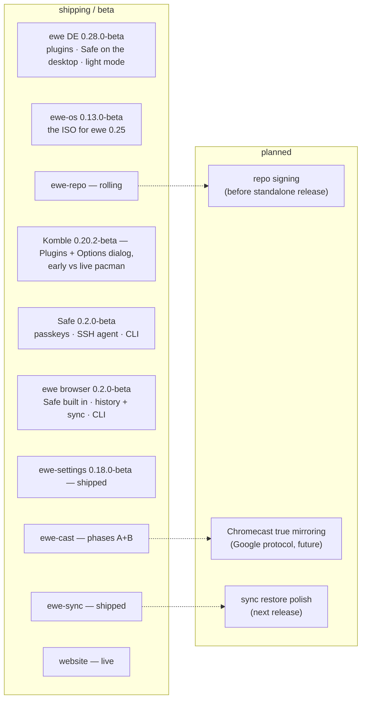

---
tags:
  - ewe-map
  - overview
title: Roadmap and Status
up: "[[Home]]"
---

# Roadmap and Status

Snapshot as of **2026-10-15**. Released: **ewe (DE) 0.28.0-beta** with **Safe 0.2.0-beta** and **ewe browser 0.2.0-beta** (2026-10-15, "a real safe": passkeys, an SSH agent, an `op`-like CLI, Safe inside the browser, browser history and sync — below); before it **ewe 0.27.0-beta** with **Safe 0.1.0-beta** (2026-10-15, Safe — ewe's own password manager — and its desktop plugin); before that **ewe 0.26.1-beta** (2026-10-14, light mode is official, companion groundwork); before that **ewe 0.26.0-beta** with **ewe browser 0.1.0-beta** and **Komble 0.20.2-beta** (2026-10-14, ewe browser replaces Helium); before that **ewe 0.25.2-beta** and **Komble 0.20.1-beta** (2026-10-11, bug fixes on 0.25.1-beta of 2026-10-10 with Komble
0.20.0-beta, ewe-settings 0.18.0-beta and ewe-sync 0.14.4-beta; 0.25.0-beta on 2026-10-04), **ewe-os (distro) 0.13.0-beta**
(2026-10-04, the ISO for ewe 0.25 with the installer's Plugins step, see
[[ewe-os ISO]]; later releases stop at the ewe-repo publish). The README speaks of a
`0.9.x` beta line and names the **1.0-beta release "Dolly"**.

## 0.28.0-beta + Safe 0.2.0-beta + ewe browser 0.2.0-beta — a real safe (released 2026-10-15)

The owner's ask the same day: "Safe is a real safe" (like 1Password today),
a browser with real sync and history, and a companion that can use both.
Contract: `ewe-safe/docs/TRIO.md`; decisions: [[Decision Index]] rows 35–37.
The owner said "merge all PRs and make new releases"; everything was merged
and released on 2026-10-15 and published to `[ewe]` the same day. No ISO.

| piece | where | state |
|---|---|---|
| Safe: `read`, `run`, `inject`, `git-credential`, `safe://` references | ewe-safe **#10** | released in Safe 0.2.0-beta; not verified: a real `git push` |
| Safe: passkeys (KeePassXC's format, ES256 + EdDSA, Safe's AAGUID) | ewe-safe **#11** (also carries `docs/TRIO.md`) | released in Safe 0.2.0-beta; byte-checked against KeePassXC's test vectors, `keepassxc-cli` 2.7.12 reads them; not verified: a real site |
| Safe window: saving an edited login works again | ewe-safe **#12** | released in Safe 0.2.0-beta (0.1.0-beta could not save an edited login) |
| Safe: SSH keys (KeeAgent format) + an ssh-agent, `ssh_confirm` | ewe-safe **#13** + ewe **#59** (`[safe] ssh_agent`, `ssh_confirm`) | released in Safe 0.2.0-beta + ewe 0.28.0-beta; not verified: the approval window on screen, `ssh adopt` on the owner's safe |
| all four Safe PRs together | ewe-safe **#14** (`integrate/trio`), bump **#15** | `v0.2.0-beta` on `b101d2d` (after #16, a test-race fix; the tag moved once, before any package was made) → `ewe-safe-0.2.0beta-1`; `cargo test` 214 passed |
| ewe-conf: quoted key parts keep their dots | ewe **#58** | released in ewe 0.28.0-beta |
| Passwords 1.3.0: **Use Safe** when the chosen manager is gone; `ewe-pass` exits 0 | ewe-plugin-passwords **#3** | vendored in ewe 0.28.0-beta (bump ewe#60, `v0.28.0-beta` on `52bf89a`); `test.sh` 52/52 |
| ewe browser: the command line (`docs/CLI.md`) + the hidden rail | ewe-browser **#3** | released in ewe browser 0.2.0-beta |
| ewe browser: Safe built in (inline suggestions, passkeys) | ewe-browser **#4** | released in ewe browser 0.2.0-beta; the owner approved it 2026-10-15; e2e 40 passed, the 7 tests against a real Safe skipped there |
| ewe browser: `app://history`, SQLite, synced deletes, other computers' tabs | ewe-browser **#5**, bump **#6** | released in ewe browser 0.2.0-beta (`v0.2.0-beta` on `1e94143` → `ewe-browser-0.2.0beta-1`); e2e 44 passed |
| the companion P2.9: Safe, ewe browser, the finder | ewe-companion **#1** + ewe-plugin-companion **#1** (0.3.0) | **merged, not released** — the companion is not in `[ewe]` yet (its first release is P7); `tests/canary.sh` 8, `tests/chat.sh` 53; against fakes only |

**On the owner's machine after the publish:**

```sh
sudo pacman -Syu        # ewe 0.28.0-beta, ewe-browser 0.2.0-beta, ewe-safe 0.2.0-beta
systemctl --user daemon-reload && systemctl --user restart ewe-safe.socket
                        # the socket unit gained the SSH agent's socket; this locks the safe
```

Then log out and in once: the session takes the new payload (Passwords
1.3.0 among it) at login, as after every ewe release
([[Packaging and Updates]]).

Live machine (2026-10-15): the owner's `Super+P` error "make sure 1Password
CLI is installed" was the old `provider = "1password"`; it was switched with
`ewe-plugin set ewe.passwords provider ewe`.

## 0.27.0-beta + Safe 0.1.0-beta — Safe, ewe's own password manager (released 2026-10-15)

The owner's 1Password move ([[RFC-008 — ewe Safe]], [[Roadmap — ewe-safe]]).
One wave: ewe-safe#7–#9 (`v0.1.0-beta`: `ewe-safed`, `ewe-safe`, the
`ewe-safe-app` window, import from 1Password — `.1pux`, CSV, live through
`op`), ewe-repo#3 (the publish collects `ewe-safe`; opt-in, nothing depends on
it), ewe#57 (0.27.0-beta vendors `ewe.safe` 1.0.0 — [[Safe Plugin]], Quick
Access on `Super+Shift+P` — and `ewe.passwords` 1.2.0, whose provider `ewe`
fills from Safe), then the ewe-repo publish. Earlier on ewe main: the `[safe]`
ewe-conf domain (#55), the unlock prompt's window rule (#56). Not in this
wave: the ewe browser integration (then staged, waiting for the owner's
review; released later that day in ewe browser 0.2.0-beta) and Komble's
listing.

Two release snags, both fixed before anything shipped: the bump PR merged on
a red CI run (a racy idle-lock test — `gh pr checks --watch | tail` hid the
failure; ewe-safe#8 made the test wait for the log line), and the first
`v0.1.0-beta` build failed because `makepkg` reads `install=` from beside the
PKGBUILD (ewe-safe#9 moved `ewe-safe.install`; the unreleased tag was moved
to the fix).

## 0.26.1-beta — light mode is official, companion groundwork (released 2026-10-14)

No new feature work in the bump itself: it releases what ewe#52 merged
after 0.26.0-beta — every generated config (GTK, Qt, kitty, Helium) follows
the active scheme's variant, so ewe is dark by default with a light mode
([[Foundation Choices]]); the `[companion]` ewe-conf domain that applies
nothing (RFC-007); kitty remote control on a file socket. Bump PR ewe#53,
then the ewe-repo publish. Only `ewe` had unreleased commits: every Tauri app
and all 13 bundled plugins already matched their releases, and ewe-browser's
next work was still uncommitted on a branch. No ISO (ewe-os unchanged).

## 0.26.0-beta — ewe browser replaces Helium (released 2026-10-14)

One wave, branch `feat/ewe-browser`: ewe-browser#1 (`v0.1.0-beta`), ewe#51,
ewe-repo#2, komble-arch#13 (`v0.20.2-beta`), prj786.github.io#5, ewe-map#8;
then the ewe-repo publish. ewe-browser (root `PKGBUILD`,
`packaging/`, `release.yml`, `ci.yml`), ewe-repo (`publish` collects it,
asserts `depend = ewe-browser`, Helium out of `aur-packages.txt`), ewe (the
`ewe` package depends on it, phase 20 installs it, seeding / `$BROWSER` /
Super+B fallback / dock pins / warm-up point at it, the Helium theming hook
runs only while Helium is installed, get.sh takes the newest release instead
of GitHub's "Latest"), komble-arch (`first_party.rs`), the website (repos
page, schema text). Decision: [[ewe browser replaces Helium]]. Release order
kept: ewe-browser `v0.1.0-beta` first, then ewe and Komble, then the ewe-repo
publish — the fresh-install gate refuses an `ewe` that depends on a package
the repo does not carry. ewe-browser's first CI run needed a 4 GB Node heap
for type-aware ESLint and `bsdtar` on the Ubuntu runner. The first publish
failed its fresh-install gate because prj786/ewe-browser was still private
(`ewe-browser -> (no release)`); the repo went public, like every first-party
repo, and the publish was rerun. No ISO this round (ewe-os unchanged).

## 0.25.2-beta — first-party plugins survive a Restore (released 2026-10-11)

Bug report: after login Komble → Plugins showed all 13 first-party plugins
broken (*the "ewe." namespace is reserved for ewe's own (bundled) plugins*)
and none would turn on. A Restore from the account (ewe-sync → This machine,
`ewe-conf pull`, 2026-10-10 15:38) had replaced `[plugins]` with an older
copy without the `"ewe.*" = "bundled"` source records, and the reserved-id
check trusted only that synced table. Now an installed copy of an id the
payload ships is first-party whatever ewe.conf says (`payload_ships`);
`enable` writes the records back, `seed` adopts such copies (`adopted`).
ewe#50. `ewe-plugin-test.sh` 82/82, every suite green. Same day, Komble
0.20.1-beta (komble-arch#12): *Add a plugin* first on Plugins, and the
Options dialog no longer blinks (see Troubleshooting → Theming). The
reporting machine's ewe.conf was merged back to its pre-Restore state
(three-way against the Nextcloud version the Restore pulled — the laptop
had not pushed since 2026-09-13).
See [[Troubleshooting Knowledge]] (Plugins).

## 0.25.1-beta — what is in it (released 2026-10-10)

One wave, branch `fix/plugins-settings-sync` in every repo: ewe#49,
komble-arch#11, ewe-settings#19, ewe-sync#7, ewe-os#16 (installer strings
only — no ISO tag), prj786.github.io#4, plus the ten plugin repos straight
to their `main`s; then the ewe-repo publish. Decisions: [[Decision Index]]
rows 27–31 (D9–D13). Real-hardware testing on the home laptop follows.

| piece | state |
|---|---|
| **Sync** ([[Sync Conflicts Are About Content]]): ewe-conf adopts a moved ETag over bytes it sent/saw, records a stored upload, answers `conflict` + `remote_is_this_machine`, stamps a hashed `machine_id`; ewe-sync's banner/tray key on `conflict`; Cloud.qml reflects/clears it | `tests/ewe-conf-sync-test.sh` green incl. a lost reply, a refused stamp, a same-bytes re-upload and two same-named machines; the laptop still needs one *Push anyway* |
| **"Shell isn't running"** in ewe-settings: re-probe on focus/10 s, timeout, `--pid` retry, stdout-only replies | dev-mock checked (`?shell=down`) |
| **Glass** ([[Glass — the slider moves the bar only]]) | `ewe-theme-test.sh` 106/106 (incl. 5 new checks); nested harness: no QML errors, Lua rules accepted |
| **Plugin settings** ([[Plugin Settings Live With the Plugin]]): Komble Options dialog, `komble --options`, Show in bar (`ewe-plugin bar`), Dock 1.1.0 / Mail 1.1.0 / System monitor 1.1.0 / Music + Places 1.0.2, ewe-settings cleanup | `ewe-plugin-test.sh` 76/76; Komble + Settings dev-mock screenshots; harness: dock resizes live, Show in bar live |
| **Desktop widgets** ([[Desktop Widgets — always movable, pin to a level]]) | harness: overlay above a fullscreen window, top covered by it, live pin/level, arrange chips |
| **One name: plugins** ([[One Name — Plugins]]) | apps, shell, CLI, docs, installer, website, vault |

Open: the laptop needs one ewe-sync *Push anyway* (its record predates the
fix); real-mouse drag of a widget and the three apps in real windows are
checked on the hardware, not in the harness.

## 0.25.0-beta — what is in it (released 2026-10-04)

| piece | branch / repo | state |
|---|---|---|
| **Plugins** (D1–D7): plugin API 3, the `Shell` singleton, `ewe-plugin install/migrate`, `bundle.json`, 13 plugins vendored in `plugins/` (default false, migrate true), Welcome Plugins step | ewe `feat/addons-platform` + `feat/addons-carve-out` → `release/0.25.0-beta` | merged into the release branch; integration (Welcome step, `Shell.toggleOverview/primaryScreenName/dockItems/closePopups`, `VERSION`, phase 90 portal threshold 1.4.1-2.1) in progress |
| the ten new plugin repos (insomnia, sysmon, ssh, vpn, media, places, phone, mail, cast, dock) at **1.0.0**; clipboard **1.1.1**, screenshot/passwords **1.1.0** | `ewe-plugin-*` (local `main`, remotes to be created) | built, harness-tested on the carved shell; real-device check pending |
| **Quiet lid** (A2): guarded `after_sleep_cmd`, per-output re-assert, `probeLid()`, buffered logind bridge; `post_upgrade` refreshes the greeter | ewe `fix/lid-resume-blinks` | merged; laptop test pending |
| **Snappy Overview** (D8): one-step open, `ewe:overview` global shortcut | ewe `fix/overview-snappy` | merged; 130 ms to half-visible measured |
| **X11 scale** = smallest lit scale of the DRM-connected set | ewe `fix/x11-scale-notes` | merged |
| Komble: Plugins catalogue, `--addons`, `plugin_install` | komble-arch `feat/addons` (0.18.1-beta base) | built, dev-mock tested; untested in Tauri |
| ewe-settings: `addons_state`/`open_addons`, plugin aware panes, Insomnia, guarded hypridle | ewe-settings `feat/addons` (0.16.4-beta base) | built, dev-mock tested |
| ewe-os 0.13.0-beta: installer **Plugins step** (live payload catalogue, nothing pre-checked, Summary row), `addons` helper verb → `ewe-install --addons-only` (per user in the chroot, best-effort), `ewe-install --addons` + prompt, live user gets `ewe.dock` | ewe-os `feat/addons-installer` | built; sandbox-proven plugin loop, headless screenshot of the step; not yet tagged/built — QEMU pass pending |

Decisions: [[Decision Index]] rows 16–26. Released as one wave (ewe#46,
komble-arch#10, ewe-settings#18, ewe-map#3), then the ewe-repo publish; no
ISO tag. Real-device checks (lid, plugins on the live box, Komble/Settings in
Tauri) are the open part.

## The RFCs

Design decisions are written up as RFCs in `ewe/docs/`. They are the
project's memory:

| RFC | title | status |
|---|---|---|
| RFC-001 | [[The One File]] — `ewe.conf` | **shipping** — phases 1–5 landed in ewe 0.9.0; phase 6 (broker + sync) was the 0.4-alpha centrepiece; target 1.0-beta "Dolly" |
| RFC-002 | [[Auth Broker]] + sync of the one file to Drive | **superseded** for the account half by RFC-005 (2026-09-02); broker + Drive backend remain for the optional Google extras |
| RFC-004 | [[ewe-cast]] — casting without the foreign app | **phases A+B built** (2026-08-30), Miracast proven against a loopback sink; first real-TV field test pending |
| RFC-005 | [[Account and Sync]] — the ewe account is a Nextcloud account | **accepted** (2026-09-02), implemented on a `nextcloud` branch across ewe, komble-arch, ewe-settings, ewe-os and the website; merges as one wave |
| RFC-006 | [[ewe-sync]] — the account app (drafted as "Flock" for an afternoon) | **proposed → built** as a fourth first-party Tauri app, shipped preinstalled from ISO 0.9-alpha on |

## Component status



## Known honest limits

- **Komble is early** — frontend builds, Rust type-checks, but has not yet
  been run against a live pacman.
- **ewe-cast Chromecast** is seconds of latency via HLS — real-time only on
  Miracast today.
- **ewe-repo packages are unsigned** (`SigLevel = Optional TrustAll`);
  signing is planned.
- **ewe-sync cannot create Nextcloud accounts** — Nextcloud has no public
  registration API; it links out to provider signup pages.
- **ewe-sync folder sync** rides `nextcloudcmd` (the Nextcloud client's
  headless engine); no selective sync inside a pair, no bandwidth limits.
- **0.25 plugins** — Komble's catalogue and ewe-settings' plugin panes have
  not run in a real Tauri window yet; the quiet-lid fix has not met a real
  lid; a fresh 0.25 install has **no dock** by design.

## What's next, per component

- [[Roadmap — Desktop and One File]] — Dolly 1.0-beta, theming phases
- [[Roadmap — Komble]] — the first live-pacman run is the gate
- [[Roadmap — ewe-sync]] — folder-sync hardening, restore polish
- [[Roadmap — ewe-cast]] — phase C field proof, Chromecast true mirroring
- [[Roadmap — ewe-companion]] — RFC-007 accepted 2026-10-14; P1 done, P2 (Claude Code cards) working end to end, P2.5 (notch + chat) and P2.6 (notch fixes + the ewe knowledge pack) P2.7 (open apps and folders) and P2.8 (runs what it suggests, on a click) done; P2.9 (Safe, ewe browser, the finder) merged 2026-10-15; not released yet (P7)
- [[Roadmap — ewe-safe]] — **Safe 0.2.0-beta released 2026-10-15** (passkeys, SSH agent, an `op`-like CLI; with ewe 0.28.0-beta and ewe browser 0.2.0-beta); **Safe 0.1.0-beta released 2026-10-15** (with ewe 0.27.0-beta); RFC-008 accepted 2026-10-14; phase 0 spike GO with five conditions (own merge, a write guard, tracked deletes, never quick-xml `overlapped-lists`, own TOTP); phase 1 done (the engine, `ewe-safed`, the `ewe-safe` CLI, the `[safe]` domain, provider `ewe` in the Passwords plugin; Super+P fills from a real safe in the nested harness); left in phase 2: unlock with login/fingerprint, the Komble listing, site docs
- [[Roadmap — Distro and Repo]] — repo signing, standalone release
- [[Open Questions]] — deliberately unresolved

## Related

- [[What is ewe]] · [[System Architecture]] · [[The One File]] ·
  [[Decision Index]]
