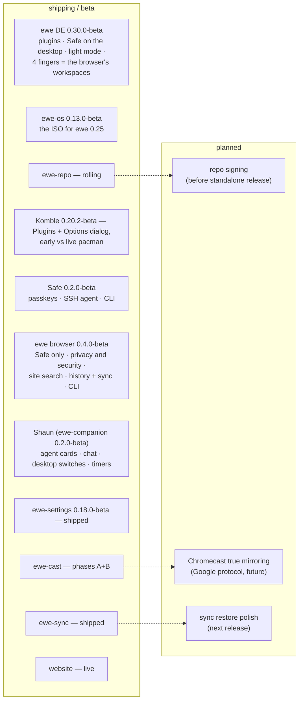

---
tags:
  - ewe-map
  - overview
title: Roadmap and Status
up: "[[Home]]"
---

# Roadmap and Status

Snapshot as of **2026-10-23**. Released: **ewe-os 0.14.0-beta** (2026-10-23, the ISO for ewe 0.35, with the website refresh — below); before it **ewe (DE) 0.35.0-beta** with **Dock 1.3.0** and **ewe-settings 0.20.0-beta** (2026-10-23, the owner's ask: every display its own workspaces, like macOS, or one shared set — below); before it **ewe browser 0.5.2-beta** (2026-10-23, the dock's Downloads ring moves while a download runs); before it **ewe (DE) 0.34.1-beta** with **Dock 1.2.1** (2026-10-23, the owner's follow-up: each minimized window is its own picture tile in the dock, like macOS — below); before it **ewe (DE) 0.34.0-beta** with **Dock 1.2.0** (2026-10-23, the owner's ask: a Mission-Control Overview, Super+Z minimize with a Minimized section in the dock, ewe browser downloads in the dock — below); before it **ewe 0.33.1-beta** (2026-10-21, sign-in links open your browser), **0.33.0-beta** (2026-10-20, ewe-conf sync merges key by key), **0.32.1-beta** and **0.32.0-beta** (2026-10-20, ewe browser back in the launcher; the Slack plugin); before them **ewe (DE) 0.31.0-beta** with **Safe 0.3.0-beta** and **ewe browser 0.5.0-beta** (2026-10-18, the owner's ask: unlock Safe with the login password, no more keyring prompt at every start, cards and addresses, every sign-up asks to save — below); before it **ewe (DE) 0.30.0-beta** with **ewe browser 0.4.0-beta** and **ewe-companion 0.2.0-beta** (2026-10-18, wave 2: gestures, right-click menus, find, privacy and security, site search and Safe-only filling in the browser; Shaun's desktop switches, timers, sums and a site's own search — below); before it **ewe (DE) 0.29.0-beta** with **ewe-companion 0.1.0-beta** (2026-10-17, the companion's first release, named **Shaun**, its notch now the bar's own material — below); before it **ewe browser 0.3.0-beta** (2026-10-17, the owner's ask: workspaces and tools in a thin bottom bar across the window, + opens a new workspace on Home; [[Browser Bottom Bar — workspaces and tools]]); before it **ewe browser 0.2.2-beta** (2026-10-16, two bug fixes: Gmail's *browser no longer supported* banner in 0.2.1-beta, dead patches on websites in 0.2.2-beta; see [[ewe-browser]]); before it **ewe (DE) 0.28.0-beta** with **Safe 0.2.0-beta** and **ewe browser 0.2.0-beta** (2026-10-15, "a real safe": passkeys, an SSH agent, an `op`-like CLI, Safe inside the browser, browser history and sync — below); before it **ewe 0.27.0-beta** with **Safe 0.1.0-beta** (2026-10-15, Safe — ewe's own password manager — and its desktop plugin); before that **ewe 0.26.1-beta** (2026-10-14, light mode is official, companion groundwork); before that **ewe 0.26.0-beta** with **ewe browser 0.1.0-beta** and **Komble 0.20.2-beta** (2026-10-14, ewe browser replaces Helium); before that **ewe 0.25.2-beta** and **Komble 0.20.1-beta** (2026-10-11, bug fixes on 0.25.1-beta of 2026-10-10 with Komble
0.20.0-beta, ewe-settings 0.18.0-beta and ewe-sync 0.14.4-beta; 0.25.0-beta on 2026-10-04), **ewe-os (distro) 0.13.0-beta**
(2026-10-04, the ISO for ewe 0.25 with the installer's Plugins step, see
[[ewe-os ISO]]; later releases stop at the ewe-repo publish). The README speaks of a
`0.9.x` beta line and names the **1.0-beta release "Dolly"**.

## ewe-os 0.14.0-beta + the website refresh (released 2026-10-23)

The owner's ask (2026-10-23): "update website … even limitations, because we
fixed a lot. dont make detalization … just simple explain … docs needs to be
[the] best part. describe plugins and built in plugins. also update installer
… make new release after that for website and installer".

| what | where | state |
|---|---|---|
| ISO for ewe 0.35: the Plugins step lists all 16 plugins (it reads the live payload); Shaun and Slack get `icMessage`, not the puzzle; the username fix (#13, parked since 0.12.x); *beta* rail label; README/INSTALL/TESTING counts | ewe-os#18, `v0.14.0-beta` on `21a5b0b`, `release-iso` | released |
| Website: plain-language home and features (ewe browser, Safe, Shaun, Overview, minimize, workspaces per display); new docs — The desktop, Apps (ewe browser, Safe, Shaun, Komble, Settings), Plugins (what a plugin is) and **Built-in plugins** (all 16, grouped, use/keys/settings); `/docs/add-ons/` 308 → `/docs/plugins/built-in/`; Known limitations cut to what is still true; privacy adds Safe, browser sync and Shaun's optional AI provider; download → 0.14.0-beta | prj786.github.io | deployed |
| QEMU pass of the CI-built ISO | owner / next session | open |

## 0.35.0-beta + Dock 1.3.0 + ewe-settings 0.20.0-beta — workspaces per display (released 2026-10-23)

The owner's ask (2026-10-23): "separated workspaces for each monitor. again
like in mac … option for monitors. like shared workspaces or separated
workspaces toggler". Shared = macOS's (switching one switches all); the
default is separate. Decision: [[Decision Index]] row 45,
[[Workspaces Per Display]].

| what | where | state |
|---|---|---|
| Every display owns ten ids (1–10, 11–20 …) shown as 1, 2, 3 …; Super+N/Shift+N/wheel/swipe-down per display; shared sync; hot-plug merge; one-time migration of the old numbering | ewe#72 (`dotfiles/hypr/workspaces.lua`), `v0.35.0-beta` on `d1cca36` | released |
| `[desktop.workspaces] mode` = separate \| shared (ewe-conf, `workspaces` domain) | ewe#72 (`bin/ewe-conf`) | released |
| Bar chip per screen, Overview strip numbers, `Shell.workspacesShared` / `Shell.workspaceNumber` | ewe#72 | released |
| Dock workspace boxes follow the mode | ewe-plugin-dock `c88fdc4` (1.3.0), vendored in ewe#72 | released |
| Settings → Displays → Workspaces (Separate \| Shared, with ≥ 2 displays) | ewe-settings#21, `v0.20.0-beta` on `14b72a8` | released |
| Website: shortcuts + schema `[desktop.workspaces]` | prj786.github.io `c60bb1d` | deployed |
| Two real monitors (hot-plug, shared sync, the swipe) | owner | open |

## 0.34.0/0.34.1-beta + Dock 1.2.0/1.2.1 — the Overview spreads your windows (released 2026-10-23)

The owner's ask (2026-10-23): "i want mac like overview. exactly like it …
performance is the must"; Super+Z should minimize into a new dock section
with polished thumbnails, the secret desktop (the Pen) removed; a downloads
icon after it for ewe browser. Decision: [[Decision Index]] row 44,
[[Overview Spreads the Windows]].

| what | where | state |
|---|---|---|
| Overview: windows fly from their real places into a spread and back; workspaces along the top (labels → thumbnails on hover/drag), drop to move; no search, no add; one frame per window, no blur | ewe#70 (`Overview.qml`) | released |
| Minimize: Super+Z → `special:minimized`, Super+Shift+Z brings the last back; the Pen binds gone | ewe#70 (`hyprland.lua`) | released |
| Dock Minimized box + thumbnail panel; Downloads ring + the day's list from ewe browser's `downloads.json` | ewe-plugin-dock `d2cc093` (1.2.0), vendored in ewe#70 | released |
| Minimized windows as their own picture tiles, no group, no panel (owner: "exactly like in mac") | ewe-plugin-dock `2189ce4` (1.2.1), ewe#71 → 0.34.1-beta | released |
| Website: first login, shortcuts, components, motion | prj786.github.io `d05a237` | deployed |
| Real-machine check (4K, multi-monitor, a real browser download) | owner | open |
| Design `preview.html` for the Overview and Dock cards still show the old designs | `design/system/components/` | open |

## 0.31.0-beta + Safe 0.3.0-beta + ewe browser 0.5.0-beta — Safe and the system (released 2026-10-18)

The owner's ask (2026-10-18, heading out: "choose any recommended option"):
unlock Safe with the sudo (login) password; get rid of the keyring prompt at
every start; cards and addresses without ruining users' safety, encrypted in
Nextcloud; full Safe control; and "when I register somewhere it should ask
to save a new login". Contract: `ewe-safe/docs/SYSTEM.md`; decision:
[[Decision Index]] row 43, [[RFC-008 — ewe Safe]] → Amendment 2026-10-18.

| what | where | state |
|---|---|---|
| The prompt at every start: a second keyring (`Default_keyring`) was the `default`, plus a gnome-keyring crash at boot. `ewe-safe keyring repair` copies everything into `login` and points `default` at it | ewe-safe#18 (`crates/secrets`), ewe#64 (TROUBLESHOOTING) | released; tried against a real gnome-keyring in a sandbox shaped like the owner's; **not yet run on the owner's machine** |
| Unlock Safe with the login password (`ewe-safe login enable`, Settings → Security); Safe opens at login through gnome-keyring's `login`; five tries, then the master password | ewe-safe#18 (`crates/login`, `login.rs`, `carrier.rs`), ewe#64 (`[safe] unlock_at_login`) | released; sandbox: enable → restart → opens by itself, locked `login` → no prompt |
| `confirm` (login or master password, 5 minutes) before a card fill | ewe-safe#18, ewe#64 (`[safe] confirm_cards`) | released |
| Cards and addresses in the same encrypted KDBX; 1Password's cards and identities import as them; `convert --from-1password` | ewe-safe#18 (`card.rs`, `cards.rs`), ewe-plugin-safe#1 (Quick Access skips them, 1.0.1 in ewe 0.31) | released; KeePassXC showing the fields not checked |
| Every sign-up asks to save (also locked: Unlock and save); cards and addresses fill in pages (cards on https only) | ewe-browser#14 | released in ewe browser 0.5.0-beta; e2e 22/22 against the real Safe 0.3.0; real sites untried |
| **Parked:** Safe's own PAM module (owner review first) and Safe as the Secret Service (`keyring adopt` refuses without the module) | `.wt/parked-pam/`, `crates/secrets` | built, not shipped |

## 0.30.0-beta + ewe browser 0.4.0-beta + ewe-companion 0.2.0-beta — wave 2 (released 2026-10-18)

The owner's ask (2026-10-18): finger gestures, more shortcuts, right-click
menus on websites and only Safe filling passwords in the browser; DNS and
security settings; and more Shaun — more browser, more knowledge about ewe,
more commands ("search men's shoes on zara" straight to Zara's results).
Delivered as "PRs + release" in one wave; no ISO (release scope unchanged).
Decisions 40–42 ([[Decision Index]]).

| change | where | state |
|---|---|---|
| Two-finger swipe back/forward, side buttons, find in page (Ctrl+F), ~20 new rebindable shortcuts (web pages first on keys they use), right-click menus on pages | ewe-browser **#13** (`feat/input-menus`) | released in ewe browser 0.4.0-beta (`v0.4.0-beta` on `1d36473` → `ewe-browser-0.4.0beta-1`); swipe tested with synthetic wheel events only |
| **Safe only**: the `ewe-pass` route leaves the browser; password-manager extensions refused before they load (36 store ids) | ewe-browser **#13** | released; decision 40 — [[Browser Passwords — Safe only]] |
| Settings → Privacy and security: Secure DNS (off/automatic/Cloudflare/Quad9/Mullvad/AdGuard/NextDNS/custom), HTTPS-Only (off by default, interstitial), third-party cookies blocked (Chromium's `ForceThirdPartyCookieBlockingEnabled`, after a restart), GPC on | ewe-browser **#13** (`feat/privacy-site-search`) | released; the five DoH providers resolved live in e2e |
| Site permissions ask per site (prompt card, `permissions.json`, site info from the lock) instead of silent denial | ewe-browser **#13** | released; decision 42 — [[Site Permissions — ask per site]]; location has no provider on Linux |
| Site search: `@zara men's shoes`, `search --site`, `site` (history → OpenSearch → a 66-site table → `site:` filter) | ewe-browser **#13** | released |
| CLI 31 → 43 tools: `site`, `workspaces`, `workspace activate\|next\|prev\|create\|rename\|remove`, `back`, `forward`, `download open\|show`, `open --workspace` | ewe-browser **#13** | released (public API, [[Contracts and Public API]]); unit 146 + 326, e2e 58 passed (7 need the real Safe) |
| Shaun: a site's own search, bookmarks, back/forward, tabs, workspaces, downloads; Wi-Fi, Bluetooth + paired devices, airplane mode, keep awake, "install X" → Komble's search; a calculator; timers and reminders (`companion.db` migration 002); proposals only for dark/light, power, empty trash; knowledge pack 91 → 122 topics with `cli.md` | ewe-companion **#3** | `v0.2.0-beta` on `30eb37f` → `ewe-companion-0.2.0beta-1`; core 81 + daemon 31 unit, `tests/chat.sh` 112, `tests/canary.sh` 9 — against fakes |
| The island's row icons (download, workspace, timer, Bluetooth) | ewe-plugin-companion **#3** (0.5.0) | vendored in ewe 0.30.0-beta |
| 4-finger swipe left/right = ewe browser's workspaces while it is focused; SHORTCUTS.md rows | ewe **#62** | released in ewe 0.30.0-beta (`v0.30.0-beta` on `1f6721e`); decision 41 — [[Four Fingers — ewe browser's workspaces]] |

Published to `[ewe]` on 2026-10-18. Install: `sudo pacman -Syu` (ewe,
ewe-browser, ewe-companion). Not verified: the swipe and the 4-finger gesture on a real
touchpad, printing by hand, Shaun against the real browser 0.4 CLI, a
paired Bluetooth device, the Insomnia plugin and a real timer banner — the
owner's try after the upgrade.

## 0.29.0-beta + ewe-companion 0.1.0-beta — Shaun (released 2026-10-17)

The owner's ask: the companion's notch never matched the top bar ("it feels
different, in dark mode and even more on light … because of notch"), and
"rename this companion as shaun". Then: "just commit and make new release".

| change | where | state |
|---|---|---|
| The notch is the bar's material: the blur rule is `xray` (the notch blurs the wallpaper, as the bar does, not the window under it), the fill clipped at the bar's edge | ewe-plugin-companion **#2** (0.4.0) | released in ewe 0.29.0-beta (ewe#61); measured equal to the bar in the island harness at 1.8, dark/light Glass, solid, the 36 px bar |
| The name is **Shaun**: the notch's word, Komble's plugin name, the persona, the knowledge pack; ids stay `companion` | ewe-plugin-companion **#2**, ewe-companion **#2**, ewe#61 (SHORTCUTS, RFC-007) | released; decision 39 |
| The first release: `.github/workflows/release.yml` (makepkg in `packaging/`), `v0.1.0-beta` | ewe-companion **#2** | package `ewe-companion-0.1.0beta-1` in [ewe] (ewe-repo **#4**) |
| `vendor-plugins.sh` leaves a plugin repo's `AGENTS.md`/`CLAUDE.md` behind | ewe#61 | released |
| `tests/island.sh restart` replaces the daemon after a rebuild | ewe-companion **#2** | merged |

Install: `sudo pacman -Syu ewe-companion`, then Komble → Plugins → From ewe →
Shaun. Not verified: the QEMU e2e (P7's gate) and a real-device check of
the packaged daemon on the owner's laptop, which ran a dev install (binaries
in `~/.local/bin`, its own user unit, the plugin as a symlink).

## 0.28.0-beta + Safe 0.2.0-beta + ewe browser 0.2.0-beta — a real safe (released 2026-10-15)

The owner's ask the same day: "Safe is a real safe" (like 1Password today),
a browser with real sync and history, and a companion that can use both.
Contract: `ewe-safe/docs/TRIO.md`; decisions: [[Decision Index]] rows 35–37.
The owner said "merge all PRs and make new releases"; everything was merged
and released on 2026-10-15 and published to `[ewe]` the same day. No ISO.

| piece | where | state |
|---|---|---|
| Safe: `read`, `run`, `inject`, `git-credential`, `safe://` references | ewe-safe **#10** | released in Safe 0.2.0-beta; not verified: a real `git push` |
| Safe: passkeys (KeePassXC's format, ES256 + EdDSA, Safe's AAGUID) | ewe-safe **#11** (also carries `docs/TRIO.md`) | released in Safe 0.2.0-beta; byte-checked against KeePassXC's test vectors, `keepassxc-cli` 2.7.12 reads them; not verified: a real site |
| Safe window: saving an edited login works again | ewe-safe **#12** | released in Safe 0.2.0-beta (0.1.0-beta could not save an edited login) |
| Safe: SSH keys (KeeAgent format) + an ssh-agent, `ssh_confirm` | ewe-safe **#13** + ewe **#59** (`[safe] ssh_agent`, `ssh_confirm`) | released in Safe 0.2.0-beta + ewe 0.28.0-beta; not verified: the approval window on screen, `ssh adopt` on the owner's safe |
| all four Safe PRs together | ewe-safe **#14** (`integrate/trio`), bump **#15** | `v0.2.0-beta` on `a3fcc5e` (after #16, a test-race fix, and #17, openssh for the package check; the tag moved twice, before any package was made) → `ewe-safe-0.2.0beta-1`; `cargo test` 214 passed |
| ewe-conf: quoted key parts keep their dots | ewe **#58** | released in ewe 0.28.0-beta |
| Passwords 1.3.0: **Use Safe** when the chosen manager is gone; `ewe-pass` exits 0 | ewe-plugin-passwords **#3** | vendored in ewe 0.28.0-beta (bump ewe#60, `v0.28.0-beta` on `52bf89a`); `test.sh` 52/52 |
| ewe browser: the command line (`docs/CLI.md`) + the hidden rail | ewe-browser **#3** | released in ewe browser 0.2.0-beta |
| ewe browser: Safe built in (inline suggestions, passkeys) | ewe-browser **#4** | released in ewe browser 0.2.0-beta; the owner approved it 2026-10-15; e2e 40 passed, the 7 tests against a real Safe skipped there |
| ewe browser: `app://history`, SQLite, synced deletes, other computers' tabs | ewe-browser **#5**, bump **#6** | released in ewe browser 0.2.0-beta (`v0.2.0-beta` on `1e94143` → `ewe-browser-0.2.0beta-1`); e2e 44 passed |
| the companion P2.9: Safe, ewe browser, the finder | ewe-companion **#1** + ewe-plugin-companion **#1** (0.3.0) | **merged, not released** — the companion is not in `[ewe]` yet (its first release is P7); `tests/canary.sh` 8, `tests/chat.sh` 53; against fakes only |

**On the owner's machine after the publish:**

```sh
sudo pacman -Syu        # ewe 0.28.0-beta, ewe-browser 0.2.0-beta, ewe-safe 0.2.0-beta
systemctl --user daemon-reload && systemctl --user restart ewe-safe.socket
                        # the socket unit gained the SSH agent's socket; this locks the safe
```

Then log out and in once: the session takes the new payload (Passwords
1.3.0 among it) at login, as after every ewe release
([[Packaging and Updates]]).

Live machine (2026-10-15): the owner's `Super+P` error "make sure 1Password
CLI is installed" was the old `provider = "1password"`; it was switched with
`ewe-plugin set ewe.passwords provider ewe`.

## 0.27.0-beta + Safe 0.1.0-beta — Safe, ewe's own password manager (released 2026-10-15)

The owner's 1Password move ([[RFC-008 — ewe Safe]], [[Roadmap — ewe-safe]]).
One wave: ewe-safe#7–#9 (`v0.1.0-beta`: `ewe-safed`, `ewe-safe`, the
`ewe-safe-app` window, import from 1Password — `.1pux`, CSV, live through
`op`), ewe-repo#3 (the publish collects `ewe-safe`; opt-in, nothing depends on
it), ewe#57 (0.27.0-beta vendors `ewe.safe` 1.0.0 — [[Safe Plugin]], Quick
Access on `Super+Shift+P` — and `ewe.passwords` 1.2.0, whose provider `ewe`
fills from Safe), then the ewe-repo publish. Earlier on ewe main: the `[safe]`
ewe-conf domain (#55), the unlock prompt's window rule (#56). Not in this
wave: the ewe browser integration (then staged, waiting for the owner's
review; released later that day in ewe browser 0.2.0-beta) and Komble's
listing.

Two release snags, both fixed before anything shipped: the bump PR merged on
a red CI run (a racy idle-lock test — `gh pr checks --watch | tail` hid the
failure; ewe-safe#8 made the test wait for the log line), and the first
`v0.1.0-beta` build failed because `makepkg` reads `install=` from beside the
PKGBUILD (ewe-safe#9 moved `ewe-safe.install`; the unreleased tag was moved
to the fix).

## 0.26.1-beta — light mode is official, companion groundwork (released 2026-10-14)

No new feature work in the bump itself: it releases what ewe#52 merged
after 0.26.0-beta — every generated config (GTK, Qt, kitty, Helium) follows
the active scheme's variant, so ewe is dark by default with a light mode
([[Foundation Choices]]); the `[companion]` ewe-conf domain that applies
nothing (RFC-007); kitty remote control on a file socket. Bump PR ewe#53,
then the ewe-repo publish. Only `ewe` had unreleased commits: every Tauri app
and all 13 bundled plugins already matched their releases, and ewe-browser's
next work was still uncommitted on a branch. No ISO (ewe-os unchanged).

## 0.26.0-beta — ewe browser replaces Helium (released 2026-10-14)

One wave, branch `feat/ewe-browser`: ewe-browser#1 (`v0.1.0-beta`), ewe#51,
ewe-repo#2, komble-arch#13 (`v0.20.2-beta`), prj786.github.io#5, ewe-map#8;
then the ewe-repo publish. ewe-browser (root `PKGBUILD`,
`packaging/`, `release.yml`, `ci.yml`), ewe-repo (`publish` collects it,
asserts `depend = ewe-browser`, Helium out of `aur-packages.txt`), ewe (the
`ewe` package depends on it, phase 20 installs it, seeding / `$BROWSER` /
Super+B fallback / dock pins / warm-up point at it, the Helium theming hook
runs only while Helium is installed, get.sh takes the newest release instead
of GitHub's "Latest"), komble-arch (`first_party.rs`), the website (repos
page, schema text). Decision: [[ewe browser replaces Helium]]. Release order
kept: ewe-browser `v0.1.0-beta` first, then ewe and Komble, then the ewe-repo
publish — the fresh-install gate refuses an `ewe` that depends on a package
the repo does not carry. ewe-browser's first CI run needed a 4 GB Node heap
for type-aware ESLint and `bsdtar` on the Ubuntu runner. The first publish
failed its fresh-install gate because prj786/ewe-browser was still private
(`ewe-browser -> (no release)`); the repo went public, like every first-party
repo, and the publish was rerun. No ISO this round (ewe-os unchanged).

## 0.25.2-beta — first-party plugins survive a Restore (released 2026-10-11)

Bug report: after login Komble → Plugins showed all 13 first-party plugins
broken (*the "ewe." namespace is reserved for ewe's own (bundled) plugins*)
and none would turn on. A Restore from the account (ewe-sync → This machine,
`ewe-conf pull`, 2026-10-10 15:38) had replaced `[plugins]` with an older
copy without the `"ewe.*" = "bundled"` source records, and the reserved-id
check trusted only that synced table. Now an installed copy of an id the
payload ships is first-party whatever ewe.conf says (`payload_ships`);
`enable` writes the records back, `seed` adopts such copies (`adopted`).
ewe#50. `ewe-plugin-test.sh` 82/82, every suite green. Same day, Komble
0.20.1-beta (komble-arch#12): *Add a plugin* first on Plugins, and the
Options dialog no longer blinks (see Troubleshooting → Theming). The
reporting machine's ewe.conf was merged back to its pre-Restore state
(three-way against the Nextcloud version the Restore pulled — the laptop
had not pushed since 2026-09-13).
See [[Troubleshooting Knowledge]] (Plugins).

## 0.25.1-beta — what is in it (released 2026-10-10)

One wave, branch `fix/plugins-settings-sync` in every repo: ewe#49,
komble-arch#11, ewe-settings#19, ewe-sync#7, ewe-os#16 (installer strings
only — no ISO tag), prj786.github.io#4, plus the ten plugin repos straight
to their `main`s; then the ewe-repo publish. Decisions: [[Decision Index]]
rows 27–31 (D9–D13). Real-hardware testing on the home laptop follows.

| piece | state |
|---|---|
| **Sync** ([[Sync Conflicts Are About Content]]): ewe-conf adopts a moved ETag over bytes it sent/saw, records a stored upload, answers `conflict` + `remote_is_this_machine`, stamps a hashed `machine_id`; ewe-sync's banner/tray key on `conflict`; Cloud.qml reflects/clears it | `tests/ewe-conf-sync-test.sh` green incl. a lost reply, a refused stamp, a same-bytes re-upload and two same-named machines; the laptop still needs one *Push anyway* |
| **"Shell isn't running"** in ewe-settings: re-probe on focus/10 s, timeout, `--pid` retry, stdout-only replies | dev-mock checked (`?shell=down`) |
| **Glass** ([[Glass — the slider moves the bar only]]) | `ewe-theme-test.sh` 106/106 (incl. 5 new checks); nested harness: no QML errors, Lua rules accepted |
| **Plugin settings** ([[Plugin Settings Live With the Plugin]]): Komble Options dialog, `komble --options`, Show in bar (`ewe-plugin bar`), Dock 1.1.0 / Mail 1.1.0 / System monitor 1.1.0 / Music + Places 1.0.2, ewe-settings cleanup | `ewe-plugin-test.sh` 76/76; Komble + Settings dev-mock screenshots; harness: dock resizes live, Show in bar live |
| **Desktop widgets** ([[Desktop Widgets — always movable, pin to a level]]) | harness: overlay above a fullscreen window, top covered by it, live pin/level, arrange chips |
| **One name: plugins** ([[One Name — Plugins]]) | apps, shell, CLI, docs, installer, website, vault |

Open: the laptop needs one ewe-sync *Push anyway* (its record predates the
fix); real-mouse drag of a widget and the three apps in real windows are
checked on the hardware, not in the harness.

## 0.25.0-beta — what is in it (released 2026-10-04)

| piece | branch / repo | state |
|---|---|---|
| **Plugins** (D1–D7): plugin API 3, the `Shell` singleton, `ewe-plugin install/migrate`, `bundle.json`, 13 plugins vendored in `plugins/` (default false, migrate true), Welcome Plugins step | ewe `feat/addons-platform` + `feat/addons-carve-out` → `release/0.25.0-beta` | merged into the release branch; integration (Welcome step, `Shell.toggleOverview/primaryScreenName/dockItems/closePopups`, `VERSION`, phase 90 portal threshold 1.4.1-2.1) in progress |
| the ten new plugin repos (insomnia, sysmon, ssh, vpn, media, places, phone, mail, cast, dock) at **1.0.0**; clipboard **1.1.1**, screenshot/passwords **1.1.0** | `ewe-plugin-*` (local `main`, remotes to be created) | built, harness-tested on the carved shell; real-device check pending |
| **Quiet lid** (A2): guarded `after_sleep_cmd`, per-output re-assert, `probeLid()`, buffered logind bridge; `post_upgrade` refreshes the greeter | ewe `fix/lid-resume-blinks` | merged; laptop test pending |
| **Snappy Overview** (D8): one-step open, `ewe:overview` global shortcut | ewe `fix/overview-snappy` | merged; 130 ms to half-visible measured |
| **X11 scale** = smallest lit scale of the DRM-connected set | ewe `fix/x11-scale-notes` | merged |
| Komble: Plugins catalogue, `--addons`, `plugin_install` | komble-arch `feat/addons` (0.18.1-beta base) | built, dev-mock tested; untested in Tauri |
| ewe-settings: `addons_state`/`open_addons`, plugin aware panes, Insomnia, guarded hypridle | ewe-settings `feat/addons` (0.16.4-beta base) | built, dev-mock tested |
| ewe-os 0.13.0-beta: installer **Plugins step** (live payload catalogue, nothing pre-checked, Summary row), `addons` helper verb → `ewe-install --addons-only` (per user in the chroot, best-effort), `ewe-install --addons` + prompt, live user gets `ewe.dock` | ewe-os `feat/addons-installer` | built; sandbox-proven plugin loop, headless screenshot of the step; not yet tagged/built — QEMU pass pending |

Decisions: [[Decision Index]] rows 16–26. Released as one wave (ewe#46,
komble-arch#10, ewe-settings#18, ewe-map#3), then the ewe-repo publish; no
ISO tag. Real-device checks (lid, plugins on the live box, Komble/Settings in
Tauri) are the open part.

## The RFCs

Design decisions are written up as RFCs in `ewe/docs/`. They are the
project's memory:

| RFC | title | status |
|---|---|---|
| RFC-001 | [[The One File]] — `ewe.conf` | **shipping** — phases 1–5 landed in ewe 0.9.0; phase 6 (broker + sync) was the 0.4-alpha centrepiece; target 1.0-beta "Dolly" |
| RFC-002 | [[Auth Broker]] + sync of the one file to Drive | **superseded** for the account half by RFC-005 (2026-09-02); broker + Drive backend remain for the optional Google extras |
| RFC-004 | [[ewe-cast]] — casting without the foreign app | **phases A+B built** (2026-08-30), Miracast proven against a loopback sink; first real-TV field test pending |
| RFC-005 | [[Account and Sync]] — the ewe account is a Nextcloud account | **accepted** (2026-09-02), implemented on a `nextcloud` branch across ewe, komble-arch, ewe-settings, ewe-os and the website; merges as one wave |
| RFC-006 | [[ewe-sync]] — the account app (drafted as "Flock" for an afternoon) | **proposed → built** as a fourth first-party Tauri app, shipped preinstalled from ISO 0.9-alpha on |

## Component status



## Known honest limits

- **Komble is early** — frontend builds, Rust type-checks, but has not yet
  been run against a live pacman.
- **ewe-cast Chromecast** is seconds of latency via HLS — real-time only on
  Miracast today.
- **ewe-repo packages are unsigned** (`SigLevel = Optional TrustAll`);
  signing is planned.
- **ewe-sync cannot create Nextcloud accounts** — Nextcloud has no public
  registration API; it links out to provider signup pages.
- **ewe-sync folder sync** rides `nextcloudcmd` (the Nextcloud client's
  headless engine); no selective sync inside a pair, no bandwidth limits.
- **0.25 plugins** — Komble's catalogue and ewe-settings' plugin panes have
  not run in a real Tauri window yet; the quiet-lid fix has not met a real
  lid; a fresh 0.25 install has **no dock** by design.

## What's next, per component

- [[Roadmap — Desktop and One File]] — Dolly 1.0-beta, theming phases
- [[Roadmap — Komble]] — the first live-pacman run is the gate
- [[Roadmap — ewe-sync]] — folder-sync hardening, restore polish
- [[Roadmap — ewe-cast]] — phase C field proof, Chromecast true mirroring
- [[Roadmap — ewe-companion]] — RFC-007 accepted 2026-10-14; P1 done, P2 (Claude Code cards) working end to end, P2.5–P2.10 done; **released**: 0.1.0-beta (2026-10-17, Shaun) and 0.2.0-beta (2026-10-18, wave 2); next P3 (notifications); P7 open (Komble `DISCOVER`, website, QEMU e2e)
- [[ewe-browser]] — **0.4.0-beta released 2026-10-18** (wave 2); open: screen sharing, external protocol links, USB/HID/serial choosers, Storage Access prompts, extension menu items, a real-touchpad check of the swipe
- [[Roadmap — ewe-safe]] — **Safe 0.2.0-beta released 2026-10-15** (passkeys, SSH agent, an `op`-like CLI; with ewe 0.28.0-beta and ewe browser 0.2.0-beta); **Safe 0.1.0-beta released 2026-10-15** (with ewe 0.27.0-beta); RFC-008 accepted 2026-10-14; phase 0 spike GO with five conditions (own merge, a write guard, tracked deletes, never quick-xml `overlapped-lists`, own TOTP); phase 1 done (the engine, `ewe-safed`, the `ewe-safe` CLI, the `[safe]` domain, provider `ewe` in the Passwords plugin; Super+P fills from a real safe in the nested harness); left in phase 2: unlock with login/fingerprint, the Komble listing, site docs
- [[Roadmap — Distro and Repo]] — repo signing, standalone release
- [[Open Questions]] — deliberately unresolved

## Related

- [[What is ewe]] · [[System Architecture]] · [[The One File]] ·
  [[Decision Index]]
