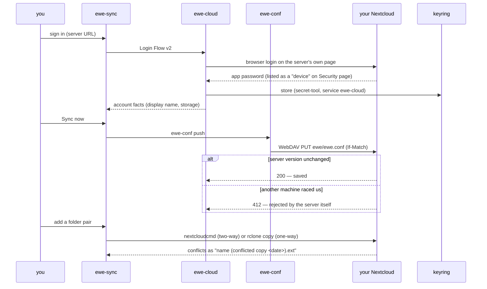

---
tags:
  - ewe-map
  - architecture
title: Account and Sync
up: "[[Home]]"
---

# Account and Sync — Nextcloud, RFC-005 / RFC-006

The ewe account is a **Nextcloud** account. The user signs in to *their*
Nextcloud — self-hosted or a hosted provider (Murena, Disroot, Infomaniak,
…) — through Nextcloud's own browser login flow. Everything ewe syncs lives
in a folder of that account.

**Why Nextcloud (RFC-005):** WebDAV, CalDAV and IMAP need nobody's
verification — no unverified-app warning, no CASA audit, no client secret in
CI. The audience is people who *don't* want Google in their login screen,
and the owner is out of the loop entirely.

## Who does what

| app | job |
|---|---|
| **ewe-sync** | the account app (RFC-006): sign-in, the **Overview** of everything the account keeps (2026-10-31), the one file, machines, folders. *Nothing else has a sync button.* |
| **`ewe-files`** | the whole account as `~/Nextcloud` (an rclone mount, files on demand) — never over a folder that holds files (a synced folder is already the account) |
| **ewe browser** | syncs its bookmarks, history, open tabs and settings itself, **following the account** (`sync.browser`); its file manager shows the connected folders from `sync-folders.json` |
| **`ewe-cloud`** | the account tool shipped in the `ewe` package: Nextcloud Login Flow v2, account facts, the app password |
| **`ewe-conf`** | `push` / `pull` / `sync-status` of the one file, WebDAV with the server's own `If-Match` conflict guard |
| **`nextcloudcmd`** / **`rclone`** | the folder-sync engines (two-way via Nextcloud's engine; one-way copies via rclone) |
| **`ewe-auth`** | only for the keyring playbook (`keyring-reset`) — Google stays optional, see [[Auth Broker]] |

## Login & sync flow

## What is stored where

- **App password** → the keyring only (service `ewe-cloud`). Revocable any
  time in Nextcloud → Settings → Security.
- **Non-secret account facts** (server, login, display name) →
  `~/.config/ewe/cloud.json`.
- **The one file** → locally `~/.config/ewe/ewe.conf`; in the account
  `ewe/ewe.conf`, `ewe/ewe.conf.meta.json` (who saved it — hostname **and**
  a hashed `machine_id`, so two machines with one hostname are told apart —
  and when) and `ewe/machines/<name>.json` (each machine's ewe version +
  app count; still keyed by hostname — give each machine its own name).
- **Folders** — pairs of a local folder and an account folder, two-way
  (Nextcloud sync engine) or one-way (rclone `copy`: adds and updates,
  never deletes).

## Triggers & conflicts

- **The one file** ([[Sync Conflicts Are About Content]]): a push is refused
  only when the account's copy holds bytes this machine never sent or saw.
  An upload whose reply was lost (a laptop suspending mid-push), or a
  same-bytes re-upload by the Nextcloud desktop client (it syncs
  `~/Nextcloud/ewe` too), is adopted silently. `sync-status` answers
  `conflict`; ewe-sync → This machine shows *Restore… / Push anyway* from it.

- Folder sync triggers: **automatic** — the local folder changed (inotify;
  a burst of writes becomes one run after 5 quiet seconds) or the **account
  folder's ETag moved** (asked every 45 s; Nextcloud moves it when anything
  inside changes), plus a catch-up run shortly after start — or **every N
  minutes**, or **once at login**. Automatic runs honour the auto-sync switch
  and this computer's pause; "Sync now" always runs.
- **The folder list follows you** (2026-10-31): `sync.folders` is shared
  in `ewe-conf sync`; a running ewe-sync starts folders another machine
  added. One engine per folder: no pair on the home folder, inside another
  pair, inside the account's mount, or on a folder the Nextcloud desktop app
  syncs (those are shown as connected and can be taken over).
  [[Sync — sign in once, everything follows]]
- Conflicts: when both sides changed a file, the engine keeps the server's
  version and writes yours as `name (conflicted copy <date>).ext`. The
  Folders pane lists them; *Keep mine* / *Keep theirs* resolves. Only paths
  inside the pair are ever touched.

## Honest limits

- ewe-sync **cannot create accounts** — Nextcloud has no public registration
  API; it links to provider signup pages.
- No selective sync inside a pair (use excludes), no bandwidth limits
  (`nextcloudcmd` 35 has `--unsyncedfolders` and `--uplimit/--downlimit`;
  not wired yet).
- `nextcloudcmd` flags are checked against the real binary (35.0.0,
  2026-10-31) — `ewe-sync/src-tauri/src/folders.rs` → `mod nccmd` is the one
  place to fix if a client version disagrees. It skips hidden files unless a
  pair has `hidden = true` (`-h`).
- Nothing needs root; there is no privileged helper.

## Related

- [[Sync — sign in once, everything follows]] · [[ewe-sync]] · [[The One File]] · [[Auth Broker]] ·
  [[Sync and Backup Flow]] · [[Roadmap and Status]]
