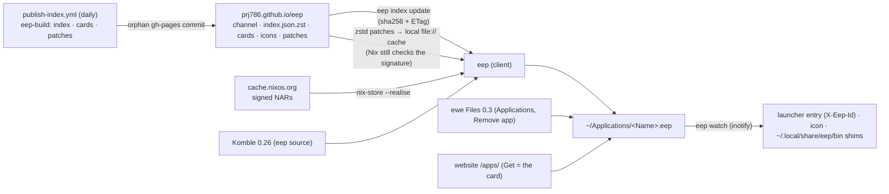

---
tags:
  - ewe-map
  - component
title: eep
up: "[[Home]]"
---

# eep — apps from the Nix binary cache

`~/Projects/ewe/eep` · [github.com/prj786/eep](https://github.com/prj786/eep)
(Rust workspace, GPL-3.0; **0.1.0-beta** released 2026-11-22 —
[[RFC-010 — eep]], decision 74). Data site:
**<https://prj786.github.io/eep>** (the repo's `gh-pages`).

ewe's app manager. **One card per app in `~/Applications`** (`Firefox.eep`,
a small TOML file with the app's icon inside): card there = app in the
launcher; card in the Trash = app gone; restored = app back with nothing to
download. pacman stays the system's manager (Rule 10); eep is opt-in
(`pacman -S eep` from `[ewe]`, or Komble), and nothing depends on it.

## The pieces

| crate / file | job |
|---|---|
| `crates/eep-core` | formats: store paths, nix-base32, narinfo, `.ls` listings, index, card, catalog, patch manifest, desktop entries, HTTP (IPv4/IPv6 race) |
| `crates/eep` | the client CLI: `install`, `remove`, `list`, `available`, `updates`, `update`, `rollback`, `gc`, `repair`, `watch`, `doctor`, `open`, `run`, `driver install` — JSON on stdout, exit 0 (Rule 5) |
| `crates/eep-build` | the server side: `releases`, `index`, `patches`, `cards`, `publish` (Nix eval in podman locally, native Nix in CI) |
| `catalog/apps.toml` | the apps eep offers (8 in 0.1: Firefox, LibreOffice, GIMP, VLC, Telegram, VSCodium, Calculator, ripgrep) |
| `packaging/` | the `eep` pacman package: driver timer (system), watcher + update timer (every user), the card MIME type + handler, `/var/cache/eep/local` (1777), `!include /etc/nix/eep.conf` added and removed by the install script |
| `.github/workflows/` | `ci.yml`; `release.yml` (tag `v*` → `eep-*.pkg.tar.zst` + the bare binary); `publish-index.yml` (daily data site) |

## Where it meets ewe

- **[[Komble]] 0.26.0-beta**: an "eep" source in Discover, an "eep apps"
  group in Installed and Updates, Settings › System "eep apps — Ready".
- **[[ewe-apps]] 0.3.0-beta** (ewe Files): Applications under Home in the
  sidebar, cards shown as their app (no `.eep`, embedded icon), **Remove
  app** for cards in Applications, Open runs `eep open`.
- **[[ewe-repo]]**: the publish workflow takes the newest eep release's
  package (opt-in, like ewe-safe) — ewe-repo#7.
- **[[Website]]** `/apps/`: Get downloads the card; `npm run apps` refreshes
  the page from an eep release.
- **ewe's launcher** (0.48.1-beta): file search skips hidden folders, so an
  app's insides never show up as results.

## Numbers

See `eep/bench/RESULTS.md` and [[RFC-010 — eep]]: weekly update 129 MB vs
542 MB, daily 7.4 %, warm launch within 2–5 % of pacman, delete → launcher
gone in 0.5 s. Costs: first install 2.9× pacman's bytes, disk 2.6×.

## Open

- Real GPU (bench B11) not run; a real systemd boot with the 0.1.0-beta
  package (the driver timer at install, the per-user watcher and timer) is
  not tested yet — the VM ran the prototype's `eep setup` path.
- `publish-index.yml` has rebuilt the current release once (byte-identical,
  nothing pushed); its patch step runs first on the next nixos-unstable
  release.
- Unfree apps (Chrome, Steam, Discord) are not in the cache — Komble keeps
  them.

## Related

- [[RFC-010 — eep]] · [[Komble]] · [[ewe-apps]] · [[ewe-repo]] · [[Website]] · [[Rules of the House]] · [[Troubleshooting Knowledge]]
