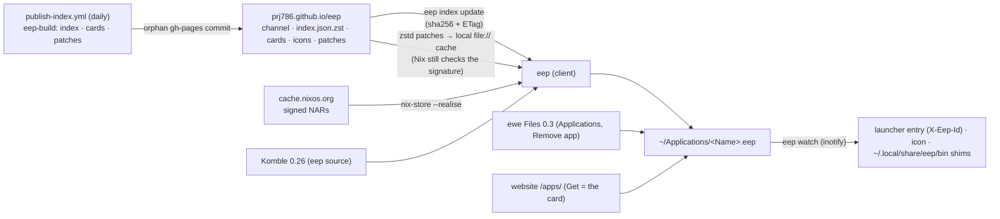

---
tags:
  - ewe-map
  - component
title: eep
up: "[[Home]]"
---

# eep — apps from the Nix binary cache

`~/Projects/ewe/eep` · [github.com/prj786/eep](https://github.com/prj786/eep)
(Rust workspace, GPL-3.0; **0.2.0-beta** released 2026-11-23 — every app
is a card, [[Every App Is a Card — eep finds what is installed]], decision
75; 0.1.0-beta 2026-11-22 — [[RFC-010 — eep]], decision 74). Data site:
**<https://prj786.github.io/eep>** (the repo's `gh-pages`).

ewe's app manager. **One card per app in `~/Applications`** (`Firefox.eep`,
a small TOML file with the app's icon inside): card there = app in the
launcher; card in the Trash = app gone; restored = app back with nothing to
download. pacman stays the system's manager (Rule 10). Since 0.2 / ewe
0.49 **every app has a card**: eep also *finds* the apps already installed
(pacman, Komble's AppImages, Steam games, the user's own entries, ewe's
apps) and gives each a `source = "system"` card (`sys-<desktop id>`) —
removing it hides the app, restoring shows it, nothing is downloaded or
uninstalled. ewe depends on eep (decision 75).

## The pieces

| crate / file | job |
|---|---|
| `crates/eep-core` | formats: store paths, nix-base32, narinfo, `.ls` listings, index, card, catalog, patch manifest, desktop entries, HTTP (IPv4/IPv6 race) |
| `crates/eep` | the client CLI: `install`, `remove`, `list`, `available`, `updates`, `update`, `rollback`, `gc`, `repair`, `watch`, `doctor`, `open`, `run`, `driver install` — JSON on stdout, exit 0 (Rule 5) |
| `crates/eep-build` | the server side: `releases`, `index`, `patches`, `cards`, `publish` (Nix eval in podman locally, native Nix in CI) |
| `catalog/apps.toml` | the apps eep offers (8 in 0.1: Firefox, LibreOffice, GIMP, VLC, Telegram, VSCodium, Calculator, ripgrep) |
| `packaging/` | the `eep` pacman package: driver timer (system), watcher + update timer (every user), the card MIME type + handler, `/var/cache/eep/local` (1777), `!include /etc/nix/eep.conf` added and removed by the install script |
| `.github/workflows/` | `ci.yml`; `release.yml` (tag `v*` → `eep-*.pkg.tar.zst` + the bare binary); `publish-index.yml` (daily data site) |

## Found apps (0.2)

`crates/eep/src/system.rs`: one pass per watcher event (the watcher also
follows `$XDG_DATA_HOME/applications` and every `$XDG_DATA_DIRS/*/applications`),
under eep's lock, before any download. `~/.local/state/eep/found.json`
records `{id: {entry, hidden}}`; hiding writes a full copy of the entry with
`NoDisplay=true` + `X-Eep-Hides=<id>` into `~/.local/share/applications`
(a user-level entry is copied aside to `~/.local/share/eep/hidden/` first);
icons follow the icon theme spec (theme → `Inherits` → hicolor → pixmaps,
`magick` for > 96 KB). The owner's machine (sandboxed HOME): 61 apps, 59
with an icon, 0.6 s for the first pass.

**Build-guard** (`eep/PROTOTYPE.md` §10, gotchas 33–38): hide with
`NoDisplay`, never `Hidden` (GIO would forget the app — ewe Files would
stop opening folders); a user-level entry replaces a system one entirely,
so the copy is the whole entry; never walk an icon theme (Reversal has
208,000 files); forget/hide only after a *sure* listing (a broken card or a
moved `~/Applications` changes nothing; the watcher never recreates the
folder after the first run); every index field is validated on fetch and
load (root's driver timer reads it — Fable's review found `release =
"/etc/cron.d"` and `eep remove '../..'` reaching outside eep's folders in
0.1); `OnlyShowIn` entries get cards (ewe's launcher shows them).

## Installing shows (0.3.0-beta, released 2026-11-23)

Owner, after a day on the real machine: a card dropped into Applications
"feels like installed but 1st start takes like forever", and a click on a
card should open "a dialog with icon and name top of the install button".
eep#3, with ewe-apps 0.4.0-beta and ewe 0.49.1-beta; the contract is
`eep/docs/CARD.md`, "While an app installs".

- **Ready or not.** An eep app can start when
  `$XDG_STATE_HOME/eep/roots/<id>` links to the card's `out`. A card that
  just arrived is not ready; a found app always is.
- **How far.** `$XDG_RUNTIME_DIR/eep/activity.json` lists what eep fetches
  now: `id`, `card`, `what` (install/update), `state` (waiting →
  downloading → finishing, or failed + `error`), `done`/`total`/`download`
  bytes, `pid` (an entry of a dead eep is ignored). Progress comes from
  Nix's own JSON log (`nix-store --realise --log-format internal-json`).
- **`eep add <card>`** = Install: the card MOVES into `~/Applications` and
  the app is fetched; not started. **`eep card <file>`** says what a card
  is before installing (`installed`, `ready`, `download`). **`eep open
  --ask`** (the card handler): an installed app starts; any other card goes
  to the installer (`ewe-files-app --install=<card>`, or `$EEP_INSTALLER`).
- **A card that arrives is installed as the index has the app today**
  (current version, patches; the card is rewritten) — only an app the index
  does not have is fetched as its card names it.
- **Robustness:** one app that can't be fetched never stops the others; a
  failed install is tried again by `eep watch` (20 s, then less often);
  taking the card out while it downloads stops the download; starting an
  installed app no longer waits for eep's lock.
- Tests: `test/run.sh install-flow.sh` in the container (real 264 MB
  download with progress, cancel, a bad card beside a good one, `--ask`).

## Where it meets ewe

- **[[Komble]] 0.26.0-beta**: an "eep" source in Discover, an "eep apps"
  group in Installed and Updates, Settings › System "eep apps — Ready".
- **[[ewe-apps]] 0.3.0-beta** (ewe Files): Applications under Home in the
  sidebar, cards shown as their app (no `.eep`, embedded icon), **Remove
  app** for cards in Applications, Open runs `eep open`.
- **[[ewe-repo]]**: the publish workflow takes the newest eep release's
  package — ewe-repo#7; **required** since ewe 0.49 depends on it (a
  missing package fails the fresh-install gate).
- **ewe 0.49.0-beta**: `depends` eep (phase 20 installs it for get.sh); the
  launcher leaves `~/Applications/*.eep` out of file results.
- **[[ewe-apps]] 0.3.1-beta**: a card with no eep says "update ewe" instead
  of opening as text.
- **[[ewe-apps]] 0.4.0-beta**: Applications is a
  place of apps — rings and "Installing 43%" on cards, its own menus, the
  Install view. It also fixes the frozen Applications folder (see
  [[Troubleshooting Knowledge]]).
- **ewe 0.49.1-beta**: the Hyprland rule `eep-install` floats the small
  Install window, centred, 400×380.
- **[[Website]]** `/apps/`: Get downloads the card; `npm run apps` refreshes
  the page from an eep release.
- **ewe's launcher** (0.48.1-beta): file search skips hidden folders, so an
  app's insides never show up as results.

## Numbers

See `eep/bench/RESULTS.md` and [[RFC-010 — eep]]: weekly update 129 MB vs
542 MB, daily 7.4 %, warm launch within 2–5 % of pacman, delete → launcher
gone in 0.5 s. Costs: first install 2.9× pacman's bytes, disk 2.6×.

## Open

- Real GPU (bench B11) not run; a real systemd boot with the 0.1.0-beta
  package (the driver timer at install, the per-user watcher and timer) is
  not tested yet — the VM ran the prototype's `eep setup` path.
- `publish-index.yml` has rebuilt the current release once (byte-identical,
  nothing pushed); its patch step runs first on the next nixos-unstable
  release.
- Unfree apps (Chrome, Steam, Discord) are not in the cache — Komble keeps
  them; since 0.2 they still get a found card.
- The catalog is 43 apps (0.2); `publish-index.yml` must rebuild the
  index with them (dispatched with the 0.2 release). Thunderbird was not
  in the cache for `2786a2a72088` (unavailable until Hydra has it).
- Found apps on the owner's real machine (first login with 0.2) and the
  real-GPU hour (B11) are the owner's checks.

## Related

- [[RFC-010 — eep]] · [[Komble]] · [[ewe-apps]] · [[ewe-repo]] · [[Website]] · [[Rules of the House]] · [[Troubleshooting Knowledge]]
