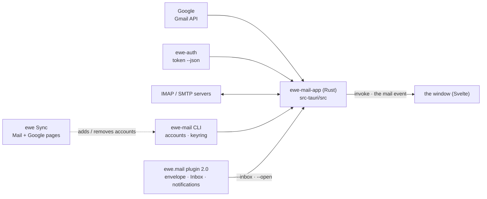

---
tags:
  - ewe-map
  - component
title: ewe Mail
up: "[[Home]]"
---

# ewe Mail — your mail in one window

`~/Projects/ewe/ewe-mail` · `github.com/prj786/ewe-mail`
(**public**) ·
Tauri 2.12 + Svelte 5 +
Tailwind 4 and the ewe design system (the [[ewe-sync]] stack) · package and
repo `ewe-mail`, binary **`ewe-mail-app`** (the core's `/usr/bin/ewe-mail` is
the CLI) · **0.1.0-beta, released 2026-11-27** (tag `v0.1.0-beta`, a GitHub pre-release with the Arch package; in `[ewe]`) ·
decision: [[ewe Mail — a window over your mail]]

**Gmail and any other mailbox, one inbox.** Read, reply, reply all, forward,
write, archive, delete, star, mark unread, move and search. Gmail works
through the owner's own Google client ([[Google Extras]], no Google client
ships — rule 7); every other account is added in ewe Sync → Mail with its
address and password and the servers are found for it. Plain-text compose
first; rich text later.

**Division of labour:** the window is this app; the bar envelope, the Inbox
page and the new-mail notifications are the [[Mail Plugin]] (layer-shell
surfaces stay in the shell — rule 3), which opens the app for every row and
notification (`ewe-mail-app --open <account> INBOX <id>`). **Accounts are
ewe Sync's** (rule 6): the app's "Add account" runs `ewe-sync --pane
mail|google`. Not resident ([[Apps Are Not Resident]]): the process ends with
its window.

## Getting it

**Preinstalled and preconfigured since ewe 0.51.0-beta** (released
2026-11-27, `[ewe]` publish run 45996222052): `ewe`'s PKGBUILD depends on
`ewe-mail`, phase 20 installs it on the get.sh path, and ewe-setup and phase 60
seed it as the `mailto:` default only where no mail app was chosen. An existing
machine gets it with `sudo pacman -Syu`; the next login refreshes an installed
Mail plugin to 2.0.0. The package is built by the repo's release workflow (a
GitHub pre-release per tag); `ewe` is only an **optional** dependency of the
package (a hard one back would be a cycle). The Mail plugin 2.0.0 needs it as
its one source.

## Where the accounts come from

| kind | id | read from | note |
|---|---|---|---|
| Gmail | `google:<email>` | `ewe-auth status` (signed in + an email), tokens from `ewe-auth token --json`, kept in memory, asked again 60 s before expiry | needs `gmail.modify`; `mail: read` means "Reconnect Google in ewe Sync to send and organise mail" |
| IMAP/SMTP | `imap:<email>` | `ewe-mail accounts`; password by `secret-tool lookup service ewe-mail host <host> user <user>` (the SMTP password the same with `smtp_host`/`smtp_user`) | an old record with no address is `imap:<user>@<host>` |

The list is read at start, on window focus when older than 30 s and after
`refresh_accounts`. Tools are found like every ewe app finds them
(`$EWE_REPO/bin`, `~/.local/share/ewe/bin`, `/usr/bin`) and run with a time
limit.

## How it is built

- Backend modules (`src-tauri/src`): accounts, imap, smtp, gmail, mime
  (parse and build), clean (HTML), threads, cache, sync, commands, settings,
  tools, launch. Crates: async-imap with rustls (IDLE), lettre (SMTP and the
  one message builder, also for Gmail's `raw`), mail-parser, ammonia, reqwest,
  rusqlite (bundled).
- Gmail: labels are folders (system labels read like every other account's),
  `threads.list` then `threads.get` metadata, open = `messages.get raw` through
  the same MIME path, `messages.batchModify` for flags and archive,
  `messages.send` with `raw` + `threadId`, `history.list` every 60 s while the
  window is open (404 re-baselines quietly). `EWE_MAIL_GMAIL_API` overrides the
  base URL (tests).
- IMAP: TLS always (993, or STARTTLS); plain only to loopback with
  `EWE_MAIL_INSECURE=1`; SPECIAL-USE roles; IDLE on INBOX (a server without it
  is polled every 2 min); `UID MOVE` or COPY + `\Deleted` + `UID EXPUNGE`.
  Threads for IMAP are a simplified JWZ over References / In-Reply-To /
  Message-ID (pure functions, unit-tested).
- **The cache** `$XDG_CACHE_HOME/ewe-mail/mail.sqlite`: rows, the Gmail
  `historyId` / IMAP `UIDVALIDITY` + highest UID per folder, the last 500
  opened messages, people seen, trusted senders. `conversations` answers from
  it at once and refreshes in the background; offline shows it with a banner.
  A `UIDVALIDITY` change drops that folder; an account that left the list has
  its rows deleted at the next start.
- **Settings** `[mail]` in `ewe.conf`, through `ewe-conf` (store-only):
  `remote_images` ask | always, `mark_read` open | manual, `signatures.<email>`
  ([[EWE-CONF Schema Reference]]). Unsent drafts: the webview's localStorage.
- **Command line (rule 5):** `--version`, `--status` and `--inbox` print one
  JSON line and exit 0 (`--inbox [--limit N]`, N 1–50, default 10, is the
  plugin's source: every account's inbox looked at now, then read from the
  shared cache — `{ok, unread, accounts, google, list, fetched_at}`, errors
  said in the JSON, 50 s at most; [[Contracts and Public API]]). `--status` is `{ok, accounts:[{id,kind,email,state,can_send}]}`
  from the tools alone, no network, no window). Launch arguments: `--open
  <account> <folder> <id>`, `--compose`, a `mailto:` address; a second launch
  tells the running window. See [[CLI Tools]].
- Dev: `npm run dev`, then `http://localhost:5178/?mock=1` (made-up accounts;
  `scene=empty|scope|offline|one`, `still`, `trace=1`, `slow=<command>`).

## What it takes on trust

- Passwords and tokens stay in Rust memory: never sent to the window, logged,
  on a command line or on disk. Every error is one readable sentence.
- Ids from the window are checked: the account must be in the list, the folder
  one of its folders, an IMAP id digits only, a Gmail id `[0-9a-f]{1,32}`.
- HTML mail: ammonia (no script, iframe, object, form, link, meta, base, `on*`,
  `javascript:`), then `iframe sandbox="allow-same-origin"` — never
  `allow-scripts` — with a CSP of its own (`default-src 'none'`, images
  `data:` until pictures are allowed). Clicks inside the frame are caught by the
  parent: http(s) opens in the browser, `mailto:` opens compose.
- Attachments go out by token only; opening one writes it under
  `$XDG_CACHE_HOME/ewe-mail/open/<random>/` (mode 0600, cleaned name) and runs
  `xdg-open`, **except** anything that runs by name, type or content
  (`.desktop`, `.sh`, `.exe`, `.AppImage`, `.jar`, `.py`, executables) — those
  are Save-only.
- Every network operation has a time limit; nothing goes through a shell.

## Where it landed (the 0.51 wave, released 2026-11-27)

| repo | PR · release | what |
|---|---|---|
| `ewe` | ewe#103 · 0.51.0-beta | `ewe-auth` (the Gmail scope, `scopes`, `mail`); `ewe-conf` store-only `accounts` and `mail` domains; `ewe-mail`: many accounts, an SMTP-tested login, `logout`, `set`, `accounts`, `autoconfig`, `unseen --all` |
| `ewe-sync` | ewe-sync#19 · 0.18.0-beta | the Mail page lists accounts with an email-first add sheet; the Google page shows the Gmail permission and a Reconnect button |
| `ewe` | (same PR) | ewe 0.51.0-beta: depends on `ewe-mail`, phase 20, the `mailto:` default seed, the MANUAL section; ewe.mail 2.0.0 vendored |
| `ewe-plugin-mail` | ewe-plugin-mail#3 (abcbb6d vendored) | **2.0.0**: ewe Mail is the one source (`--inbox`), the plugin polls nothing; rows and notifications open the app |
| `ewe-repo` | ewe-repo#10 | publish.yml carries ewe-mail (required: ewe depends on it) |
| `komble-arch` | komble-arch#27 · 0.26.2-beta | the name "ewe Mail" and the first-party DISCOVER entry |
| `prj786.github.io` | prj786.github.io#20 | the docs page `/docs/apps/mail`, the apps grid |
| `ewe-mail` | `main` · `v0.1.0-beta` | the app; crash.rs (`journalctl -t ewe-mail-app -p crit`) and pointer.rs like every ewe Tauri app |

**Existing Gmail users reconnect Google once in ewe Sync** (Disconnect → Connect):
an older token has only `gmail.readonly`, so Gmail reads but cannot send until
then.

## Tests

`npm test` 22/22 · `cargo test` 41 unit tests plus the end-to-end test ·
`tests/mail.sh` (the backend against loopback IMAP and SMTP servers and a fake
Gmail API, with fake `ewe-auth` and `ewe-mail` on a temporary `EWE_REPO`) ·
`tests/smoke.sh` (the CLI contract on the release binary) · a live run of the
real window in a headless cage against the same stand-ins. Core:
`tests/ewe-mail-test.sh` and `tests/ewe-auth-test.sh` pass. **Never** against
real mail, `ewe.conf`, keyring or Google account in automated tests; a live
run on real mail is the owner's call.

## Not done

Merging (waits for the release session) and the `[ewe]` publish (needs the owner's explicit OK); the website pages; rich
text; server drafts; a run against the owner's real accounts.

> **Build guard:** keep `@tauri-apps/api` and the `tauri` crate on the same
> major.minor — the skeleton copied ewe Mobile's `~2.11` pin while cargo
> resolved 2.12, and `tauri build` refused. The binary is `ewe-mail-app`, never
> `ewe-mail`. The window must never get `allow-scripts` on the mail frame.
> A live run in a headless cage needs `GIO_USE_VFS=local GVFS_DISABLE_FUSE=1`
> ([[Troubleshooting Knowledge]]).

## Related

- [[ewe Mail — a window over your mail]] · [[Mail Plugin]] · [[Google Extras]] ·
  [[Auth Broker]] · [[ewe-sync]] · [[ewe Mobile]] · [[Apps Are Not Resident]] ·
  [[Contracts and Public API]]
