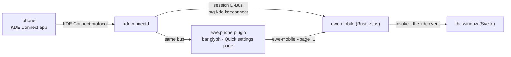

---
tags:
  - ewe-map
  - component
title: ewe Mobile
up: "[[Home]]"
---

# ewe Mobile — your phone on your desktop

`~/Projects/ewe/ewe-mobile` · `github.com/prj786/ewe-mobile` (**private for
now** — the owner, 2026-11-23) · Tauri v2 + Svelte 5 (the ewe Sync stack) ·
binary `ewe-mobile` · **0.1.0-beta released 2026-11-23** (`v0.1.0-beta` on
`ca5f921`) · decision: [[ewe Mobile — a window over KDE Connect]]

**One ewe window instead of KDE Connect's five.** `kdeconnectd` keeps the
link to the phone, the pairing keys and the caches; ewe Mobile is everything
you see of it, in the ewe design system. The phone runs the stock KDE Connect
app. An ewe app for Android is planned beside it (the owner, 2026-11-23:
"beside ewe mobile there will be apk for android … kde connect + more
stuff"); nothing is built for it yet.

**Division of labour:** the bar's phone glyph and the Quick settings *Mobile*
page are the [[Phone Plugin]]'s (layer-shell surfaces stay in the shell —
rule 3); the window is this app. The plugin's page has a button that opens
it.

## Getting it

The package is built by the repo's `release` workflow and sits on its GitHub
release. While the repo is private it is **not in `[ewe]`** — ewe-repo's
publish workflow cannot read another private repo's release with its own
token — and not on the website:

```
gh release download v0.1.0-beta -R prj786/ewe-mobile -p '*.pkg.tar.zst'
sudo pacman -U ewe-mobile-*.pkg.tar.zst      # brings kdeconnect; sshfs comes with ewe since 0.49.2
```

When it goes public: `ewe-mobile` joins ewe-repo's publish list as an opt-in
package (the ewe-safe pattern) and the website's apps.

## The pages

The ids are `ewe-mobile --page <id>` — public, never renamed with a label.

| id | page | what |
|---|---|---|
| `phone` | Phone | battery, mobile signal, ring it, send the clipboard or files, open its storage, the newest messages and notifications |
| `messages` | Messages | SMS/MMS as conversations: names and photos from the phone's contacts, picture attachments, links, search, a new message to a contact or a number; a sent message shows "Sending…" until the phone confirms it |
| `contacts` | Contacts | the phone's address book (read-only): search, message, have the phone dial, copy; readable while the phone is away |
| `notifications` | Notifications | by app: dismiss (on the phone too), reply where the app takes one; silent ones behind a switch |
| `media` | Media | the phone's player: play, pause, skip, seek, volume, which player |
| `files` | Files | send files (drop anywhere on the window), text, links; browse the phone's storage in ewe Files (`sshfs`); open what the phone sent |
| `remote` | Remote | this computer's mouse and keyboard on the phone |
| `devices` | Devices | pair/unpair, pick the phone in use, name this computer, switch single features on and off; the welcome while nothing is linked |

## How it is built



- `src-tauri/src/bus.rs` — the bus; a reply becomes JSON once, nothing models
  Qt's types. `kdc.rs` — every command. `events.rs` — ONE match rule for the
  `/modules/kdeconnect` tree, each signal one `kdc` event. `contacts.rs` —
  the vCards the daemon caches in `~/.local/share/kpeoplevcard/kdeconnect-<id>/`.
- **Keeps nothing**: no database, no copy of the messages; the window closes
  and the process ends ([[Apps Are Not Resident]]). The one thing remembered
  is which phone was in use (the webview's local storage).
- **Not in `ewe.conf`**: no key, no setting. Pairing keys are kdeconnectd's.
- Command line (rule 5 — JSON, exit 0): `--version`, `--status` (the daemon
  and its devices, **never starts the daemon**), `--page <id>` (a second
  launch tells the running window).
- `EWE_MOBILE_NO_DAEMON=1` — never start `kdeconnectd` (the bus starts it on
  ANY method call; a test on a private bus would be a new device on the
  network). The same guard as the plugin's `EWE_PHONE_NO_DAEMON`.

## What it takes on trust

The page shows text a phone wrote, so every command argument is treated as a
string someone else may have written (two independent reviews, 2026-11-23):

- **Only the daemon's signals count** — each is checked against the address
  that owns `org.kde.kdeconnect` at that moment. A match rule's `sender` is
  not enough: a signal sent straight AT a client is delivered whatever the
  rule says (`tests/origin.sh`: a stand-in daemon and an impostor on a
  private bus; with the check off, 16 of the impostor's 16 got through).
- Ids are letters, digits and `_` before they reach an object path.
- **Files open only if the phone sent them** (a fetched attachment; a
  received file written in the last minutes — the daemon also says
  "received" for a shared link, and a link can name any file).
- **Files are sent only if someone chose them:** the picker runs in Rust,
  a dropped file is one the window system reported as dropped.
- Web links only, digits for the dialler, nothing through a shell, a time
  limit on every call.
- With no-daemon asked, calls go to the daemon's own bus address, which the
  bus never starts anything for — no gap between "is it running?" and the
  call.

## Verified, and not

Verified 2026-11-23 on the owner's machine against a paired Pixel, reading
only: devices, battery, signal, 10 notifications with icons, 53 threads,
a conversation's messages as signals, 38 contacts with photos, the player
with its cover; the real binary's window (headless cage) on Devices and
Files. **Not verified on a phone:** everything that writes — sending a
message, replying to a notification, dismiss, pairing, ring, clipboard, file
send, the dialler, media controls, remote input, mounting storage. The D-Bus
bodies follow the introspected signatures; the first real send is the test.

> **Build guard:** SMS is on the **device** object (interface
> `org.kde.kdeconnect.device.conversations`), there is no `/conversations`
> child; a message is the **struct** `(i s a(s) x i i x i x a(xsss))` in a
> variant. `replyToConversation` does nothing, silently, for a thread the
> daemon has not cached. A second `requestAllConversationThreads` sends no
> message again — read `activeConversations()` first. See
> [[Troubleshooting Knowledge]].

## Tests

`npm test` (numbers, times, SMS parts, links) · `cargo test` (vCards, the
message decoder, events, ids) · `tests/smoke.sh` (the CLI contract on a
private bus) · `tests/origin.sh` (only the daemon's signals pass) · two `#[ignore]`d live tests that read the real phone and print
counts (`cargo test live_reads -- --ignored --nocapture`, `live_signals`).
The UI alone: `npm run dev` → `http://localhost:5177/?mock=1` (made-up
people; `scene=`, `scheme=`, `thread=`, `still`).

## Related

- [[Phone Plugin]] · [[Phone and VPN]] · [[ewe Mobile — a window over KDE Connect]] ·
  [[Process Split — Shell vs Apps]] · [[Apps Are Not Resident]] · [[ewe-sync]]
