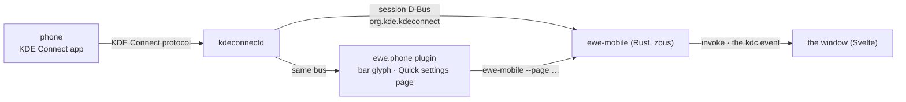

---
tags:
  - ewe-map
  - component
title: ewe Mobile
up: "[[Home]]"
---

# ewe Mobile — your phone on your desktop

`~/Projects/ewe/ewe-mobile` · `github.com/prj786/ewe-mobile` (**public**
since 2026-11-27, decision 82) · Tauri v2 + Svelte 5 (the ewe Sync stack) ·
binary `ewe-mobile` · **0.2.1-beta released 2026-11-27** (ewe-mobile#4,
`v0.2.1-beta` on the merge `e657066`: a phone app opened here no longer shows
a black window while the phone sleeps) · **0.2.0-beta 2026-11-26** (`d8f33b9`:
Screen, Apps, the C3 verbs — "one ecosystem") · **0.1.1-beta 2026-11-26**
(`c64a5b4`: the Remote page) · **0.1.0-beta 2026-11-23** (`ca5f921`) ·
decisions: [[ewe Mobile — a window over KDE Connect]],
[[RFC-012 — ewe Mobile, both halves]], [[ewe Mobile — one ecosystem]],
[[ewe Mobile — public and opt-in]]

**One ewe window instead of KDE Connect's five.** `kdeconnectd` keeps the
link to the phone, the pairing keys and the caches; ewe Mobile is everything
you see of it, in the ewe design system. The phone runs the stock KDE Connect
app, or — since 2026-11-26 — **ewe Mobile for Android**, a GPL fork of it with
ewe's face (below). **The plan is decided and built:**
[[RFC-012 — ewe Mobile, both halves]] (accepted 2026-11-26) — the phone's
folders in ewe Files ([[ewe-apps]] 0.5.0-beta), its screen and its apps as
windows through scrcpy over Wi-Fi debugging (the `screen` and `apps` pages
here, 0.2.0-beta), and the APK. "Imagine it as one ecosystem" (the owner):
the phone's notifications are ewe cards, no KDE Connect window shows
anywhere, the phone has a dock button — [[ewe Mobile — one ecosystem]].

**Division of labour:** the bar's phone glyph and the Quick settings *Mobile*
page, **the dock button and its popup**, and the notification cards are the
shell's and the [[Phone Plugin]]'s (layer-shell surfaces stay in the shell —
rule 3); the window is this app. The plugin's page has a button that opens
it.

## Getting it

An **opt-in package in `[ewe]`**, like [[ewe-safe]] (decision 82, 2026-11-27):
nothing installs it until you ask.

```
sudo pacman -S ewe-mobile       # brings kdeconnect and sshfs
```

The package is built by the repo's `release` workflow; ewe-repo's publish
workflow takes the newest release's package (a warning, not a failure, when
there is none). It `conflicts=('eep<0.4.1beta')`, so update eep first
(`sudo pacman -Syu`). `android-tools` and `scrcpy` are optional (Screen and
Apps; Komble offers them). The Phone plugin (bar glyph, Quick settings page,
dock button) is a separate install: Komble → Plugins → Phone. How a phone is
paired: [[Pairing a Phone]]. The next ISO (0.18.0-beta) is to offer ewe Mobile
and ewe Safe, unchecked, on its Apps screen.

## The pages

The ids are `ewe-mobile --page <id>` — public, never renamed with a label.

| id | page | what |
|---|---|---|
| `phone` | Phone | battery, mobile signal, ring it, send the clipboard or files, open its storage, the newest messages and notifications |
| `messages` | Messages | SMS/MMS as conversations: names and photos from the phone's contacts, picture attachments, links, search, a new message to a contact or a number; a sent message shows "Sending…" until the phone confirms it |
| `contacts` | Contacts | the phone's address book (read-only): search, message, have the phone dial, copy; readable while the phone is away |
| `notifications` | Notifications | by app: dismiss (on the phone too), reply where the app takes one; silent ones behind a switch |
| `media` | Media | the phone's player: play, pause, skip, seek, volume, which player |
| `files` | Files | send files (drop anywhere on the window), text, links; browse the phone's storage in ewe Files (`sshfs`); open what the phone sent |
| `remote` | Remote | this computer's mouse and keyboard on the phone: a pad (tap, hold-then-drag to swipe or long-press, the wheel turns the page, Back / Home / Recents) and a box that types into the field open on the phone. **The phone must allow it once** (below) |
| `screen` | Screen | the phone's screen in scrcpy's own window over Wireless debugging. Says what it costs first, pairs with the six-digit code once, then Mirror (phone's screen off, sound here, stay awake, a quality pick) |
| `apps` | Apps | the phone's apps with their real icons (from ewe Mobile for Android, kept while the phone is away), search; a click opens an app in its own window here when the debugging link is up, else on the phone; a menu offers both; each app can also sit in the launcher |
| `devices` | Devices | pair/unpair, pick the phone in use, name this computer, switch single features on and off; the welcome while nothing is linked |

## How it is built



- `src-tauri/src/bus.rs` — the bus; a reply becomes JSON once, nothing models
  Qt's types. `kdc.rs` — every command. `events.rs` — ONE match rule for the
  `/modules/kdeconnect` tree, each signal one `kdc` event. `contacts.rs` —
  the vCards the daemon caches in `~/.local/share/kpeoplevcard/kdeconnect-<id>/`.
- **Keeps nothing**: no database, no copy of the messages; the window closes
  and the process ends ([[Apps Are Not Resident]]). The one thing remembered
  is which phone was in use (the webview's local storage).
- **Not in `ewe.conf`**: no key, no setting. Pairing keys are kdeconnectd's.
- Command line (rule 5 — JSON, exit 0): `--version`, `--status` (the daemon
  and its devices, **never starts the daemon**), `--page <id>` (a second
  launch tells the running window), and since 0.2.0 the verbs of contract C3
  ([[Contracts and Public API]]): `--apps`, `--open-app`, `--screen`,
  `--adb-status`. The headless verbs never open the window and never start
  `kdeconnectd`.
- `apps.rs` — the list the phone sends (C1), checked key by key, the cache
  every reader shares (C2) and the launcher entries (C4); `adb.rs` — the
  debugging link and scrcpy's windows; `screen.rs` — the two pages' commands
  and the C3 verbs.
- `EWE_MOBILE_NO_DAEMON=1` — never start `kdeconnectd` (the bus starts it on
  ANY method call; a test on a private bus would be a new device on the
  network). The same guard as the plugin's `EWE_PHONE_NO_DAEMON`.

## The Remote page and the phone (0.1.1-beta, released 2026-11-26)

The pointer and the keys go out whether or not anyone is listening. An
Android phone takes them only once **KDE Connect is an accessibility
service** there (KDE Connect → "Some plugins need permissions" → Mouse
receiver → Accessibility settings; a copy from outside the Play Store first
needs "Allow restricted settings" in its App info). Until then it drops
everything silently — the page "kinda not working at all" (the owner,
2026-11-26; the phone had it off).

- Two things come back, and the page is built on them (KDE Connect for
  Android 1.36+): `remoteState` is true while the phone takes input — the
  page shows what to switch on while it is false — and every key the phone
  really typed is acknowledged (`keyPressReceived` → the `keyEcho` event).
  Keys with no answer went nowhere: no text field is open there.
- What a gesture means is in `src/lib/remote.js` (plain functions, tested):
  a press that stays put 450 ms puts the finger down (`singlehold`, lifted
  with `singlerelease`); right-click is Back on a phone, as in scrcpy.
- The typing box is a real, unseen `<textarea>`: a paste, a dead key and an
  input method reach it as text and go out as one packet a line
  (`text_send`).

## The screen and the apps (0.2.0-beta, released 2026-11-26)

- **The phone's apps come from ewe Mobile for Android.** It sends one entry per
  launchable app (name, package, a 96 px PNG of the launcher icon) through
  `kdeconnectd`'s `remotecommands`; a list without the `"ewe"` marker is
  someone else's and is ignored. The stock KDE Connect app shows "Install ewe
  Mobile on your phone" instead. The cache (`~/.cache/ewe-mobile/<device>/`)
  is written by this app and by the plugin's bridge, and is what makes the dock
  and the launcher work while the phone is away.
- **"Here" needs Wireless debugging** (adb + scrcpy, both optional packages,
  offered through Komble). Each window has a stable class
  (`ewe-mobile-screen`, `ewe-mobile-app-<package>`) through `SDL_APP_ID`; the
  mirrored screen floats at a phone's aspect (a rule in `hyprland.lua`), an
  app tiles like any app.
- **Every phone app is a launcher entry** `ewe-mobile-app-<package>.desktop`,
  marked `X-Eep-Skip=true` so eep makes no card of it. `NoDisplay` follows the
  setting "Show the phone's apps in the launcher". Entries of packages that left
  the list, and all of them when the phone is unpaired, are deleted.
- **Checked on the owner's phone** (a Pixel on Android 17, 2026-11-26):
  82 launchable apps (31 system) arrived, 604 KB with the icons; `--apps`
  wrote 82 icons; `--open-app com.google.android.calculator --here` gave a
  resizable window of that class; `--screen` gave `ewe-mobile-screen` titled
  with the phone's name; `triggerCommand` opened Calculator on the phone
  (background start through the accessibility service, phone unlocked);
  `--adb-status` picked the phone over an emulator.
- **The dock button** (ewe.phone, dock 1.5.1 on 2026-11-27) is on every display's dock.
- **Deploy order matters** — eep 0.4.1-beta first ([[Troubleshooting Knowledge]]).
  The package says so: `conflicts=('eep<0.4.1beta')`.

## ewe Mobile for Android

`~/Projects/ewe/ewe-connector-android` · `github.com/prj786/ewe-connector-android`
(#2, merged `ce3f5be1`) · GPL-3.0 · a fork of `kdeconnect-android`
(tag v1.37.3, remote `upstream`) · the app is **ewe Mobile**, id
`io.github.prj786.ewemobile` (debug: `….debug`) · **debug builds only — no
release key yet** (the owner's to make; no key is ever committed). Plan and
patch table: `docs/PLAN.md`; the face: `docs/EWE-UI.md` ([[ewe Mobile — one ecosystem]],
decision 81).

- **A product flavor.** The `ewe` flavor's source set `src/ewe/` (manifest,
  Compose theme generated from the design system's `tokens.json`, Geist,
  Lucide, the kit, the screens) merges over upstream's by name; upstream's
  `src/main` carries only the patch table — the id, the launcher activity
  forwarding every entry point to `EweActivity`, no Material You, `KdeTheme`
  wrapping `EweTheme`, the labels, two `packageName` fixes, and the launcher icon
  in notifications. Rebasing onto a new tag can only conflict in those rows.
  Tasks: `assembleEweDebug lintEweDebug testEweDebugUnitTest`.
- **The face:** Home (the computer at a glance), Devices, Setup (every
  permission), Settings; Remote, Media, Commands, Send, Ring and Presenter as
  feature screens. Tokens and glyphs are generated (`scripts/gen-theme.py`,
  `gen-lucide.py`, `--check` holds the copies to their sources).
- **`EweAppsPlugin`** sends the apps list (C1) and opens an app on
  `triggerCommand(<package>)`; `ewe:refresh` sends the list again.
- **Notifications carry the app's launcher icon**, not the large icon — the
  "initials" were Google Messages' letter avatar.
- **Checked:** 148 unit tests, lint and the token checks on the branch; on the
  owner's phone the merged build installed over the old one and kept pairing and
  the accessibility service. The stock KDE Connect app is **uninstalled** from
  that phone; the PC lists one paired phone.
- **Open:** the release key; getting it onto other phones; the link drops seen
  with two apps on one phone (the cause was not found).

## What it takes on trust

The page shows text a phone wrote, so every command argument is treated as a
string someone else may have written (two independent reviews, 2026-11-23):

- **Only the daemon's signals count** — each is checked against the address
  that owns `org.kde.kdeconnect` at that moment. A match rule's `sender` is
  not enough: a signal sent straight AT a client is delivered whatever the
  rule says (`tests/origin.sh`: a stand-in daemon and an impostor on a
  private bus; with the check off, 16 of the impostor's 16 got through).
- Ids are letters, digits and `_` before they reach an object path.
- **Files open only if the phone sent them** (a fetched attachment; a
  received file written in the last minutes — the daemon also says
  "received" for a shared link, and a link can name any file).
- **Files are sent only if someone chose them:** the picker runs in Rust,
  a dropped file is one the window system reported as dropped.
- Web links only, digits for the dialler, nothing through a shell, a time
  limit on every call.
- With no-daemon asked, calls go to the daemon's own bus address, which the
  bus never starts anything for — no gap between "is it running?" and the
  call.

## Verified, and not

Verified 2026-11-23 on the owner's machine against a paired Pixel, reading
only: devices, battery, signal, its notifications with icons, its message threads,
a conversation's messages as signals, its contacts with photos, the player
with its cover; the real binary's window (headless cage) on Devices and
Files. **Not verified on a phone:** everything that writes — sending a
message, replying to a notification, dismiss, pairing, ring, clipboard, file
send, the dialler, media controls, remote input, mounting storage. The D-Bus
bodies follow the introspected signatures; the first real send is the test.

**Remote, 2026-11-26:** every D-Bus method the app calls was held against
the live daemon's introspection with the phone in reach — one had drifted
(`sendKeyPress`, below). The Remote page's calls are tested against a
stand-in daemon on a private bus (`tests/remote.sh`), and the built binary
was driven with real pointer and key events under a headless `cage` (drag,
tap, hold-swipe, right-click, wheel, the three buttons, typing, a dead key,
a pasted selection) with the stand-in receiving each call. **Still not
verified on a phone that accepts input** — the owner's has to be switched on
first.

> **Build guard:** SMS is on the **device** object (interface
> `org.kde.kdeconnect.device.conversations`), there is no `/conversations`
> child; a message is the **struct** `(i s a(s) x i i x i x a(xsss))` in a
> variant. `replyToConversation` does nothing, silently, for a thread the
> daemon has not cached. A second `requestAllConversationThreads` sends no
> message again — read `activeConversations()` first.
> `remotekeyboard.sendKeyPress` takes **seven** arguments since 26.08
> (`key, specialKey, shift, ctrl, alt, super, sendAck`); with six, the last
> is read as `super`. A phone's `scroll` is not a distance: it adds `dy` up
> and turns one page past 500, forward when positive. A dead Remote page is
> the phone's accessibility switch before it is a bug. See
> [[Troubleshooting Knowledge]].
>
> **Build guard (0.2.0):** run ewe Mobile with an eep older than 0.4.1 and
> its 82 launcher entries become 82 `~/Applications` cards within a minute —
> deploy eep first (`conflicts=('eep<0.4.1beta')`); clean-up is deleting the
> `ewe-mobile-app-*` entries (eep retires the cards itself), never the cards
> (the watcher then hides the apps). `adb install -r` of an update keeps
> Android 17's accessibility service on; `am force-stop` switches it off.

## Tests

`npm test` (numbers, times, SMS parts, links) · `cargo test` (vCards, the
message decoder, events, ids) · `tests/smoke.sh` (the CLI contract on a
private bus) · `tests/origin.sh` (only the daemon's signals pass) ·
`tests/remote.sh` (the Remote page's calls arrive with the signatures the
daemon declares, and a key's acknowledgement comes back) · two `#[ignore]`d live tests that read the real phone and print
counts (`cargo test live_reads -- --ignored --nocapture`, `live_signals`).
The UI alone: `npm run dev` → `http://localhost:5177/?mock=1` (made-up
people; `scene=`, `scheme=`, `thread=`, `still`; for Remote `keyboard=1`,
`deaf=1`, and `trace=1` — every command the page sends, on the console).

## Related

- [[Pairing a Phone]] · [[Phone Plugin]] · [[Phone and VPN]] · [[ewe Mobile — a window over KDE Connect]] ·
  [[ewe Mobile — one ecosystem]] · [[eep]] ·
  [[Process Split — Shell vs Apps]] · [[Apps Are Not Resident]] · [[ewe-sync]]
