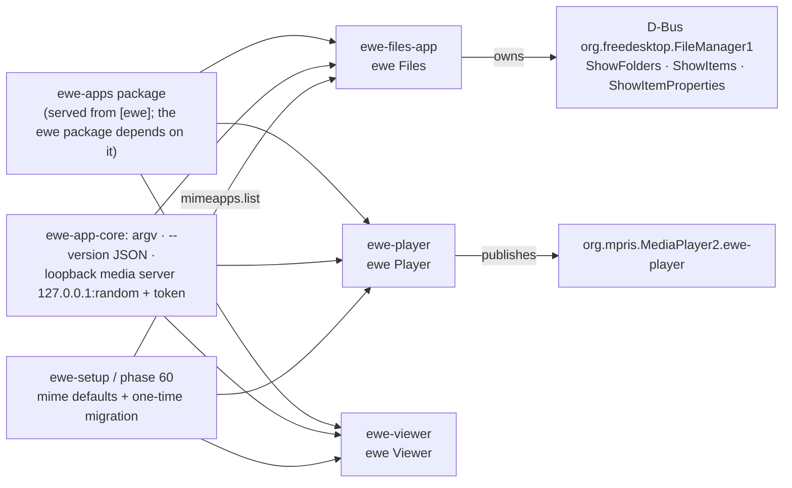

---
tags:
  - ewe-map
  - component
title: ewe-apps
up: "[[Home]]"
---

# ewe-apps — ewe Files, ewe Player, ewe Viewer

`~/Projects/ewe/ewe-apps` · [github.com/prj786/ewe-apps](https://github.com/prj786/ewe-apps)
(one repo, one package `ewe-apps`, three binaries; **0.1.0-beta** released
2026-11-19 with ewe 0.44.0-beta — decision 56, [[ewe's Own Apps — Files, Player, Viewer]];
**0.1.1-beta** released 2026-11-20; **0.2.0-beta built 2026-11-21, not released** — below)

The desktop's own file manager, media player and document/picture viewer.
They replace **Nemo, Engrampa, imv, Zathura and mpv** as the defaults
(mpv stays installed for `mpvpaper`). **Tauri 2 on the system WebKitGTK,
Solid + TypeScript + Vite in the window, Rust underneath, the UI ported from
ewe Browser** — the same material as ewe Browser's file manager, without
Electron. Shared code: the Rust crate `ewe-app-core` (`crates/core`: argv,
`--version`, the loopback media server, single instance) and the npm
packages `@ewe/shared` and `@ewe/ui`.



## The three apps

| app | binary · desktop id · `StartupWMClass` | what it takes | its own flags |
|---|---|---|---|
| **ewe Files** | `ewe-files-app` · `ewe-files-app.desktop` | folders (`inode/directory`), `x-scheme-handler/trash`, archives (zip, 7z, tar.*, rar, cpio, iso, jar, deb, rpm, apk — bsdtar/7zip, `unar` for RAR bsdtar cannot open) | `--select=<path>` (reveal), `--open-with=<path>` (the Open-with dialog on the parent), `--properties`, `--tab` (a tab in the focused window, else a new one), `--folders`, `--shot=<scene>`, `--shot-width=900`. Search everywhere uses `plocate` when installed. Terminal: `ewe-terminal-here`, then `$TERMINAL`, then kitty. Set as wallpaper: `ewe-conf set desktop.wallpapers.default …` + `wallpaper.sh --reapply`. Tools found through `$EWE_BIN`, then `~/.local/share/ewe/bin`, then `PATH` |
| **ewe Player** | `ewe-player` · `ewe-player.desktop` | video and audio (mp4, mkv, webm, mov, avi, wmv, flv, mpeg, ts, 3gp, ogg, m4v; mp3, m4a, flac, ogg/vorbis/opus, aac, wav, wma, aiff, mka, webm, m3u/pls playlists), folders, `http(s)://` URLs | `--enqueue`, `--scene=<name>` (`controls subs-menu audio-menu playlist mini music-albums music-album music-songs music-now music-playing`). Music library from `$EWE_MUSIC_DIR`, else `XDG_MUSIC_DIR`, else `~/Music`. Idle inhibit through `org.freedesktop.ScreenSaver.Inhibit`. Sets (only if unset) `WPE_SHELL_MEDIA_DISK_CACHE_SIZE_BYTES=536870912`, `…_NSEC=600000000000`, `WEBKIT_GST_ENABLE_HLS_SUPPORT=1`, `WEBKIT_GST_ENABLE_DASH_SUPPORT=1`. Codecs come from GStreamer: `gst-plugins-{base,good,bad,ugly}`, `gst-libav` (MPEG-4 Part 2, WMV/WMA, ALAC, AC-3, DTS), `gst-plugin-va` |
| **ewe Viewer** | `ewe-viewer` · `ewe-viewer.desktop` | PDF (pdf.js), EPUB, comics (cbz/cbr), pictures (png jpeg gif webp avif bmp svg tiff ico heif/heic jxl tga ppm xpm qoi), text and code (markdown, plain, log, csv/tsv, python, sh, c/c++, rust, go, json, yaml, toml, html), office (docx/doc/odt/rtf, xlsx/xls/ods, pptx/ppt/odp) | PDF: `--page=N`, `--find=text`, `--sidebar=pages\|contents`, `--mode=continuous\|single\|two`, `--zoom=page-width\|page-fit\|1.5`, `--night`, `--present`, `--fill=field=value`. Books: `--toc`, `--flow=paged\|scrolled`, `--theme=auto\|light\|sepia\|dark`. Comics `--spread`; Markdown `--source`; sheets `--sheet=N`; pictures `--info`, `--slideshow`, `--zoom=200` |

Common to all three (`ewe-app-core`, **contracts** — [[Contracts and Public API]]):

- **`--version`** prints one JSON object and exits 0 (rule 5):
  `{"ok":true,"name":"ewe-viewer","product":"ewe Viewer","version":"0.1.0-beta"}`
  (`name` = the binary, `product` = the display name).
- **Argv:** anything starting with `--` is a flag and takes its value as
  `--key=value` — *a flag's value is never a separate token* (so
  `--select <path>` does not work; `--select=<path>` does); `--` ends the
  flags; `file://` URLs are decoded, relative paths joined to the cwd;
  `--demo` opens the kit gallery. `glib::set_prgname(id)`, so the Wayland
  `app_id` = the binary = `StartupWMClass` (the shell's
  `Shell.entryForClass` finds the entry).
- **Single instance** (`tauri-plugin-single-instance`): a second launch
  emits `launch` into the running one. **Nothing stays resident** — closing
  the last window ends the process ([[Apps Are Not Resident]]).
- **The loopback media server:** `127.0.0.1:<random>`, a 32-byte hex token
  compared in constant time (no token → 403); routes `/raw/{name}?path=&t=`,
  `/thumb?path=&size=&t=`, `/cover?path=&t=`; single-range 206, ETag/304,
  regular files under absolute paths only. CORS: it **echoes back only the
  apps' own origins** (`tauri://localhost`, `http://tauri.localhost`,
  `http://localhost:*`, `http://127.0.0.1:*`) with `Vary: Origin`, answers
  the `Range` preflight (204, max-age 86400) and exposes `Accept-Ranges,
  Content-Range, Content-Length, ETag, Content-Type`.
  `EWE_APPS_MEDIA_SERVER_FILE=<path>` writes `{port, token}` (0600) for
  tests. (One AGENTS.md line still says `*`; the code reflects origins.)
- **Memory**, measured: ewe Files ~213 MB PSS (540 MB RSS), ewe Player
  ~189 MB PSS — a WebKit app each; none at idle, since none is resident.

## Narrow windows (0.1.1-beta, built 2026-11-20)

The owner: "file manager, not truly responsive". Window-level tiers on top of
the pane's own container tiers (one `ResizeObserver` in `App.tsx` sets
`data-size`; CSS containers on the root):

| app | tiers |
|---|---|
| ewe Files | **≥ 1100** as before · **760–1100** places 168 px (chips hidden), preview ≤ 38 % · **< 760** places become a drawer (places button; closes on a place, outside click, Esc) and Preview (F9) a right-side overlay — session only, `prefs.places`/`prefs.preview` untouched; Split · Preview · Operations · New window fold into one ⋯ · **< 480** the tabs scroll, others ellipsize at 96 px. Split (F3) refused with "Not enough room for two panes" under a 600 px main area (works from ≈ 770 with places shown — a half-screen tile at 800 is two 316 px panes). Properties / Compress fit 520 × 440 |
| ewe Player | music nav: a column ≥ 720, an icon rail below, a segmented control above the list below 520; the video bar below 560 (measured on the video area, mini player excluded) moves time, speed, picture, audio into ⋯ |
| ewe Viewer | PDF toolbar icon-only below 760, Find and the page modes into ⋯ below 560; the image info panel ≤ half the window |

Also: grid thumbnails ask for the smallest of 128/256/512 that covers the tile
at the screen's scale; the open tab always keeps its name; breadcrumbs scroll to
the current folder; toasts size to their text and header tooltips open below
(the shared UI kit, all three apps). Shots: `scripts/shot.sh … --shot-width=N
--shot-height=N` (Player and Viewer take them too since 0.1.1); Files scenes
`places`, `more`, `tabs`, `compress` are new. Open: drag-and-drop onto places
in a narrow window (the drawer closes when a drag starts).

## Links, languages, encodings, phone pictures (0.2.0-beta, built 2026-11-21 — not released)

Branch `feat/player-links` (merged with `feat/text-images`); decisions 68
and 70 ([[ewe Player Plays Links — yt-dlp]],
[[Every Script Reads Right — encodings, phone pictures, right-to-left]]).
Map: the repo's `AGENTS.md` "Links", "Errors", "Languages", "Text in any
encoding", "Phone pictures", "User text direction".

- **ewe Player plays web page links** — `ewe-player <url>`, Ctrl+L
  (*Open URL…*), a dropped/pasted link, an M3U of page links, ewe Browser's
  *Play in ewe Player*. `links.rs` `resolve_link`: direct media as is,
  else `yt-dlp -J` → HLS master / progressive / muxed HLS / DASH; split-only
  → *Open in mpv*; DRM → *locked*. Verified: YouTube, Twitch VOD + clip,
  BBC News, a CORS-less CDN `.mp4`, an M3U of two pages. Vimeo: DRM/login.
  No remux route yet.
- **Honest errors** — `media_support` (`{libav, ytdlp, mpv}`, once):
  gst-libav is named only when it is missing (`EWE_PLAYER_LIBAV=0|1`
  forces it); a web page is called a web page; yt-dlp's own sentence;
  the codec in words. Actions: Open with another app, Open in ewe
  Browser, Open in mpv, Try again, Next.
- **Track languages** — "English", "Русский · Commentary", "ქართული";
  *Preferred language* submenus (audio, subtitles; `auto` = the system's,
  which WebKit takes from the *installed* locale); bottom cues ride above
  the visible control bar (`--vp-cue-lift`).
- **Text in any encoding** — core `text.rs` + `/text` route (BOM → UTF-8 →
  UTF-16 → chardetng + encoding_rs, hinted by `Movie.ru.srt` or the
  locale): subtitles (*Subtitle encoding* menu), `.m3u` titles, the
  Viewer's text/Markdown/CSV (encoding button, `--encoding=`,
  `--encoding-menu`), Files' quick look + preview.
- **Phone pictures** — HEIC/HEIF/HIF through `heif-dec` into a cached
  upright JPEG (`/picture` route, `$XDG_CACHE_HOME/ewe-apps/pictures/`, LRU
  512 MB); AVIF and JPEG XL show natively; thumbnails for all three.
- **Right-to-left** — `dir="auto"` on every name/title/tag; Noto script
  faces before `system-ui` in both font stacks.
- **Packaging** — depends `+ yt-dlp` (pulls `yt-dlp-ejs` + `deno`),
  `+ libheif`; optdepends `+ mpv`.
- **Open:** the remux route for split-only sites; link drops from a
  browser (not exercised headless); ID3v1/Latin-1-frame tags in cp1251 still
  read as Latin-1 (lofty); copy / set-as-wallpaper of a HEIC uses the
  original.

## How the desktop wires them in (ewe 0.44.0-beta)

- **Package:** `ewe-apps` is a dependency of `ewe` (`PKGBUILD`), served
  from `[ewe]` — ewe-repo's `publish.yml` downloads the newest
  `prj786/ewe-apps` release and the fresh-install gate refuses a publish
  without it ([[ewe-repo]]). Phase 20 installs it on the tarball path
  (`install_release_pkg ewe-apps prj786/ewe-apps …`). The `ewe-apps`
  PKGBUILD's own depends: `webkit2gtk-4.1 gtk3 gst-plugins-{base,good,bad,ugly}
  gst-libav gst-plugin-va ffmpegthumbnailer libarchive 7zip`; optdepends
  `ewe`, `plocate`, `unar`. `pkgver` = tag without the dash
  (`v0.1.0-beta` → `0.1.0beta`), like the Tauri apps; `arch=(x86_64 aarch64)`.
- **Defaults** (`packaging/ewe-setup` and phase 60, `_mime`): seeded only
  where the user has no working explicit choice —
  `ewe-files-app.desktop` for `inode/directory` and the archive types,
  `ewe-viewer.desktop` for PDF, EPUB, comics, docx/xlsx/ods, csv and the
  common picture types, `ewe-player.desktop` for the video and audio types.
  **One-time migration** `_mime_take`: a user whose explicit default *is*
  `nemo.desktop`, `engrampa.desktop`, `imv.desktop`,
  `org.pwmt.zathura.desktop` or `mpv.desktop` is moved to the new app once;
  marker `~/.local/state/ewe/default-apps-0.44.done` (local, never synced),
  gated on `/usr/share/applications/ewe-files-app.desktop` being readable.
  ewe Settings → Default apps gained the rows **Music player**, **Document
  viewer** and **Archives** (0.24.0-beta — [[ewe-settings]]).
- **The shell:** `hyprland.lua` `fileManager = "ewe-files-app"` (Super+E);
  the launcher's *Open with…* runs `ewe-files-app --open-with=<path>` and
  *Open containing folder* `ewe-files-app <dir>` / `--select=<path>`;
  `warmup.sh` warms the three binaries; `start-hyprland.sh` falls back to
  `ewe-files-app.desktop`. Phase 90 checks `apps: ewe Files`, `apps: ewe
  Player + ewe Viewer` and `codecs: FFmpeg in GStreamer (gst-libav)`
  (`gst-inspect-1.0 avdec_h264`).
- **ewe Browser 0.8.4-beta:** *Play in ewe Player* runs `$EWE_PLAYER_BIN`
  (default `ewe-player`), falling back to `mpv --force-window=immediate`;
  the folder-default give-back names `ewe-files-app.desktop` ([[ewe-browser]]).
- **D-Bus:** ewe Files owns `org.freedesktop.FileManager1` at
  `/org/freedesktop/FileManager1` (zbus) — `ShowFolders`, `ShowItems`,
  `ShowItemProperties` each open a window with `--folders` / `--select` /
  `--properties`. The name is **simply not claimed while Nemo holds it**
  (stderr `ewe-files-app: FileManager1 not claimed: …`) — one reason to
  remove Nemo after the upgrade.
- **The Nemo files that stay conditional:** phase 30/60 copy the Nemo
  actions only when `command -v nemo`; the dconf terminal key moved to the
  path Nemo actually reads (`/org/cinnamon/desktop/applications/terminal`
  `exec='ewe-terminal-here'`, `exec-arg='-e'`).

## After the upgrade (the owner, once)

The package pulls the new apps in; pacman removes nothing on its own. The
old apps keep their window classes, their `FileManager1` claim (Nemo) and
their MIME registrations until removed:

```sh
sudo pacman -Rns nemo engrampa imv zathura zathura-pdf-mupdf mpv-mpris mpv-uosc-git
```

`mpv` **stays** — `mpvpaper` (live wallpapers) uses it, and ewe Browser's
fallback player is still mpv. `kdeconnect` (Phone plugin), `ewe-cast` and
`gnome-network-displays` (Cast plugin) are now installed by Komble from the
plugin's `requires` ([[The Package Diet]]); `base-devel` comes with the first
AUR build ([[Komble]]). A machine that already has them keeps them.

## Gotchas that cost a day (from `AGENTS.md`)

- **WebKitGTK refuses a module worker from `tauri://`** ("Load failed"):
  pdf.js's worker is imported into the main bundle and pdf.js falls back to
  `globalThis.pdfjsWorker` when it is already there.
- **Tauri's drag-drop swallows the DOM `drop`** (its handler returns true
  for any uri-list): drops are handled from `onDragDropEvent` by hit-testing
  `[data-drop]` under the pointer; DOM `dragover` still highlights, DOM
  `drop` is the fallback, deduped by time. Ctrl copies. Not exercised
  headless.
- **`fetch()` from the page needs CORS:** the webview is `tauri://localhost`,
  the media server `http://127.0.0.1`; ``/`<video>` never cared,
  `fetch()` (text, PDFs, books, sheets) failed with a bare "Load failed"
  until `server.rs` reflected the app origins and answered the `Range`
  preflight.
- **`tauri build` refuses an npm `@tauri-apps/api` whose major.minor differs
  from the `tauri` crate** — pin both (`tauri = "2"` → 2.12.x,
  `@tauri-apps/api ~2.12.5`, `@tauri-apps/cli ~2.12.6`); `~2.11` on the
  crate alone does not work. Build with the Tauri CLI, never bare `cargo
  build`.
- `notify` reports `OPEN` — drop `EventKind::Access` or a watcher that reads
  what it watches wakes itself ([[Troubleshooting Knowledge]]). A second
  window needs `win-*` in the capability. Events emitted before `listen()`
  are lost. `Builder::setup` is replaced by a plugin's — use a plugin.
- **Player:** WebKitGTK publishes its own MPRIS player
  (`org.mpris.MediaPlayer2.org.webkit.app-<hash>.Sandboxed.instance-N`) —
  the shell's now-playing has to skip `org.webkit.*` players (**not done in
  ewe yet**; the Music plugin will show two players until it is). WebKit's
  media download buffer: 5–20 MB videos with audio never started until the
  `WPE_SHELL_MEDIA_DISK_CACHE_*` values above.
- **A `crossorigin` `<video>` cannot play links** (0.2): CDNs (googlevideo,
  Twitch, BBC) send no `Access-Control-Allow-Origin`, so every remote load
  failed as "format not supported" — the owner's "Cannot play watch". Only
  the loopback server's files get `crossorigin`; links stay ≤ 100 % volume
  (Web Audio plays a cross-origin source as silence) and a link after a
  boosted file gets a fresh `<video>`.
- **WebKit's automatic caption selection** flips a track set to `showing`
  back off when more tracks arrive; the textTracks `change` event
  re-applies the choice. Bottom cues sat under the control bar until
  `--vp-cue-lift` moved the cue container (a `transform`, not `cue.line`).
- **`system-ui` is not a fontconfig family on Arch** — WebKit drew Arabic
  in FreeMono (unjoined) and Hebrew in FreeSans; name Noto faces first.
  `text-overflow: ellipsis` follows the clipping element's direction —
  `dir="auto"` goes on that element.
- `heif-dec` writes `out-1.jpg`, `out-2.jpg` … for bursts (`picture::settle`
  keeps the first); `chardetng` 1.0 has no confidence score (`confident` =
  same guess with and without the hint, no decode errors).

> **Build guard:** the three apps are **Tauri on the system WebKitGTK**, not
> Electron — no bundled runtime, no second browser engine
> ([[Process Split — Shell vs Apps]]). The binaries, desktop ids, the
> `--version` JSON, `--select=`/`--open-with=`, `EWE_PLAYER_BIN` and the
> `FileManager1` ownership are contracts (rule 4): ewe's launcher, ewe
> Browser, `ewe-setup` and the shell bind to them. *Breaks if violated:*
> "Open containing folder", "Play in ewe Player" and every mime default on
> installed machines. Since 0.2: `ewe-player <http(s)-url>` is public too;
> never put `crossorigin` on a remote `<video>`, never blame gst-libav
> without `media_support`, decode user text only through the core's `/text`.

## Related

- [[ewe's Own Apps — Files, Player, Viewer]] · [[The Package Diet]] ·
  [[Apps Are Not Resident]] · [[ewe Desktop]] · [[ewe-browser]] ·
  [[ewe-settings]] · [[ewe-repo]] · [[Contracts and Public API]] ·
  [[Version Ledger]]
