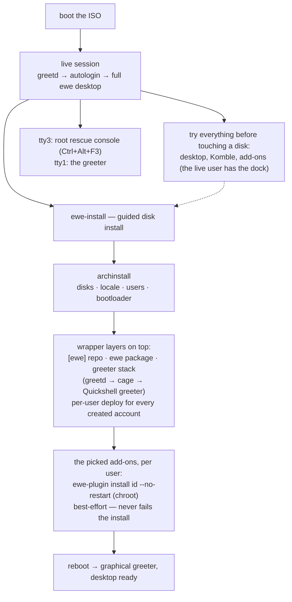

---
tags:
  - ewe-map
  - component
title: ewe-os ISO
up: "[[Home]]"
---

# ewe-os — the Distro / ISO

`~/Projects/ewe/ewe-os` · [github.com/prj786/ewe-os](https://github.com/prj786/ewe-os) ·
**0.15.0-beta** released 2026-11-01 (the ISO for ewe 0.37: the installer signs you in — *Your ewe account*, ewe-os#19); before it **0.14.0-beta** released 2026-10-23 (the ISO for ewe 0.35: all 16 plugins in the installer, ewe-os#18; before it 0.13.0-beta on 2026-10-04, the ISO for ewe 0.25's plugins, ewe-os#15; distro has its own version line; the DE's `ewe` package has another)

The distro layer: the **archiso profile** that builds the live/install ISO.
The DE, apps and packaging live in their own repos — this one turns them
into a bootable distribution.

## Build

```sh
sudo pacman -S archiso
sudo ./build.sh          # → out/ewe-0.1-alpha-x86_64.iso
./run-iso.sh             # boot it in QEMU/KVM (UEFI)
```

The profile (`iso/`) derives from archiso's **releng v89**: its full rescue
toolbox is kept, networkd/iwd are swapped for NetworkManager (what the DE
uses), and greetd + the live user service are enabled on top.

## What the ISO does



- **First start** — the DE deploys itself via `ewe-setup` from the
  preinstalled `ewe` package, at boot, under the plymouth splash.
- **Rolling forward** — the ISO pins nothing; the `[ewe]` pacman repo is
  preconfigured, so live and installed systems update with plain
  `pacman -Syu`. See [[Packaging and Updates]].

## The installer app

`installer/` is a **Tauri GUI (`ewe-installer`)** — the guided install's
face (RFC-003 in `ewe-os/docs/`): Welcome · Network · Time & place · Disk ·
Your login · **Your ewe account** (0.15.0-beta) · **Plugins** (0.13.0-beta) ·
Summary · Install. Nothing privileged runs in the app: every step is a verb
of the pkexec'd `installer/helper/ewe-install-helper` (`partition mkfs
pacstrap hibernate settz setlocale sethostname user layer upgrade account
addons bootloader reboot`);
`layer` and `addons` delegate to `ewe-install --layer-only` /
`--addons-only` — one implementation, two faces.

**The Plugins step** lists every plugin the live payload carries
(`/usr/share/ewe/plugins/bundle.json` + manifests, read by the backend's
`addons` command — no user config needed), grouped by category, with the
manifest's Theme icon name mapped to the bundled Lucide face. **Nothing is
pre-checked** ([[Add-ons — opt-in, not preinstalled]]); the Dock row says
*Recommended if you like a dock*. The picks are installed after
`ewe-setup` (which on a fresh account runs `migrate --fresh` and installs
nothing) as the new user in the chroot — `ewe-plugin install <id>
--no-restart`, Hyprland/Wayland/D-Bus variables dropped — each one
best-effort: `{"addon":id,"ok":false}` is shown on the Done screen and the
install still succeeds. An ISO with an older ewe (no `bundle.json`) has no
such step. TUI: `ewe-install --addons id,id`, a prompt in guided mode.
Signed in with a backup (0.15.0-beta), the backup's first-party plugins are
**pre-checked** (*From your account*) — the owner's call: bring back what
you had, turn on anything else; a skipped account keeps D1 (nothing
pre-checked).

**Your ewe account** (0.15.0-beta, [[Sync — sign in once, everything
follows]]) — sign in or skip. The backend (`installer/src-tauri/src/
account.rs`) drives the live system's `ewe-cloud login` in a private 0700
config under `$XDG_RUNTIME_DIR` with ewe-cloud's file keyring (the live
user's keyring is never involved) and reads the backup with `ewe-conf
pull --out` + `dump`. The `account` verb (after `upgrade`, before
`addons`) takes `<user> <server> <login> <yes|no>` with **both passwords
on stdin**: it creates the new user's **login keyring with the login
password** (`gnome-keyring-daemon --unlock` in a private D-Bus session,
`default` = `login`) and stores the app password there — PAM unlocks the
same keyring at the first login, so the first boot is signed in — writes
`cloud.json`, and with `yes` runs `ewe-conf pull` + `apply --no-hooks` as
the user (recorded as synced; Welcome then skips its restore step). The
TUI has no account step yet.

**The live session** is the one non-opt-in place: a fresh 0.25 account has
no dock, and the stick pins *Install ewe* in the dock — so
`ewe-live-deploy` installs `ewe.dock` for the live user only (the installer
also autostarts and is first in the launcher). Installed systems get
nothing they did not pick.

## Docs in-repo

- `docs/INSTALL.md` — the install guide
- `docs/TROUBLESHOOTING.md` — problems

## Related

- [[Install Flow]] · [[ewe-repo]] · [[ewe Desktop]] · [[Website]]
