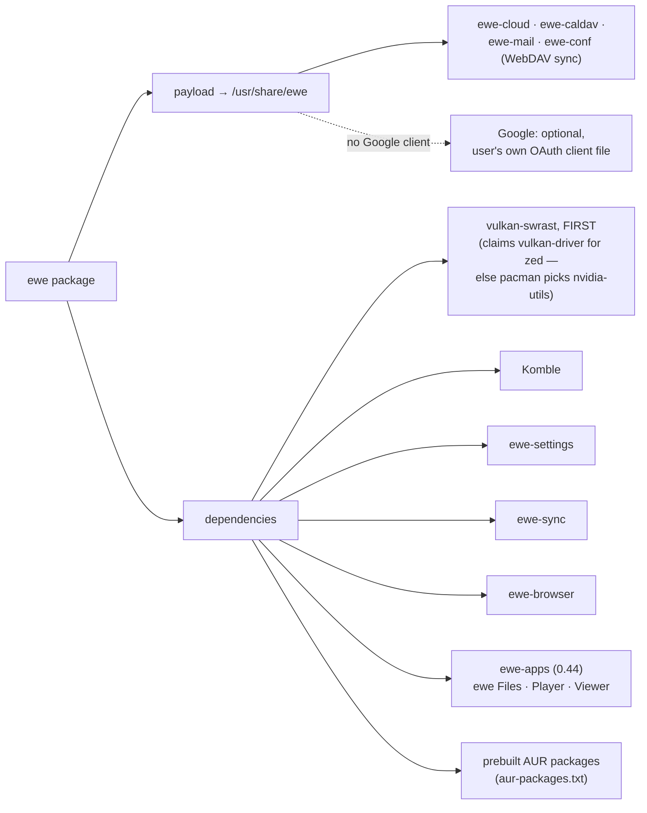

---
tags:
  - ewe-map
  - component
title: ewe-repo
up: "[[Home]]"
---

# ewe-repo — the pacman repository

`~/Projects/ewe/ewe-repo` · [github.com/prj786/ewe-repo](https://github.com/prj786/ewe-repo)

The pacman repository for the ewe desktop. The rolling **x86_64** release of
this repo *is* the repository: `ewe.db` plus every package, rebuilt by the
`publish` workflow and hosted as a GitHub release.

## Use it

```ini
[ewe]
SigLevel = Optional TrustAll
Server = https://github.com/prj786/ewe-repo/releases/download/x86_64
```

(`ewe`'s `install.sh` appends this to `/etc/pacman.conf` for you.)

```sh
sudo pacman -Syu        # updates the DE like any other package
sudo pacman -S ewe      # or: pull the whole desktop onto a fresh Arch install
```

## What `pacman -S ewe` pulls



Since 0.44 ([[The Package Diet]]) `ewe-cast`, `gnome-network-displays`,
`kdeconnect`, `qt5-wayland`, `base-devel`, the old GTK apps and `mpv-uosc-git`
are **not** pulled by `ewe`: plugins' `requires` (Komble installs them with
the plugin) and Komble's `ensure_build_tools` cover them.

## Publish

The `publish` workflow rebuilds everything from the latest releases and AUR
PKGBUILDs and recreates the x86_64 release. Triggers:

- manual `workflow_dispatch`
- a `repository_dispatch` of type `publish`
- the **Monday cron**

Run it after any ewe / komble-arch / ewe-settings / ewe-sync / ewe-browser /
ewe-apps release. Since 2026-11-19 (ewe-repo#6) it downloads the newest
`prj786/ewe-apps` release too (`gh release download … --pattern
'*.pkg.tar.zst'`; a missing release is a warning the gate then turns into a
refusal).

**The fresh-install gate** resolves `pacman -Sp … gate/ewe` against the
freshly built database and refuses the publish when the tree contains
`jack2`, `tesseract-data-afr`, `papirus-icon-theme`, `iwd` or — since
2026-11-19 — **`nvidia-utils`** (the `vulkan-driver` pull, [[The Package Diet]]).

## Known state

- Packages are currently **unsigned** (`SigLevel = Optional TrustAll`);
  repo signing is planned before the standalone-distro release.
- `pkgbuilds/` holds the package recipes; the `aur-packages.txt` list names
  the AUR packages that get prebuilt so users never build them
  (`mpv-uosc-git` left it 2026-11-19; `gnome-network-displays` stays, for
  the Cast plugin's `requires`).
- `reversal-icon-theme` **pkgrel 2** (2026-11-19): `hardlink -q -c
  usr/share/icons` — the 24 colour variants are full copies differing in
  ~285 of ~10,660 files; hard-linked they take **~14 MiB installed instead
  of 416 MiB** (~1.9 GB on a btrfs disk), and every icon is still a regular
  file to the loaders.

## Related

- [[Packaging and Updates]] · [[Update Flow]] · [[Komble]] ·
  [[ewe-os ISO]]
