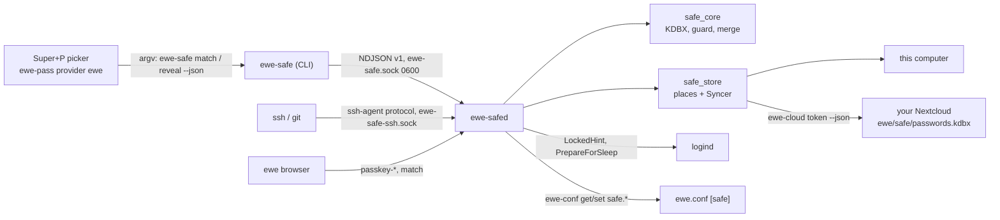

---
tags:
  - ewe-map
  - component
title: ewe-safe
up: "[[Home]]"
---

# ewe-safe — Safe, the password manager

`~/Projects/ewe/ewe-safe` · [github.com/prj786/ewe-safe](https://github.com/prj786/ewe-safe) ·
Rust workspace (keepass-rs, vendored with one fix) · [[RFC-008 — ewe Safe]] ·
**0.2.0-beta released 2026-10-15** (0.1.0-beta the same morning), opt-in
from `[ewe]` (`pacman -S ewe-safe`; the desktop plugin: [[Safe Plugin]]) —
[[Roadmap — ewe-safe]].

One KDBX 4 file in a **place** you pick, held unlocked by a small daemon,
filled into any app with `Super+P` through the [[Passwords Plugin]]
(provider `ewe`). KeePassXC and the phone apps open the same file.

## The parts

| crate | what |
|---|---|
| `core` (`safe_core`) | open/create/save a KDBX file with a verified atomic write; the item model (Login, Note); the **write guard** (anything keepass-rs would drop → read-only); search; generator; TOTP; **Safe's own merge** |
| `store` (`safe_store`) | places (`local`, `nextcloud`/WebDAV) with their conflict guard; the `Syncer`: cache, 20 backups, `sync.json`, stale → fetch, merge, verify, retry, pending offline, rollback warning |
| `daemon` (`ewe-safed`) | socket-activated user service; holds the key only while unlocked; locks on screen lock, sleep, idle, `lock`; syncs on change, unlock, nudge, every 5 min |
| `cli` (`ewe-safe`) | the JSON verbs of `docs/PROTOCOL.md` v1 |

The contract is `ewe-safe/docs/PROTOCOL.md` (verbs, shapes, error codes,
socket, events); the format and merge rules are `docs/FORMAT.md`; the
places and sync engine are `docs/PLACES.md`.

The window is `ewe-safe-app` (Tauri v2 + Svelte 5, single instance;
`--unlock` = the compact unlock window, class `ewe-safe-unlock`, floated by
`hyprland.lua`; `--show <id>`, `--new`, `--import`). `ewe-safe unlock --ask`
opens it (the kitty prompt only when the window isn't installed). Import
from 1Password: `.1pux`, CSV, or live through `op` (`docs/IMPORT.md`).

## New in 0.2.0-beta (released 2026-10-15)

The owner's "a real safe" ([[RFC-008 — ewe Safe]] → Amendment 2026-10-15;
contract `docs/TRIO.md`). The four PRs landed together through ewe-safe#14
(`integrate/trio`); bump #15, tag `v0.2.0-beta` on `75d2502`, package
`ewe-safe-0.2.0beta-1`; published to `[ewe]` on 2026-10-15. After the
upgrade: `systemctl --user daemon-reload && systemctl --user restart
ewe-safe.socket` (the socket unit gained the agent's socket; this locks the
safe).

| what | PR | in short |
|---|---|---|
| a CLI like `op` | ewe-safe#10 | `read "safe://Personal/GitHub/password"`, `run --env-file .env -- cmd`, `inject -i tpl -o out` (0600), `git-credential` (strict host match; asks before saving; never deletes). Socket verb `resolve`; error `ambiguous` |
| passkeys | ewe-safe#11 | KeePassXC's `KPEX_PASSKEY_*` fields + tag `Passkey`; ES256, EdDSA; socket verbs `passkey-list/create/get` for ewe browser; `ewe-safe passkey list`, `edit --remove-passkey`; summary `passkey`; errors `excluded`, `unsupported`; the window shows a passkey row |
| the window's edit fix | ewe-safe#12 | 0.1.0-beta threw `ReferenceError` on every save of an edited login; after Add it selected the request id instead of `item_id`. Fixed in 0.2.0-beta |
| SSH keys + agent | ewe-safe#13, ewe#59 | kind `ssh-key` (KeeAgent format); `ewe-safe ssh add/new/list/adopt/enable/disable/status`; the agent on `ewe-safe-ssh.sock`, lists keys while locked from `ssh-public.json`, asks per program (`ssh_confirm`); 1Password's SSH Keys now import as keys, `ssh adopt` converts the notes an earlier import made |

`ewe-safe ssh enable` writes `~/.config/environment.d/90-ewe-safe-ssh.conf`;
an `IdentityAgent` line in `~/.ssh/config` (1Password's, on the owner's
machine) still wins over `SSH_AUTH_SOCK` — put the line `enable` prints there.

## What 0.2.0-beta cannot do yet

No unlock with login/fingerprint (polkit); places other than this computer
and Nextcloud say "Coming soon"; no export; not in Komble's lists yet. Not
yet tried for real: a passkey on a real site, `git push` through the agent,
the agent's approval window on screen.

## Related

- [[RFC-008 — ewe Safe]] · [[Roadmap — ewe-safe]] · [[Passwords Plugin]] ·
  [[Account and Sync]] · [[Storage Map]]

> **Build guard:** PROTOCOL.md is public API (rule 4) — add fields, never
> rename; the master password never enters the shell; tests run only in XDG
> sandboxes against the mock WebDAV server, never the live account, the live
> safe, `~/.ssh` or a live browser profile. Passkeys and SSH keys keep
> KeePassXC's formats (checked against its source; the passkey fixture is
> KeePassXC-made, an SSH one is still to add); Safe never trusts an origin a
> page sent; `ssh_confirm` is not a security boundary.
