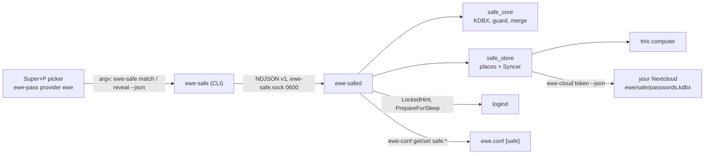

---
tags:
  - ewe-map
  - component
title: ewe-safe
up: "[[Home]]"
---

# ewe-safe — Safe, the password manager

`~/Projects/ewe/ewe-safe` · [github.com/prj786/ewe-safe](https://github.com/prj786/ewe-safe) ·
Rust workspace (keepass-rs, vendored with one fix) · [[RFC-008 — ewe Safe]] ·
**0.1.0-beta released 2026-10-15**, opt-in from `[ewe]` (`pacman -S ewe-safe`;
the desktop plugin: [[Safe Plugin]]) — [[Roadmap — ewe-safe]].

One KDBX 4 file in a **place** you pick, held unlocked by a small daemon,
filled into any app with `Super+P` through the [[Passwords Plugin]]
(provider `ewe`). KeePassXC and the phone apps open the same file.

## The parts

| crate | what |
|---|---|
| `core` (`safe_core`) | open/create/save a KDBX file with a verified atomic write; the item model (Login, Note); the **write guard** (anything keepass-rs would drop → read-only); search; generator; TOTP; **Safe's own merge** |
| `store` (`safe_store`) | places (`local`, `nextcloud`/WebDAV) with their conflict guard; the `Syncer`: cache, 20 backups, `sync.json`, stale → fetch, merge, verify, retry, pending offline, rollback warning |
| `daemon` (`ewe-safed`) | socket-activated user service; holds the key only while unlocked; locks on screen lock, sleep, idle, `lock`; syncs on change, unlock, nudge, every 5 min |
| `cli` (`ewe-safe`) | the JSON verbs of `docs/PROTOCOL.md` v1 |

The contract is `ewe-safe/docs/PROTOCOL.md` (verbs, shapes, error codes,
socket, events); the format and merge rules are `docs/FORMAT.md`; the
places and sync engine are `docs/PLACES.md`.

The window is `ewe-safe-app` (Tauri v2 + Svelte 5, single instance;
`--unlock` = the compact unlock window, class `ewe-safe-unlock`, floated by
`hyprland.lua`; `--show <id>`, `--new`, `--import`). `ewe-safe unlock --ask`
opens it (the kitty prompt only when the window isn't installed). Import
from 1Password: `.1pux`, CSV, or live through `op` (`docs/IMPORT.md`).

## What 0.1.0-beta cannot do yet

No unlock with login/fingerprint (polkit); places other than this computer
and Nextcloud say "Coming soon"; no export; the ewe browser integration
waits for the owner's review; not in Komble's lists yet.

## Related

- [[RFC-008 — ewe Safe]] · [[Roadmap — ewe-safe]] · [[Passwords Plugin]] ·
  [[Account and Sync]] · [[Storage Map]]

> **Build guard:** PROTOCOL.md is public API (rule 4) — add fields, never
> rename; the master password never enters the shell; tests run only in XDG
> sandboxes against the mock WebDAV server, never the live account.
