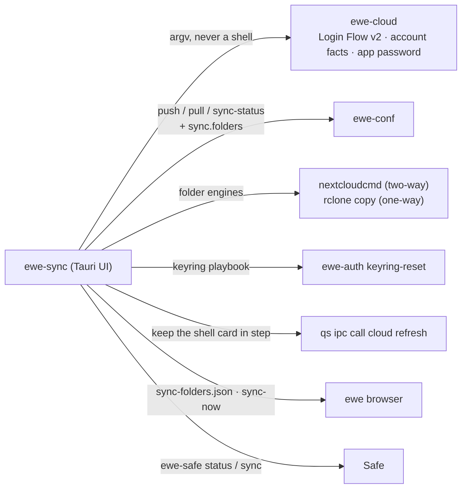

---
tags:
  - ewe-map
  - component
title: ewe-sync
up: "[[Home]]"
---

# ewe-sync — the account & sync app

`~/Projects/ewe/ewe-sync` · [github.com/prj786/ewe-sync](https://github.com/prj786/ewe-sync) ·
Tauri v2 + Svelte 5 · RFC-006 (drafted under the working name **Flock**)

**Your ewe account, in one place** — sign in once and everything follows:
settings and apps (the one file, `ewe.conf`), the browser, passwords (Safe)
and folders, on every computer you sign in to. The bar shows the state; the
window opens on the Overview ([[Sync — sign in once, everything follows]]).

**Division of labour:** Komble installs apps and records them in the one
file; ewe-settings edits the one file; **ewe-sync moves the one file and
your folders between your machines**. Nothing else in ewe has a sync button.

## The panes

| pane | what |
|---|---|
| Overview | (2026-10-31) everything the account keeps: settings & apps, browser, passwords, folders — state + this computer's switches (`sync.enabled`, `sync.browser`), one Sync now for everything; **Bring everything back** on a new computer (`restore_preview` reads the backup with `ewe-conf pull --out` first); the folders worth keeping on the first computer |
| Account | sign in to *your* Nextcloud (any provider, or your own server) through the server's own login page; who you are, storage; sign out; links to provider signup pages |
| Mail | any IMAP mailbox — add, change, remove, check unread. Password → keyring; only host/user/port reach `ewe.conf` |
| Google | the optional extra: where your own `oauth-client.json` goes, connect/disconnect, Gmail + Drive state. ewe ships no Google client |
| Settings & apps | (was "This machine"; route id `machine`) the one file: backup saved by which machine and when, last sync, auto-sync switch, Sync now / Back up / Restore |
| Machines | every machine that backed up to the account, with its ewe version and app count |
| Folders | every connected folder: ewe-sync's (open, sync now, pause on this computer, change, stop syncing), suggested user folders (one click), the Nextcloud app's (*Let ewe-sync take over*), the whole account (`~/Nextcloud`); a picker for the account's folders; conflicts resolved in place |

**The bar's sync glyph** (signed-out · offline · syncing · conflict · idle;
`qs ipc call sync state <state> <detail>`, public API — IpcHub.qml) is fed
from Rust since 2026-11-19: `src-tauri/src/bar.rs` reads `ewe-cloud status`
and `ewe-conf sync-status` every 2 min, the folder runner reports every
change, Sync now / Bring everything back hold a busy guard. Until 0.16.2 the
page's Svelte store derived it and poked the shell, which is why
`ewe-sync --hidden` had to keep a WebKit page alive all session (~180 MB
idle). **The window exists only while it is on screen**: built on demand
(`tray.rs show_main`, not declared in tauri.conf.json), destroyed on close
with its web process terminated (`terminate_web_process` — WebKit would
otherwise cache the page-less process for 30 min), and the process stays
(`RunEvent::ExitRequested` → `prevent_exit`). Hidden it costs ~20 MB. A
deep link (`--pane`, `--add-folder`, the conflict notification) is stored
first and the page told to take it, so a window built for it opens on the
right pane (decision: [[Apps Are Not Resident]], ewe Sync 0.17.0-beta). No
tray icon since 0.13. Command line:
`--hidden`, `--pane <id>`, `--add-folder <path>` (both reach a running
app), `--status` (prints `sync-folders.json`), `--check`.

**The conflict banner** (This machine: *Restore… / Push anyway*) and the
bar's conflict state key on `sync-status`'s **`conflict`** (an older
ewe-conf: `!in_sync` with a remote). Until 2026-10-10 they keyed on
`error`, which `sync-status` never set to a conflict — a refused machine
had **no way out** in the UI ([[Sync Conflicts Are About Content]]). The
banner says "this computer" when `remote_is_this_machine`; *Sync now* on a
conflict jumps to This machine. dev-mock: `?mock=1&conflict=newer|mine|exists`.

## How it works — a thin UI over the ewe tools

Nothing needs root; there is no privileged helper. Storage layout and
conflict rules: [[Account and Sync]].

## What it cannot do

**Create accounts.** Nextcloud's user-creation API needs administrator
credentials, and a provider's signup form is theirs. ewe-sync links to
signup pages; you create the account in the browser and sign in here.

## Related

- [[Account and Sync]] · [[The One File]] · [[Sync and Backup Flow]] ·
  [[Auth Broker]] · [[Roadmap and Status]]

> **Build guard:** ewe-sync drives the ewe tools as argv — never through a
> shell; it needs no root; and it cannot (by design) create accounts. The
> whole division of labour: [[RFC-006 — ewe-sync App]].
