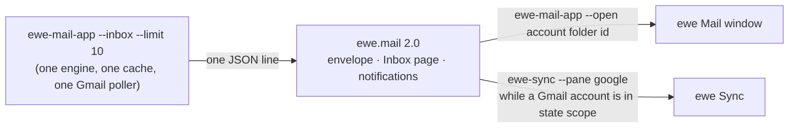

---
tags:
  - ewe-map
  - plugin
title: Mail Plugin
up: "[[Plugin System]]"
---

# Mail — `ewe.mail`

`~/Projects/ewe/ewe-plugin-mail` ·
[github.com/prj786/ewe-plugin-mail](https://github.com/prj786/ewe-plugin-mail)
· v1.1.0 (in ewe 0.25.1; 1.0.0 in 0.25.0; **2.0.0 in ewe 0.51.0-beta, released 2026-11-27** — below) · API 3 · **plugin since 0.25** (was `Mail.qml` + the Gmail half of
`Google.qml` — [[Gmail Split — core Google, Mail add-on]]).

Unread mail where you look: an **Inbox** page (latest ten, click opens
one), an envelope + count in the pill while there is unread mail, a
notification per new message (never a storm for mail that was already
there). **Through 1.x** two sources, one inbox — IMAP won when both were set up:

- **IMAP** — the core `ewe-mail` keeps the account in `ewe.conf` + keyring; the
  plugin ran `ewe-mail status` and `ewe-mail unseen`.
- **Gmail** — the plugin asked the core broker `ewe-auth token --json` for a
  short-lived token; the History API told new arrivals from old unread.

**From 2.0.0 neither:** [[ewe Mail]] is the one source (section below).

| kind | file |
|---|---|
| the model — singleton **`Inbox`** (never shadows the core `Mail`) | `Inbox.qml` |
| `service` — the two IPC targets + the resume hook | `Service.qml` |
| `quick-page` key **`mail`** (order 80) | `Page.qml` |
| `bar-status` (order 60) | `Status.qml` |

## Facts

- **Install:** Komble → Plugins, or `ewe-plugin install ewe.mail`.
- **IPC:** `qs ipc call ewe.mail status|refresh|fetch|setNotify <bool>` and
  the alias **`mail`** with the same verbs; the `status` field set and
  order are **byte-identical** to pre-0.25 (test-asserted). ewe-settings no
  longer reads it (D10 — its Mail section is gone).
- **Setting (1.1.0):** `notify` (bool, default true) — new-mail
  notifications. Komble → Plugins → Mail → Options, the Inbox page's bell
  and `mail setNotify` all write it (`Shell.setSetting`, API 3.2); 1.0's
  value in `mail-state.json` is carried over once if it was off
  (`notifyCarried`). [[Plugin Settings Live With the Plugin]]
- Polls every 2 min (5 on battery), on a stale Quick settings open, after
  `Shell.resumed()`.
- **State paths kept:** `~/.config/quickshell/mail-state.json` (IMAP),
  `google-mail.json` (Gmail cursor + notified set) — an upgrade re-notifies
  nothing. "Reconnect Google" → ewe-sync.
- Requires `python` / `python3`, `notify-send`, `xdg-open`.

## 2.0.0 — ewe Mail is the one source (ewe 0.51.0-beta, 2026-11-27)

ewe-plugin-mail#3 (abcbb6d), vendored into ewe's `plugins/ewe.mail` with
bundle.json 2.0.0 (ewe 0.51.0-beta).
The plugin stays the shell's half of mail — the envelope, the Inbox page and
the notifications — and asks [[ewe Mail]] for everything else.

- **Source:** `ewe-mail-app --inbox --limit 10` (shape in
  [[Contracts and Public API]]) every 2 min (5 on battery), on a stale Quick
  settings open, when ewe.conf or `auth.json` changes and after a resume. The
  plugin **no longer polls Gmail** (History API, token plumbing) **or IMAP**
  (`ewe-mail unseen`); **no token or password is in the shell**.
- Rows and notifications open `ewe-mail-app --open <account> <folder> <id>`;
  the head button is "Open ewe Mail"; **"Reconnect Google"** opens `ewe-sync
  --pane google` while a Gmail account is in the `scope` state.
- **`mail status` keeps its field set and order**; values come from ewe Mail's
  accounts. Notifications once per `account/id`; the first look marks what is
  there as seen (no storm on upgrade).
- It **requires the `ewe-mail` package**; without it the page says so and
  offers nothing else. Still an opt-in add-on (default false, migrate true,
  unchanged). The core `ewe-mail` CLI keeps `status` and `unseen`, but the
  plugin no longer calls them. Checked in the nested shell with a stand-in
  ewe-mail-app.
- ewe Mail itself never notifies, so nothing is told twice.

> **Build guard:** the plugin never touches OAuth, Calendar, Drive or sync
> verbs (from 2.0.0 not even the broker's token); a missing `mail` target is **not an error** for ewe-settings
> (`ADDON_TARGETS`).

## Related

- [[Plugin System]] · [[Google Extras]] · [[Gmail Split — core Google, Mail add-on]] ·
  [[ewe-settings]] · [[ewe Mail]]
