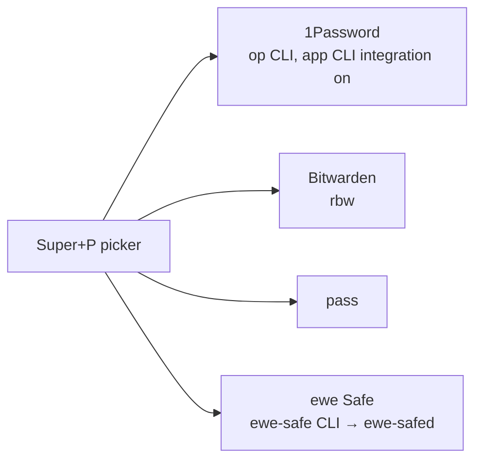

---
tags:
  - ewe-map
  - plugin
title: Passwords Plugin
up: "[[Home]]"
---

# Passwords — `ewe.passwords`

`~/Projects/ewe/ewe-plugin-passwords` ·
[github.com/prj786/ewe-plugin-passwords](https://github.com/prj786/ewe-plugin-passwords)

First-party **plugin since 0.25** (API 2 manifest, v1.1.0): shipped inside
the payload, **not installed on a fresh machine**, migrated once for
upgraders who had it.

`Super+P` in any window lists the logins that match the **focused app** and
types the one you pick — username, Tab, password — through a virtual
keyboard (`wtype`), since no password manager fills into native apps on
Linux.

## Keys in the picker

| key | action |
|---|---|
| `Enter` | type username + Tab + password |
| `Ctrl+Enter` | type the password only |
| `Ctrl+C` / `Ctrl+Shift+C` | copy |
| `Ctrl+P` | pin a login to the current app |

## Providers



- **Settings:** `provider` (auto / ewe / 1password / bitwarden / pass),
  `press_enter`.
- **Provider `ewe`** ([[ewe-safe]], plugin 1.2.0, ewe-plugin-passwords#2,
  vendored in ewe 0.27.0-beta):
  first under `auto` once a safe is set up; Safe does the matching; a
  locked safe shows "Safe is locked — press Enter to unlock" (Enter runs
  `ewe-pass unlock` → `ewe-safe unlock --ask`), Ctrl+L locks; pins become
  `app:<class>` tags inside the safe, so they sync.
- **Next: 1.3.0** (ewe-plugin-passwords#3, PR open, not merged; vendored at
  the next ewe release): when the chosen manager is **gone** (its CLI isn't
  installed, 1Password's app integration can't be reached, not signed in)
  and Safe is set up, the error row offers **Use Safe** (Enter works too):
  `ewe-pass use-safe` → `ewe-plugin set ewe.passwords provider ewe`. Slow
  answers and timeouts offer nothing. `ewe-pass` always exits 0 now (rule 5).
- **"Make sure 1Password CLI is installed"** on `Super+P` = the `provider`
  setting is still `1password` (the owner's machine, 2026-10-15, now `ewe`).
  Change it with `ewe-plugin set ewe.passwords provider ewe`, never
  `ewe-conf set` with the dotted id.
- **Deps:** `wtype` (an ewe dependency).
- `ewe-pass` in the repo is the tool the panel runs;
  `./ewe-pass status` says what it will do and why not.

Install / remove / re-add (Komble → Plugins, or):

```sh
ewe-plugin install ewe.passwords
ewe-plugin remove ewe.passwords
ewe-plugin install ewe.passwords      # not `add <url>` — that failed for a reserved id before 0.25
```

`Super+P` exists only while the plugin is enabled
(`generated/plugin-keybinds.lua`).

## Related

- [[Plugin System]] · [[Clipboard Plugin]] · [[CLI Tools]]

> **Build guard:** `test.sh` runs on a PATH of fakes only — a fake `op`,
> `wtype`, `hyprctl`, `ewe-conf`, `ewe-safe` — so the machine's real
> 1Password or Safe can never answer a test. Keep it that way when adding a
> provider.
