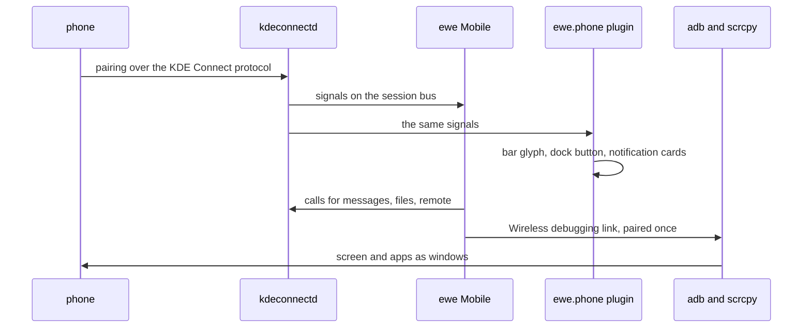

---
tags:
  - ewe-map
  - workflow
title: Pairing a Phone
up: "[[Home]]"
---

# Pairing a Phone — from a fresh install to the phone in ewe

Two links, made once each. The first is KDE Connect's: it carries messages,
notifications, files, media and the remote. The second is Android's Wireless
debugging: it carries the phone's screen and its apps as windows, and is
optional. Sources: ewe Mobile's `README.md` and `docs/ECOSYSTEM.md`, the
[[Phone Plugin]]'s README.

## What you do

1. **On the computer**: `sudo pacman -S ewe-mobile` (or tick it on the
   installer's Apps screen once the ISO offers it). It brings `kdeconnect`
   and `sshfs`. Optionally Komble → Plugins → Phone for the bar glyph, the
   Quick settings page and the dock button — a separate install
   ([[ewe Mobile — public and opt-in]]).
2. **On the phone**: install the KDE Connect app (Google Play or F-Droid; on
   an iPhone the App Store). Open it on the same Wi-Fi as the computer.
3. **In ewe Mobile**: Devices → choose the phone → accept on the phone. Both
   show the same key; check that they match.
4. **Optional, for Screen and Apps**: on the phone turn on Developer options
   and Wireless debugging; install `android-tools` and `scrcpy` (Komble
   offers them); pair this computer once with the six-digit code the phone
   shows. Afterwards the phone is found by itself on the same Wi-Fi.
5. **Optional, for the Remote page**: on the phone allow KDE Connect as an
   accessibility service (KDE Connect → the plugins that need permissions →
   Mouse receiver → Accessibility settings). Until then the phone drops the
   pointer and keys without a word.

## What each piece does

| piece | job |
|---|---|
| `kdeconnectd` | the link to the phone, the pairing keys and the caches; headless, "the invisible engine" (decision 79). The plugin starts it when it is installed and not running |
| ewe Mobile | the window: every page of it; keeps no database ([[ewe Mobile]]) |
| the [[Phone Plugin]] | the shell side: the bar glyph, the Quick settings Mobile page, the dock button, notification cards; hides KDE Connect's own launcher entries (`hide_kdeconnect`, default on) |
| adb and scrcpy | the second link: the phone's screen and "open here" windows (optional packages) |
| ewe Files | the phone as a row under Devices, mounted through `kdeconnectd` and `sshfs` ([[ewe-apps]]) |

## What can go wrong

- A dead Remote page is the phone's accessibility switch before it is a bug.
- A phone that is asleep or off the Wi-Fi shows as away; the apps list and
  contacts stay readable from the cache, opening is off.
- Developer options is the price of the screen and "open here"; some banking
  apps refuse to run while it is on.
- More in [[Troubleshooting Knowledge]].

## Related

[[ewe Mobile]] · [[Phone Plugin]] · [[ewe Mobile — one ecosystem]] ·
[[RFC-012 — ewe Mobile, both halves]] · [[Install Flow]]
