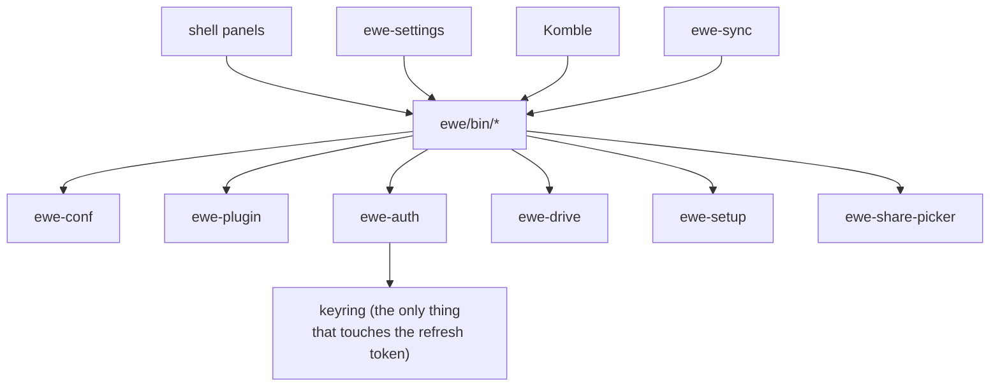

---
tags:
  - ewe-map
  - development
title: CLI Tools
up: "[[Home]]"
---

# CLI Tools — every GUI is a front end

> Every graphical thing here is a front end to one of these, so anything
> you can click, you can script — and debug by running the same command
> yourself.

All in `ewe/bin/`. Every one prints JSON and exits 0, so callers never hang
on them.

## The roster

| tool | job | verbs |
|---|---|---|
| **`ewe-conf`** | [[The One File]] — the only writer | `get` · `set` · `dump` · `import` · `apply` · `push` · `pull` · `path` · `sync-status` |
| **`ewe-plugin`** | [[Plugin System]] — plugins and the plugins | `add` · `list [--json]` · `info` · **`install <id>`** · **`migrate [--fresh]`** (0.25) · `enable` · `disable` · `update` · `remove` · `restore` · `validate` · `seed` · `path` · `create` · `dev` · `place` · `set` · `get` |
| **`ewe-auth`** | [[Auth Broker]] — one Google identity for every app | `status` · `login [--with-mail]` · `token` · `logout` · `keyring-reset` |
| **`ewe-drive`** | your Drive as a folder (optional Google extra) | `setup` · `mount` · `unmount` · `status` |
| **`ewe-cloud`** | the Nextcloud account tool (Login Flow v2) | `login <server>` · `status` · `token` |
| **`ewe-files`** | mount the account at `~/Nextcloud` (rclone remote from keyring) | `setup` · … |
| **`ewe-caldav`** | CalDAV calendar sync for the shell widget | — |
| **`ewe-mail`** | IMAP mailbox for the Control Centre badge | — |
| **`ewe-theme`** | [[Theming Pipeline]] — schemes, tokens, imports | `scheme list/show/apply/import/export/set/from-wallpaper/duplicate/remove` · `set overrides.*` · `build` |
| **`ewe-bt`** | bluetooth pairing for the Settings app (same as BtAgent) | — |
| **`ewe-globalshortcuts`** | portal global shortcuts (1Password Quick Access…) | — |
| **`ewe-pass`** | the tool behind the [[Passwords Plugin]] picker | `status` (says what it will do and why not) · `unlock` · `lock` (provider `ewe`) · `use-safe` (1.3.0, PR ewe-plugin-passwords#3: sets `provider = ewe` through `ewe-plugin set`; always exits 0) |
| **`ewe-safe`** | [[ewe-safe]] — Safe, the password manager (its own repo; `docs/PROTOCOL.md` v1) | `status` · `summary` · `init` · `open` · `unlock [--ask]` · `lock` · `list` · `search` · `match` · `show` · `reveal [--json]` · `copy` · `add` · `edit` · `rm` · `restore` · `generate` · `sync` · `place` · `passwd` · `ping` · `version`. **Built 2026-10-15, PRs open, not merged:** `read` · `run` · `inject` · `git-credential` (#10; rule-5 exceptions, they copy `op` and git) · `passkey list` (#11) · `ssh list\|add\|new\|adopt\|enable\|disable\|status` (#13) |
| **`ewe-setup`** | per-user deployment of the installed payload | — |
| **`ewe-share-picker`** | the portal's screen-share picker, backed by the shell | — |

The website documents each tool: `prj786.github.io/docs/cli/<tool>`.

**`ewe-browser <verb>`** (PR ewe-browser#3, not merged; `docs/CLI.md`) — not
in `ewe/bin` either: one JSON object, exit 0, 31 tools (`tabs`, `history`,
`open`, `search`, `play`, `page --text`, `tab …`, `commands`, …), replies
with outside text marked `untrusted`. 0.1.0-beta has none — a verb opens as
a page. The companion calls it ([[Contracts and Public API]]).

Not in `ewe/bin` but equally a contract: **`komble --updates | --settings |
--search[=q] | --addons | --plugins`** (the shell's `Shell.openStore(page)`
and ewe-settings call these — [[Komble]]).

Plugins carry their own small tools: `cast-check.sh` / `cast-audio.sh`
([[Cast Plugin]], under `~/.config/ewe/plugins/ewe.cast/`),
`kdeconnect-bridge.py` ([[Phone Plugin]]), `sample.sh`
([[System Monitor Plugin]]), `ewe-pass` ([[Passwords Plugin]]).

The refresh token lives only in the keyring — `ewe-auth` is the single thing
that touches it.

## Related

- [[The One File]] · [[Auth Broker]] · [[Plugin System]] · [[Repo Layout]]
