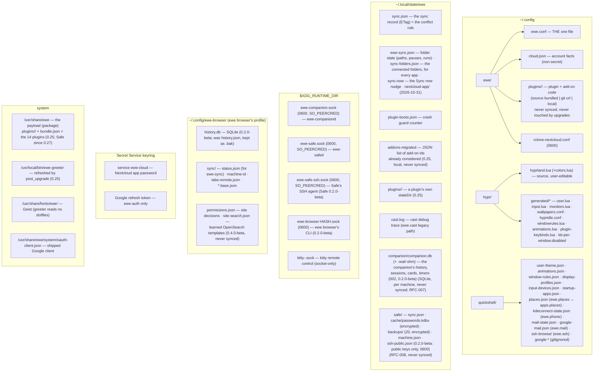

---
tags:
  - ewe-map
  - reference
title: Storage Map
up: "[[Home]]"
---

# Storage Map — where every byte lives

The complete file geography. "Generated" means: build artifact, never edit
by hand (rule 9, [[Rules of the House]]).

## Details worth memorising

- **User-state seeding**: `*.default` files (committed) seed their
  gitignored runtime counterparts only when missing
  (`user-theme.json`, `pinned-apps.json`, `places.json`,
  `hypr/generated/user.lua`). Edit the `.default`; never commit the runtime
  file.
- **systemd user units are copied, not symlinked** (the dotfile farm
  symlinks everything else; `link_tree` backs up real dirs to
  `<dest>.bak.<RUN_STAMP>` first).
- **Google caches** (`google-profile/events/mail.json` etc.) are
  non-secret and gitignored; the refresh token is keyring-only.
- **Nextcloud account layout** (remote): `ewe/ewe.conf`,
  `ewe/ewe.conf.meta.json`, `ewe/machines/<id>.json` (was `<name>.json`
  until the 2026-11-01 fix — two computers with one hostname overwrote each
  other), `ewe/remote/<id>.json` (RFC-009, discovery only); folder pairs
  anywhere in the account. `<id>` = first 16 hex of
  sha256("ewe:" + /etc/machine-id), the same in ewe-sync and ewe-remote.
- **Remote (RFC-009)**: `~/.local/share/ewe/remote/` (0700) holds
  `host_ed25519` (the sharing host key), `id_ed25519` (this computer's
  client key — never leaves it), `authorized_keys` (who may log in here;
  first line = the pairing key's forced command), `sshd_config` (generated
  every start), `code` (0600), `pairing.json` (fails/last), `computers.json`
  (who we paired with), `known_hosts` (pinned as `ewe-<id>`), `ssh_config`,
  `registry.json` (cache), `published.json`; runtime
  `$XDG_RUNTIME_DIR/ewe-remote/` (sshd pid, tunnels.json, ControlMaster
  sockets). Unit: `~/.config/systemd/user/ewe-remote-sshd.service` (copied by
  `lib/deploy.sh`, enabled only by `ewe-remote share on`).
- **Plugin code is outside the payload** — upgrades never touch it; the
  payload's `plugins/<id>/` copies are the **plugins**, installed on
  request (`ewe-plugin install`), once for upgraders (`migrate`), refreshed
  only on version change ([[Add-ons — vendored payload and bundle.json]]).
- **Plugins keep the state paths the built-ins used** (`places.json`,
  `kdeconnect-state.json`, `mail-state.json`, `google-mail.json`,
  `ssh-browse/`) so an upgrade loses nothing; new plugin-private state goes
  in the injected `stateDir` (`~/.local/state/ewe/plugins/<id>/`).
- **`addons-migrated`** is per machine — it must never move into `ewe.conf`
  ([[Add-ons — one-time migration for upgraders]]).
- **`.dev-mock/`** folders in the Tauri repos hold mock data for frontend
  work — not shipped.
- **Safe** ([[ewe-safe]]): the safe itself is one encrypted KDBX file in its
  place (`ewe/safe/passwords.kdbx` in the account, or
  `~/.local/share/ewe/safe/passwords.kdbx` for this computer only); its
  per-machine cache, backups and `sync.json` live in
  `~/.local/state/ewe/safe/`; its non-secret settings are `[safe]` in
  `ewe.conf`. The master password is never stored.
- **Safe's SSH agent** (Safe 0.2.0-beta, released 2026-10-15):
  `ssh-public.json` in `~/.local/state/ewe/safe/` lets the agent list keys
  while the safe is locked (public keys and titles only, written only while
  the agent is on); `ewe-safe ssh enable` writes
  `~/.config/environment.d/90-ewe-safe-ssh.conf` (`SSH_AUTH_SOCK`). The
  private keys stay inside the KDBX file. **Since Safe 0.4.0-beta (the SSH
  gate, building):** two lines on top of `~/.ssh/config` (`Include
  ~/.ssh/ewe-safe/config`; a one-time `~/.ssh/config.before-safe`) and
  Safe's own `~/.ssh/ewe-safe/` (`config` = `Host *` → Safe's agent +
  `known_hosts`; `key-<tag>.pub` public key files; `known_hosts` of GitHub,
  GitLab, Bitbucket, Azure DevOps, Codeberg; `allowed_signers` for commit
  signing); `ssh-used.json` (last use per key: fingerprint, time, program)
  in `~/.local/state/ewe/safe/`. Rebuilt on every computer from the safe.
- **Safe's login unlock and keyring** (Safe 0.3.0-beta, 2026-10-18), all
  in `~/.local/state/ewe/safe/`, `0600`, never synced: `login.key` (W under
  Argon2id of the login password), `master.wrap` (the master password under
  W, only while login unlock is on), `keyring.safe` + `keyring.index` and
  the marker `keyring.on` (only after the parked `keyring adopt`). The
  carrier is one item in gnome-keyring's `login` keyring ("Safe — unlock key
  for this computer", `application=ewe-safe`). Cards and addresses live in
  the KDBX file like every item.
- **ewe browser** keeps its profile in `~/.config/ewe-browser/` (not
  `ewe.conf`). Its `downloads.json` (`{version: 1, entries: [{id, url,
  filename, path, mime, received, total, speed, status, started, ended}]}`,
  newest first, ms, ≤ 200, atomic writes ≤ 1/s) is **read by the dock**
  since Dock 1.2.0 — a cross-repo contract: keep the path and the fields.
  The dock's "Clear" mark is `~/.local/state/ewe/dock-downloads.json`
  (`{clearedAt: ms}`, local, never synced). Synced through the account: `ewe/browser/bookmarks.json`,
  `history.json` (with clear records since 0.2.0-beta), `settings.json`,
  and `tabs-<id>.json` per machine (since 0.2.0-beta). See
  [[Browser History — SQLite, synced clear records]]. Since 0.4.0-beta the
  profile also holds `permissions.json` (Allow / Block per top-level site,
  1000 origins — [[Site Permissions — ask per site]]) and
  `site-search.json` (OpenSearch templates learned on visited pages, 500
  hosts); neither syncs, nor do the Privacy and security settings.
- **The companion keeps its own state** in `~/.local/state/ewe/companion/`
  (`companion.db`, 30-day retention), not in `ewe.conf`: history is per
  machine. Since 0.2.0-beta it also keeps timers and reminders there
  (migration `002_timers`, 50 waiting at most), so they survive a restart. Its synced, non-secret prefs are `[companion]` in `ewe.conf`
  (`ewe-conf` domain `companion`, applies nothing); API keys (P4) go in the
  keyring, never the file.

## Related

- [[Contracts and Public API]] · [[The One File]] · [[Account and Sync]] ·
  [[Plugin System]]
